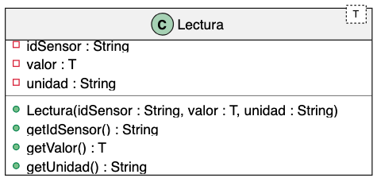

# Programación Aplicada

## 1.1a. Tipos y parámetros genéricos


**Autor:** Ing. Pablo Torres, Mgtr.  
**Unidad:** 1. Programación genérica
[Inicio del curso](../../../README.md) · [Ver en el navegador](index.html)

---

## 1. Conceptos y ejemplos

### 1.1. Qué es la programación genérica

La **programación genérica** permite definir estructuras y operaciones mediante parámetros de tipo. Una implementación puede trabajar con distintos tipos de datos, conservando las relaciones que el compilador necesita comprobar. No se trata de aceptar cualquier valor sin restricciones: se trata de declarar qué relaciones de tipos deben respetarse.

En Java, una clase genérica declara sus parámetros después del nombre:
```java
class Caja<*T*> {
    private final T valor;
    Caja(T valor) { this.valor = valor; }
T obtener() { return valor; }
}
```

`T` relaciona el atributo, el constructor y el resultado de `obtener()`. Cuando se utiliza `Caja<String>`, esos puntos trabajan con `String`; con `Caja<Integer>`, trabajan con `Integer`. La estructura y el algoritmo se escriben una sola vez.
Las interfaces también pueden ser genéricas. Por ejemplo, `List<E>` define una colección ordenada cuyos elementos tienen un tipo declarado. `List<String>` es una lista de cadenas; `ArrayList<String>` es una implementación concreta de ese contrato.

### 1.2. Seguridad de tipos y diferencia frente a Object

La **seguridad de tipos** consiste en impedir operaciones incompatibles con los tipos declarados. Los genéricos trasladan al compilador comprobaciones que, usando `Object`, podrían quedar pendientes hasta la ejecución.
```java
Object dato = "Biblioteca";
String nombre = (String) dato;
// Integer numero = (Integer) dato; // Compila, pero lanza ClassCastException.
Caja<*String*> caja = new Caja<>("Biblioteca");
String contenido = caja.obtener(); // No requiere casting.
// Integer numero = caja.obtener(); // Error de compilación.
```
Un **cast de referencia** comprueba si un objeto puede tratarse como otro tipo; no transforma una cadena en un número. Una conversión de contenido, como `Integer.parseInt("42")`, realiza otra operación: interpreta texto para producir un valor numérico.
Los genéricos evitan clases duplicadas, documentan relaciones y reducen conversiones inseguras. No garantizan por sí solos mayor velocidad, ausencia de errores lógicos ni validez de los datos.

### 1.3. Parámetro de tipo, argumento e inferencia

| Elemento | Significado | Ejemplo |
|---|---|---|
| Parámetro de tipo | Nombre declarado para representar un tipo | `T` en `Caja<T>` |
| Argumento de tipo | Tipo utilizado al parametrizar la declaración | `String` en `Caja<String>` |
| Tipo parametrizado | Tipo genérico con sus argumentos | `Caja<Integer>` |
| Parámetro de valor | Variable que recibe un dato en una llamada | `valor` en `Caja(T valor)` |
| Operador diamante | Permite inferir argumentos del constructor | `new Caja<>("Texto")` |
`T`, `E`, `K` y `V` suelen representar tipo, elemento, clave y valor. Son convenciones, no palabras reservadas. Una declaración puede tener varios parámetros: `Map<K, V>` relaciona el tipo de una clave con el tipo de su valor.
La **inferencia de tipos** deduce argumentos a partir de las expresiones y del contexto. No hace que Java tenga tipado dinámico: el tipo se sigue comprobando en compilación. Elegir `Object` explícitamente, como en `Caja<Object>`, permite distintos tipos de valores porque ese es el contrato solicitado.

### 1.4. Restricciones y borrado de tipos

Los argumentos genéricos son tipos de referencia. Se usa `Caja<Integer>`, no `Caja<int>`. Las clases envolventes y sus conversiones se desarrollan en 1.1c.
Java implementa los genéricos mediante **borrado de tipos**: al compilar, sustituye parámetros por sus cotas o por `Object` e introduce las conversiones necesarias. No crea una clase de ejecución diferente por cada argumento. Parte de la información genérica puede permanecer como metadatos de declaraciones; no equivale a conservar el argumento de cada objeto como una clase distinta.
Esto explica restricciones como `new T()`, `new T[10]` o un campo `static T` dependiente del parámetro de la clase. Un miembro estático pertenece a la clase, no a una parametrización concreta. Los métodos estáticos sí pueden declarar sus propios parámetros de tipo, como se estudiará en 1.1b.
Evita los **tipos crudos**, como `Caja` sin argumento. Se mantienen por compatibilidad y omiten comprobaciones que sí existen con `Caja<T>`. `Caja<?>`, que se estudiará en 1.2, expresa un tipo desconocido manteniendo comprobaciones.


### 1.5. Tipo correcto, valor válido e inmutabilidad


`Caja<Double>` exige un `Double`, pero no establece un rango permitido. Del mismo modo, un genérico no prohíbe `null` automáticamente: la clase debe definir y validar ese contrato.
Un atributo `final` solo puede asignarse una vez durante la construcción. Si contiene una referencia a una lista modificable, la referencia no cambia, pero la lista todavía puede modificarse. Por ello, **referencia final** e **inmutabilidad del objeto** son propiedades diferentes.

Para un contenedor sencillo conviene decidir si admite nulos, si permite reemplazar su valor y cómo comunica entradas inválidas. Esa decisión forma parte de su interfaz pública, junto con los tipos.


## 2. Demostración: un contenedor con contrato explícito
La misma clase almacena un título y una cantidad. El constructor rechaza valores nulos y el cliente recupera cada dato con su tipo concreto. Guarda este ejemplo independiente como `TiposDemo.java`.

```bash
java app/src/main/java/edu/ups/pap/u01/TiposDemo.java
```


```java
import java.util.Objects;
/**
 * Demuestra el uso de una clase genérica, la recuperación de valores
 * sin casting y la validación de valores nulos.
 */
public class TiposDemo {
    /**
     * Contenedor que almacena un valor de un tipo definido por el cliente.
     *
     * static: permite crear una Caja sin crear una instancia de TiposDemo.
     * final: impide crear subclases de Caja.
     *
     * @param <T> tipo del valor almacenado
     */
    static final class Caja<*T*> {
        // final impide reemplazar la referencia después de inicializarla.
        // No garantiza que el objeto almacenado sea inmutable.
        private final T valor;
        /**
         * Construye una caja con un valor obligatorio.
         *
         * @param valor dato que se almacenará
         * @throws NullPointerException si el valor es null
         */
        Caja(T valor) {
            // Devuelve el valor si no es null.
            // Si es null, lanza una excepción con el mensaje indicado.
            this.valor = Objects.requireNonNull(
                    valor, "El valor es obligatorio"
            );
        }
        /**
         * Recupera el valor conservando el tipo declarado para la caja.
         *
         * @return valor almacenado de tipo T
         */
T obtener() {
            return valor;
        }
    }
    public static void main(String[] args) {
        // String es el argumento de tipo que sustituye a T.
        // El operador <> permite inferirlo en el constructor.
Caja<*String*> titulo = new Caja<>("Algoritmos");
        // Los genéricos requieren tipos de referencia.
        // El literal int 12 se convierte automáticamente a Integer.
Caja<*Integer*> ejemplares = new Caja<>(12);
        // El compilador conoce el tipo devuelto en cada caso.
        // No se necesitan conversiones explícitas.
String texto = titulo.obtener();
Integer cantidad = ejemplares.obtener();
        System.out.println(texto + " | " + cantidad);
        // getClass() devuelve la clase del objeto durante la ejecución.
        // Ambas cajas comparten la clase Caja debido al borrado de tipos.
        // Se comparan las clases, no los valores almacenados.
        System.out.println(titulo.getClass() == ejemplares.getClass());
        try {
            // null es compatible con String en compilación,
            // pero el constructor lo rechaza durante la ejecución.
            new Caja<*String*>(null);
        } catch (NullPointerException e) {
            // La excepción se captura para mostrar su mensaje.
            System.out.println(e.getMessage());
        }
        // Error de compilación si se descomenta:
        // obtener() devuelve String y no puede asignarse a Integer.
        // Integer incorrecto = titulo.obtener();
    }
}
```
Con JDK 17 o superior, desde la carpeta del ejemplo:
```bash
java TiposDemo.java
```
Salida esperada:
```text
Algoritmos | 12
true
El valor es obligatorio
```

El `true` compara las clases de ejecución, no los valores ni sus contratos de compilación. La excepción responde a una regla del constructor, mientras que la asignación comentada sería rechazada por el compilador.


## 3. PC1.1a · Modelo de lecturas de CampusMonitor
**CampusMonitor** será una aplicación Java de consola que registra y procesa mediciones de sensores de un campus. 
Durante la asignatura se utilizará **CampusMonitor** como proyecto base.

No se creará un proyecto diferente para cada tema. El mismo proyecto se irá ampliando progresivamente durante las prácticas de clase.

En las siguientes unidades se reutilizarán las clases, modelos y funcionalidades implementadas anteriormente. Por esta razón:
- conserva el código desarrollado en cada práctica;
- no elimines funcionalidades anteriores;
- organiza las nuevas clases dentro de los paquetes indicados;
- realiza un commit al finalizar cada práctica.

El objetivo es que CampusMonitor evolucione durante el curso mientras se aplican los diferentes conceptos de programación.
### Creación del proeycto 

Esta sección se realiza **una sola vez**, al iniciar el proyecto personal.
Cada estudiante debe trabajar en su propio repositorio:
```text
icc-pap-campusmonitor-apellido
```
Desde la carpeta donde quieras crear el proyecto ejecuta:
```bash
gradle init \
  --type java-application \
  --dsl kotlin \
  --project-name icc-pap-campusMonitor \
  --package edu.ups.pap
```
Gradle solicitará algunas opciones adicionales.
Selecciona:
```text
Enter target Java version (min: 7, default: 21): 25
Select application structure:
  1: Single application project
  2: Application and library project
Enter selection (default: Single application project) [1..2] 1
Select test framework:
  1: JUnit 4
  2: TestNG
  3: Spock
  4: JUnit Jupiter
Enter selection (default: JUnit Jupiter) [1..4] 1
Generate build using new APIs and behavior
(some features may change in the next minor release)?
(default: no) [yes, no] yes
```

Al finalizar debe aparecer:

```text
BUILD SUCCESSFUL
```
### Contrato y alcance

Implementa una **clase pública genérica `Lectura<T>`** en `edu.ups.pap.modelo`. Representa una medición: qué sensor produjo el dato, cuál es su valor y en qué unidad se expresa. `T` corresponde exclusivamente al tipo del valor.




Modifica la clase principal `App` para demostrar el funcionamiento de `Lectura<T>`, mediante un metodo generico runLectura()
1. **Crea dos objetos:**
   | Variable | Tipo | Identificador | Valor | Unidad |
   |---|---|---|---|---|
   | `temperatura` | `Lectura<Double>` | `S01` | `22.5` | `°C` |
   | `ocupacion` | `Lectura<Integer>` | `S02` | `18` | `personas` |
2. **Recupera sus valores utilizando `getValor()`:**
   - Guarda el valor de `temperatura` en una variable `Double`.
   - Guarda el valor de `ocupacion` en una variable `Integer`.
   - No utilices casts.
3. **Muestra en consola** el identificador, valor y unidad de cada lectura. Una salida válida sería:
   ```text
   Lecturas de CampusMonitor
   S01 | 22.5 °C
   S02 | 18 personas
   Valores recuperados sin casting:
   Temperatura: 22.5
   Ocupación: 18
   ```
4. **Comprueba las validaciones del constructor.** Intenta crear lecturas con:
   - Identificador vacío.
   - Unidad vacía.
   - Valor `null`.
### Reultados

Árbol de los archivos relevantes; conserva los demás archivos de configuración existentes. Las demostraciones son independientes y no forman parte obligatoria de esta estructura.
```text
icc-pap-campusmonitor-apellido/
├── app/
│   ├── build.gradle.kts
│   └── src/main/java/edu/ups/pap/
│       ├── App.java
│       └── modelo/
│           └── Lectura.java
|       └── u01/
|           └──TiposDemo.java
├── evidencias/
│   └── PC1.1a.md
├── gradle/wrapper/
│   ├── gradle-wrapper.jar
│   └── gradle-wrapper.properties
├── gradlew
├── gradlew.bat
└── settings.gradle.kts
```
### Evidencias

Sube todos los cambios al repositorio remoto, donde en un el siguiente archivo `evidencias/PC1.1a.md`, deberan constar las sigueintes evidencias.
#### 1. Implementación realizada

Describe brevemente:
- Qué representa la clase `Lectura<T>`.
- Qué representa `T` y por qué permite utilizar la misma clase para temperatura y ocupación.
- Qué agregaste en `App.java`.
#### 2. Ejecución correcta

Agrega **una captura de la consola** donde se vean:
- Las dos lecturas con identificador, valor y unidad.
- Los valores recuperados mediante `getValor()`.
Debajo de la captura, explica por qué puedes guardar los resultados directamente en variables `Double` e `Integer`, sin casting.
## Referencias
- [Introducción a los genéricos — Dev.java](https://dev.java/learn/language/fp/generics/intro/)
- [Borrado de tipos — Dev.java](https://dev.java/learn/generics/type-erasure/)