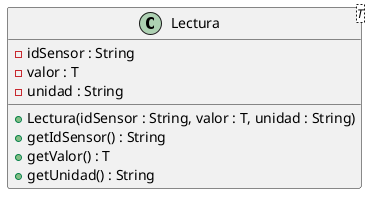

# Programación Aplicada

## 1.1a. Tipos y parámetros genéricos


**Autor:** Ing. Pablo Torres, Mgtr.  
**Unidad:** 1. Programación genérica  
**Proyecto de trabajo:** CampusMonitor

[Inicio del curso](../../../README.md) · [Presentación editable](presentacion.pptx) · [Ver en el navegador](index.html)

---

## Proyecto de trabajo: CampusMonitor

Durante la asignatura se utilizará **CampusMonitor** como proyecto base.

No se creará un proyecto diferente para cada tema. El mismo proyecto se irá ampliando progresivamente durante las prácticas de clase.

En las siguientes unidades se reutilizarán las clases, modelos y funcionalidades implementadas anteriormente. Por esta razón:

- conserva el código desarrollado en cada práctica;
- no elimines funcionalidades anteriores;
- organiza las nuevas clases dentro de los paquetes indicados;
- realiza un commit al finalizar cada práctica.

El objetivo es que CampusMonitor evolucione durante el curso mientras se aplican los diferentes conceptos de programación.

---

## 0. Creación inicial del proyecto CampusMonitor

Esta sección se realiza **una sola vez**, al iniciar el proyecto personal.

Cada estudiante debe trabajar en su propio repositorio:

```text
icc-pap-campusmonitor-apellido
```

Desde la carpeta donde quieras crear el proyecto ejecuta:

```bash
gradle init \
  --type java-application \
  --dsl kotlin \
  --project-name icc-pap-campusMonitor \
  --package edu.ups.pap
```

Gradle solicitará algunas opciones adicionales.

Selecciona:

```text
Enter target Java version (min: 7, default: 21): 25

Select application structure:
  1: Single application project
  2: Application and library project
Enter selection (default: Single application project) [1..2] 1

Select test framework:
  1: JUnit 4
  2: TestNG
  3: Spock
  4: JUnit Jupiter
Enter selection (default: JUnit Jupiter) [1..4] 1

Generate build using new APIs and behavior
(some features may change in the next minor release)?
(default: no) [yes, no] yes
```

Al finalizar debe aparecer:

```text
BUILD SUCCESSFUL
```

### Estructura inicial

Gradle genera una estructura similar a:

```text
icc-pap-campusMonitor/
├── app/
│   ├── build.gradle.kts
│   └── src/
│       ├── main/
│       │   └── java/
│       │       └── edu/
│       │           └── ups/
│       │               └── pap/
│       │                   └── App.java
│       └── test/
│           └── java/
├── gradle/
├── gradlew
├── gradlew.bat
└── settings.gradle.kts
```

A partir de las prácticas de la Unidad 1 se utilizará el paquete:

```text
edu.ups.pap.u01
```

Por ejemplo:

```text
app/src/main/java/edu/ups/pap/u01/
```

> **Importante:** no ejecutes nuevamente `gradle init` para cada práctica. Las siguientes actividades modifican y amplían este mismo proyecto.

---

# 1. Conceptos y ejemplos

## Contexto

CampusMonitor debe almacenar identificadores, nombres y lecturas de sensores.

Duplicar una clase contenedora para cada tipo provoca repetición de código. Por ejemplo, sería innecesario crear una clase para almacenar cadenas, otra para enteros y otra para sensores.

Utilizar `Object` permite almacenar diferentes objetos, pero se pierde información sobre el tipo concreto del dato. Al recuperar el valor, quien utiliza la clase debe conocer su tipo real y realizar una conversión.

Los genéricos permiten expresar esta relación directamente en el código y hacer que el compilador verifique los tipos antes de ejecutar el programa.

## Antes de empezar


La ilustración sirve como analogía. El contrato técnico se define en el texto y el código.

<a id="concepto-1"></a>

## 1.1. El problema de Object y del casting

Una variable de tipo `Object` puede referirse a un `String`, un `Integer` o un `Sensor`.

Esa flexibilidad pierde información en la interfaz del contenedor: al recuperar `Object`, quien llama debe conocer el tipo real y convertirlo.

Un cast no transforma el objeto y puede lanzar `ClassCastException`.

```java
Object dato = "Aula 201";

String nombre = (String) dato;

// Compila, pero falla durante la ejecución.
// Integer numero = (Integer) dato;
```

La programación genérica conserva la relación entre el tipo que entra y el tipo que sale.

Por ejemplo:

```java
Caja<String> ubicacion = new Caja<>("Laboratorio");
String nombre = ubicacion.obtener();
```

El compilador sabe que `obtener()` devuelve un `String`, por lo que no es necesario realizar conversiones.

La ventaja principal es la **seguridad de tipos** y la **reutilización de código**.

Los genéricos no implican que el programa sea más rápido ni crean una clase diferente en ejecución para cada tipo utilizado.

<a id="concepto-2"></a>

## 1.2. Parámetro de tipo y argumento de tipo

En:

```java
class Caja<T>
```

`T` es un **parámetro de tipo**.

Representa un tipo que será definido posteriormente cuando alguien utilice la clase.

Por ejemplo:

```java
Caja<String> ubicacion;
Caja<Integer> capacidad;
```

Aquí:

```text
T        → parámetro de tipo
String   → argumento de tipo
Integer  → argumento de tipo
```

Los nombres más utilizados son:

```text
T → Type
E → Element
K → Key
V → Value
```

También pueden utilizarse nombres más descriptivos cuando mejoren la comprensión del código.

El operador diamante `<>` permite que Java infiera el tipo del objeto:

```java
Caja<String> ubicacion = new Caja<>("Laboratorio");
Caja<Integer> capacidad = new Caja<>(30);
```

Evita utilizar tipos genéricos sin argumento:

```java
Caja caja;
```

Esto se conoce como **raw type** y elimina parte de las comprobaciones de tipos realizadas por el compilador.

<a id="concepto-3"></a>

## 1.3. Tipos de referencia y restricciones

Los argumentos utilizados en los genéricos deben ser tipos de referencia.

Por ejemplo:

```java
Caja<Integer> cantidad;
Caja<Double> temperatura;
Caja<String> ubicacion;
```

No se utiliza:

```java
Caja<int>
Caja<double>
```

Para los tipos primitivos se utilizan sus clases envolventes:

```text
int     → Integer
double  → Double
boolean → Boolean
char    → Character
```

Java puede realizar automáticamente operaciones de boxing y unboxing cuando sea necesario. Este comportamiento se revisará posteriormente.

Un parámetro genérico sin restricciones solo garantiza las operaciones disponibles en `Object`.

Por ejemplo, con:

```java
class Caja<T>
```

no podemos asumir que `T` tiene métodos específicos de `String`, `Integer` o cualquier otro tipo.

Las cotas genéricas y otros contratos se estudiarán en contenidos posteriores.

<a id="concepto-4"></a>

## 1.4. Contrato del contenedor e inmutabilidad

La demostración utiliza un campo `final`:

```java
private final T valor;
```

Esto significa que la referencia almacenada no puede ser reasignada después de construir el objeto.

Sin embargo, `final` no vuelve automáticamente inmutable al objeto almacenado.

También se rechazan valores nulos:

```java
Objects.requireNonNull(valor);
```

Los genéricos garantizan el tipo del dato, pero no validan automáticamente las reglas del dominio.

Por ejemplo:

```java
Caja<Double> temperatura;
```

garantiza que el valor será `Double`, pero no garantiza que la temperatura tenga un valor válido.

En CampusMonitor, los modelos deberán incorporar posteriormente sus propias reglas de validación.

## Mapa de conceptos


---

<a id="demostracion"></a>

# 2. Demostración guiada

## 2.1. Problema y contrato

CampusMonitor necesita almacenar distintos tipos de información utilizando una misma estructura.

En lugar de crear:

```text
CajaString
CajaInteger
CajaSensor
```

se utilizará una única clase:

```java
Caja<T>
```

Esta demostración muestra cómo un parámetro genérico permite reutilizar la misma estructura manteniendo seguridad de tipos.

**Archivo completo:** [TiposDemo.java](ejemplos/TiposDemo.java)

```java
package edu.ups.pap.u01;

import java.util.Objects;

public class TiposDemo {

    static final class Caja<T> {

        private final T valor;

        Caja(T valor) {
            this.valor = Objects.requireNonNull(valor);
        }

        T obtener() {
            return valor;
        }
    }

    record Sensor(String id, String ubicacion) {}

    public static void main(String[] args) {

        Caja<String> lugar =
                new Caja<>("Laboratorio 1");

        Caja<Integer> limite =
                new Caja<>(30);

        Caja<Sensor> dispositivo =
                new Caja<>(
                    new Sensor("S01", lugar.obtener())
                );

        System.out.println(
                dispositivo.obtener().id()
                + " / "
                + lugar.obtener()
        );

        System.out.println(
                "Capacidad: " + limite.obtener()
        );

        System.out.println(
                lugar.getClass() == limite.getClass()
        );

        try {
            new Caja<String>(null);
        } catch (NullPointerException e) {
            System.out.println("Valor nulo rechazado");
        }
    }
}
```

---

## 2.2. Ubicación del archivo

Dentro del proyecto Gradle crea:

```text
app/src/main/java/edu/ups/pap/u01/TiposDemo.java
```

La estructura queda:

```text
icc-pap-campusMonitor/
└── app/
    └── src/
        └── main/
            └── java/
                └── edu/
                    └── ups/
                        └── pap/
                            ├── App.java
                            └── u01/
                                └── TiposDemo.java
```

---

## 2.3. Ejecución

Desde la raíz del proyecto:

```text
icc-pap-campusMonitor/
```

ejecuta:

```bash
java app/src/main/java/edu/ups/pap/u01/TiposDemo.java
```


---

## 2.4. Resultado y lectura de la ejecución

La salida esperada es:

```text
S01 / Laboratorio 1
Capacidad: 30
true
Valor nulo rechazado
```

Analiza la ejecución:

1. Identifica qué tipos concretos reemplazan a `T`.
2. Determina qué devuelve `obtener()` en cada objeto.
3. Explica por qué no se necesita casting.
4. Observa el resultado de:

```java
lugar.getClass() == limite.getClass()
```

5. Cambia uno de los valores y predice la salida antes de ejecutar nuevamente el programa.

---

<a id="pc"></a>

# 3. PC1.1a · Práctica de clase

## 3.1. Objetivo

Ampliar CampusMonitor utilizando una clase genérica que represente una lectura realizada por un sensor.

En esta práctica crearás el modelo:

```java
Lectura<T>
```

Una lectura debe relacionar:

```text
sensor + valor + unidad
```

Ejemplos:

```text
S01 → 22.5 → °C
S02 → 18   → personas
```

El tipo del valor cambia dependiendo del sensor.

Por esta razón `Lectura` será genérica.

---

## 3.2. Modelo que debes implementar

Debes crear una clase llamada:

```java
Lectura<T>
```

donde `T` representa el tipo del valor medido.

Por ejemplo:

```java
Lectura<Double>
```

representará una lectura cuyo valor es `Double`.

Mientras que:

```java
Lectura<Integer>
```

representará una lectura cuyo valor es `Integer`.

### Atributos requeridos

El modelo debe almacenar:

```text
idSensor : String
valor    : T
unidad   : String
```

Conceptualmente:

```text
Lectura<T>
-------------------------
idSensor : String
valor    : T
unidad   : String
-------------------------
getIdSensor() : String
getValor()    : T
getUnidad()   : String
```

También puedes representarlo con PlantUML:



La implementación puede realizarse como una **clase genérica convencional**.

En esta práctica utiliza una clase y no un `record`, porque posteriormente reutilizaremos y ampliaremos este modelo.

---

## 3.3. Paso 1 · Crear la clase Lectura

Crea el archivo:

```text
app/src/main/java/edu/ups/pap/u01/Lectura.java
```

La clase debe comenzar con:

```java
package edu.ups.pap.u01;

public class Lectura<T> {

    // atributos

    // constructor

    // métodos
}
```

Debes completar la implementación utilizando los siguientes atributos:

```java
private final String idSensor;
private final T valor;
private final String unidad;
```

El constructor deberá recibir:

```java
Lectura(String idSensor, T valor, String unidad)
```

y almacenar los datos.

Debe incluir métodos para recuperar:

```java
String getIdSensor()
T getValor()
String getUnidad()
```

No utilices:

```java
Object valor;
```

La finalidad de la actividad es conservar el tipo utilizando `T`.

---

## 3.3. Paso 2 · Crear lecturas utilizando distintos tipos

En la clase principal crea una lectura de temperatura:

```java
Lectura<Double>
```

con los siguientes datos:

```text
idSensor = S01
valor    = 22.5
unidad   = °C
```

Luego crea una lectura de ocupación:

```java
Lectura<Integer>
```

con:

```text
idSensor = S02
valor    = 18
unidad   = personas
```

Observa que se utiliza la misma clase:

```java
Lectura<T>
```

pero con diferentes argumentos de tipo:

```java
Double
Integer
```

---

## 3.6. Paso 4 · Incorporar el comando lecturas

CampusMonitor irá incorporando diferentes comandos durante el curso.

Agrega un comando:

```text
lecturas
```

que muestre las lecturas registradas.

Por ejemplo, una ejecución podría producir:

```text
S01 | 22.5 °C
S02 | 18 personas
```

Si todavía no tienes implementado un sistema de comandos completo, puedes resolver temporalmente esta práctica desde `main`.

Por ejemplo:

```java
public static void main(String[] args) {

    // crear lecturas

    // mostrar lecturas
}
```

Posteriormente este código será integrado con las demás funcionalidades de CampusMonitor.

---

## 3.7. Paso 5 · Comprobar la seguridad de tipos

La siguiente asignación debe producir un error de compilación:

```java
Lectura<Double> temperatura =
        new Lectura<>("S01", 22.5, "°C");

// Double valor = temperatura.getValor();

Integer ocupacion = temperatura.getValor();
```

No debes dejar la línea incorrecta activa porque impediría compilar el proyecto.

Documenta el ejemplo como comentario:

```java
// Error de compilación:
// Integer ocupacion = temperatura.getValor();
//
// getValor() devuelve Double porque temperatura
// fue declarada como Lectura<Double>.
```

También puedes comprobar que esta operación sí es válida:

```java
Double valor = temperatura.getValor();
```

El objetivo es comprobar que el compilador conoce el tipo del valor sin necesidad de casting.

---

## 3.8. Paso 6 · Probar un caso inválido

Debes comprobar al menos una validación.

Por ejemplo:

```java
Lectura<Double> incorrecta =
        new Lectura<>("", 22.5, "°C");
```

o:

```java
Lectura<Double> incorrecta =
        new Lectura<>("S01", null, "°C");
```


---

## 3.9. Estructura esperada después de la práctica

Al finalizar, una estructura mínima podría ser:

```text
icc-pap-campusMonitor/
├── app/
│   └── src/
│       └── main/
│           └── java/
│               └── edu/
│                   └── ups/
│                       └── pap/
│                           ├── App.java
│                           └── u01/
│                               ├── TiposDemo.java
│                               └── Lectura.java
│
├── evidencias/
│   └── PC1.1a.md
│
├── gradle/
├── gradlew
├── gradlew.bat
├── settings.gradle.kts
└── app/
    └── build.gradle.kts
```

La organización podrá ampliarse en las siguientes prácticas.

No elimines `Lectura.java`: este modelo será reutilizado posteriormente en CampusMonitor.

---

## 3.10. Comprobación y evidencia

Prueba los siguientes casos:

| Caso | Comportamiento requerido |
|---|---|
| `S01, 22.5, °C` | Lectura válida. `getValor()` devuelve `Double` |
| `S02, 18, personas` | Lectura válida. `getValor()` devuelve `Integer` |
| identificador vacío | `IllegalArgumentException` |
| unidad vacía | `IllegalArgumentException` |
| valor `null` | `IllegalArgumentException` |


Si creaste otra clase principal para CampusMonitor, reemplaza `TiposDemo.java` por el archivo correspondiente.

---

## 3.11. Archivo de evidencia

Crea:

```text
evidencias/PC1.1a.md
```

Incluye las siguientes secciones:

```markdown
# PC1.1a · Tipos y parámetros genéricos

## Cambio realizado

Descripción breve de la funcionalidad implementada.

## Captura de salida en la consola
```


## Commit final

Realiza el commit:

```bash
git add .
git commit -m "feat(pc1.1a): tipos-y-parametros-genericos"
git push
```


---

# Lo esencial

- `T` representa un parámetro de tipo.
- `Lectura<Double>` y `Lectura<Integer>` utilizan la misma clase con contratos de tipo diferentes.
- Los genéricos evitan conversiones inseguras al recuperar valores.
- Los argumentos genéricos deben ser tipos de referencia.
- `final` impide reasignar una referencia, pero no valida las reglas del dominio.
- La seguridad de tipos no reemplaza las validaciones de los valores.
- CampusMonitor será ampliado progresivamente durante las siguientes prácticas.

# Referencias técnicas

- [Genéricos en Java](https://dev.java/learn/generics/)
- [Reflexión](https://dev.java/learn/reflection/)
- [API Java 25](https://docs.oracle.com/en/java/javase/25/docs/api/index.html)