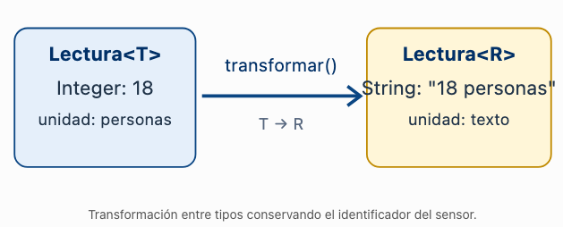

# Programación Aplicada

## 1.1b. Métodos genéricos y cotas


**Autor:** Ing. Pablo Torres, Mgtr.  
**Unidad:** 1. Programación genérica

[Inicio del curso](../../../README.md) · [Ver en el navegador](index.html)

---

## 1. Conceptos y ejemplos


### 1.1. Qué es un método genérico

Un **método genérico** declara sus propios parámetros de tipo para relacionar los datos que recibe y los que devuelve. La declaración aparece antes del tipo de retorno. El método puede pertenecer a una clase genérica o a una clase que no lo sea.

```java
static <R> R identidad(R valor) {
    return valor;
}
```

`<R>` declara el parámetro; `R` antes del nombre indica el retorno, y `R valor` especifica el argumento recibido. Una llamada puede trabajar con `String` y otra con `Integer`, conservando la relación entre entrada y salida sin casting.

No todo método que utiliza un tipo genérico declara uno propio. En `class Caja<T>`, `T obtener()` utiliza el `T` de la clase. En cambio, `<R> Caja<R> mapear(...)` introduce un parámetro nuevo para esa operación. Esa distinción permite transformar datos sin cambiar el tipo del objeto original.

### 1.2. Alcance, inferencia y métodos static

El parámetro del método tiene alcance en su declaración y cuerpo. Conviene usar nombres diferentes cuando ya existe otro parámetro en la clase: `T` para el dato almacenado y `R` para el resultado de una transformación.

El compilador normalmente **infiere** el argumento de tipo a partir de los argumentos y del contexto. También se puede indicar explícitamente: `Utilidades.<String>identidad("texto")`, si `Utilidades` declara ese método estático. La inferencia es una comprobación de compilación, no tipado dinámico.

Un método estático no tiene acceso al parámetro de tipo de una instancia. Puede declarar el suyo, como `static <N> N identidad(N valor)`. Un método de instancia sí puede combinar el parámetro de la clase con uno propio. El método `mapear` de la demostración utiliza esta segunda posibilidad.


### 1.3. Cotas y operaciones disponibles

Una **cota** limita los tipos admisibles y garantiza ciertas operaciones. Sin una cota explícita, un parámetro solo ofrece las operaciones de `Object`.

```java
static <N extends Number> double convertir(N numero) {
    return numero.doubleValue();
}
```

`N extends Number` admite `Integer`, `Double` y otros subtipos. Permite invocar `doubleValue()`, pero no escribir `numero + numero`: `N` no se convierte en un primitivo. Además, convertir cualquier número a `double` puede perder precisión.

En una cota, `extends` se usa tanto para clases como para interfaces. `Comparable<N>` exige un orden natural; `Comparator<N>` es un objeto que aporta un criterio externo. Una cota múltiple usa `&`, como `<E extends Number & Comparable<E>>`: si contiene una clase debe ir primero y solo puede haber una. Agrega únicamente las restricciones que el algoritmo utiliza.


### 1.4. Transformaciones mediante Function

`Function<A, B>` es una interfaz de Java que representa una operación: recibe un valor `A` y produce un resultado `B`. Su método principal es `B apply(A valor)`. Una función puede cambiar el tipo, cambiar el valor conservando el tipo, o construir otro objeto.

```java
Function<String, Integer> longitud = texto -> texto.length();
Integer cantidad = longitud.apply("Java"); // 4
```

La expresión `texto -> texto.length()` es una **lambda**: implementa la operación de la interfaz funcional. La parte izquierda es el parámetro; la derecha calcula el resultado. Aquí se utiliza para pasar una transformación como argumento, sin desarrollar todavía una cadena de operaciones con Streams.

En una clase `Contenedor<T>`, un método `<R> Contenedor<R> mapear(Function<T, R> operacion)` conserva `T` como entrada y utiliza `R` como salida. El resultado no cambia el parámetro de tipo del contenedor original; se crea un contenedor diferente.


### 1.5. Contrato de una operación genérica

La firma expresa compatibilidad de tipos; el contrato debe definir los valores admitidos. Es necesario decidir qué ocurre si la función es nula, devuelve nulo o lanza una excepción. También debe indicarse si la operación modifica el objeto original o devuelve uno nuevo.

En una transformación inmutable, el original conserva sus atributos y el resultado contiene los nuevos datos. No significa que toda función recibida sea pura: una lambda puede acceder a estado externo o producir efectos. El método no debe prometer propiedades que no puede garantizar de sus colaboradores.

Generalizar el tipo no valida el significado del dato. Una conversión de unidad necesita una fórmula correcta y una unidad de destino coherente, además de tipos compatibles.


### 1.6 Orden natural con `Comparable`

`Comparable<T>` es una interfaz que permite definir el **orden natural** de los objetos mediante el método `compareTo`.

El resultado de `a.compareTo(b)` indica:

| Resultado | Significado |
|---|---|
| Negativo | `a` es menor que `b` |
| Cero | Ambos son equivalentes según el orden |
| Positivo | `a` es mayor que `b` |

Clases como `Integer` y `String` ya implementan esta interfaz. Por eso podemos utilizarlas en un método genérico que obtenga el mayor de dos valores:


---


## 2. Demostración: transformar sin modificar el original

El ejemplo convierte un texto en su longitud y después en una etiqueta. La clase declara `T`, mientras que `mapear` declara su propio `R`. Cada llamada puede producir un tipo diferente.

**Archivo:** `app/src/main/java/edu/ups/pap/u01/MetodosDemo.java`.

```java
package edu.ups.pap.u01;

import java.util.Objects;
import java.util.function.Function;

/** Distingue el tipo T del contenedor del tipo R declarado por un método. */
public class MetodosDemo {
    static final class Contenedor<T> {
        private final T valor;

        Contenedor(T valor) {
            this.valor = Objects.requireNonNull(valor, "El valor es obligatorio");
        }

        T obtener() { return valor; }

        /**
         * Aplica una operación y crea otro contenedor sin modificar el original.
         * @param <R> tipo del resultado de esta llamada
         * @param operacion función que recibe T y devuelve R
         * @return contenedor del nuevo valor
         * @throws NullPointerException si la función o su resultado son nulos
         */
        <R> Contenedor<R> mapear(Function<T, R> operacion) {
            Objects.requireNonNull(operacion, "La operación es obligatoria");
            R resultado = operacion.apply(valor);
            return new Contenedor<>(resultado); // El constructor valida el resultado.
        }
    }

    /** La cota permite usar doubleValue(), una operación definida por Number. */
    static <N extends Number> double duplicar(N valor) {
        Objects.requireNonNull(valor, "El número es obligatorio");
        return valor.doubleValue() * 2;
    }

    public static void main(String[] args) {
        Contenedor<String> original = new Contenedor<>("Algoritmos");

        // La lambda recibe String; length() produce int, convertido a Integer.
        Contenedor<Integer> longitud = original.mapear(texto -> texto.length());
        // Otra llamada elige otro resultado R: aquí, String.
        Contenedor<String> etiqueta = longitud.mapear(n -> "Letras: " + n);

        System.out.println("Original: " + original.obtener());
        System.out.println("Longitud: " + longitud.obtener());
        System.out.println(etiqueta.obtener());
        System.out.println("Doble: " + duplicar(longitud.obtener()));

        try {
            original.mapear(null);
        } catch (NullPointerException e) {
            System.out.println(e.getMessage());
        }
        // Contenedor<Double> error = original.mapear(texto -> texto.length());
        // No compila: la función produce Integer, no Double.
    }
}
```

Desde la raíz del proyecto Java, con JDK 17 o superior:

```bash
java app/src/main/java/edu/ups/pap/u01/MetodosDemo.java
```

**Salida esperada:**

```text
Original: Algoritmos
Longitud: 10
Letras: 10
Doble: 20.0
La operación es obligatoria
```

La primera transformación produce `Contenedor<Integer>`; la segunda, `Contenedor<String>`. `obtener()` utiliza el parámetro de su clase y `mapear()` es el método que declara un parámetro nuevo. El original sigue conteniendo `Algoritmos`.


### 2.2 Demostración de Compararble

Editar la clase sensor: 

```java
/**
 * Sensor cuyo orden natural se establece por su identificador.
 */
public record Sensor(String id, String ubicacion)
        implements Comparable<Sensor> {

    /**
     * Compara identificadores en orden lexicográfico.
     *
     * @return negativo, cero o positivo si este identificador
     *         es menor, igual o mayor que el del otro sensor
     */
    @Override
    public int compareTo(Sensor otro) {
        // String ya implementa Comparable<String>.
        return this.id.compareTo(otro.id);
    }
}
```

Crea la nueva clase `CompableDemo`

```java
public class ComparableDemo {

    /**
     * Devuelve el mayor objeto según su orden natural.
     * Si empatan, devuelve el primero.
     *
     * @param <T> tipo que implementa Comparable<T>
     */
    static <T extends Comparable<T>> T mayor(T primero, T segundo) {
        // El criterio de comparación lo define la clase de los objetos.
        return primero.compareTo(segundo) >= 0 ? primero : segundo;
    }

    public static void main(String[] args) {
        Sensor sensor1 = new Sensor("S01", "Laboratorio");
        Sensor sensor2 = new Sensor("S02", "Biblioteca");

        // Invoca Sensor.compareTo: compara "S01" con "S02".
        int resultado = sensor1.compareTo(sensor2);

        System.out.println("S01 es menor que S02: " + (resultado < 0));

        // El compilador infiere que T es Sensor.
        Sensor seleccionado = mayor(sensor1, sensor2);

        System.out.println("Sensor con mayor identificador: " + seleccionado);

        // El mismo método también funciona con otros tipos comparables.
        System.out.println("Mayor número: " + mayor(12, 25));
    }
}
```


`T` solo puede representar tipos que implementen `Comparable<T>`. Aunque `Comparable` es una interfaz, **las cotas de los parámetros genéricos se declaran con `extends`**.

Sin esa cota, el compilador no podría garantizar que `primero` tenga el método `compareTo`.

**Diferencia con `Comparator`:** `Comparable` establece el orden natural del tipo; `Comparator` permite proporcionar distintos criterios externos, como ordenar por nombre, valor o fecha.


---


## 3. PC1.1b · Transformación de lecturas

Continúa en el proyecto de [PC1.1a](../01-tipos/material.md). Ya existe `Lectura<T>`, con identificador, valor y unidad. Ahora podrá producir una lectura transformada conservando la medición original.

### 3.1. Ampliación de la clase Lectura

En la misma clase pública `Lectura<T>`, incorpora un **método público de instancia que declare su propio parámetro `R`**:

```java
public <R> Lectura<R> transformar(Function<T, R> conversor, String nuevaUnidad)
```

Importa `java.util.function.Function`. El método debe aplicar `conversor` al valor actual y devolver una nueva `Lectura<R>` con el mismo identificador y la unidad recibida. No debe modificar los atributos del objeto original ni sustituir sus getters o constructor.

Rechaza un conversor nulo o un resultado nulo con `IllegalArgumentException` y mensaje descriptivo. La nueva lectura debe cumplir las validaciones de identificador y unidad de PC1.1a. No ocultes las excepciones que pueda lanzar el conversor.

La operación pertenece al modelo porque transforma una lectura individual y devuelve otra. Los recorridos de colecciones se incorporarán en una clase distinta cuando se necesiten.

### 3.2. Actividades en App.java

Crea `private static void runTransformaciones()` e invócalo desde `main`, conservando `runLectura()` y el código de la PC anterior. Este método de apoyo no declara parámetros de tipo: el método genérico que debes implementar es `Lectura.transformar`.

1. Reutiliza una temperatura `S01, 22.5, °C` y una ocupación `S02, 18, personas`.
2. Convierte la temperatura a Fahrenheit mediante `F = C × 9.0 / 5.0 + 32`; obtén una `Lectura<Double>` con unidad `°F`.
3. Transforma el valor de ocupación en el texto `18 personas`; obtén una `Lectura<String>` con unidad `texto`. Recupera ese resultado en una variable `String`, sin cast.
4. Muestra los originales y los resultados. Verifica que los identificadores se conservan y que los originales no cambiaron.
5. Comprueba por separado conversor nulo, resultado nulo y unidad de destino vacía. Captura las excepciones para observar todos los mensajes en la consola.

La parte relevante de una salida correcta es:

```text
Original: S01 | 22.5 °C
Transformada: S01 | 72.5 °F
Original: S02 | 18 personas
Transformada: S02 | 18 personas | unidad: texto
```

#### ¿Cómo funciona el método genérico?

La declaración más importante es:

```
public <R> Lectura<R> transformar(
    Function<T, R> conversor,
    String nuevaUnidad)
```

Analicemos cada componente:

| Elemento         | Significado                                             |
| ---------------- | ------------------------------------------------------- |
| `T`              | Tipo original almacenado en `Lectura<T>`                |
| `<R>`            | Declara un nuevo parámetro de tipo exclusivo del método |
| `Lectura<R>`     | Tipo de lectura que devuelve el método                  |
| `Function<T, R>` | Función que recibe un `T` y devuelve un `R`             |
| `nuevaUnidad`    | Unidad que tendrá la nueva lectura                      |

Lo importante: `T` pertenece a la clase y `R` pertenece al método. No tienen que ser iguales.

Por ejemplo, una lectura `Lectura<Integer>` puede transformarse en `Lectura<String>`.

Transformación entre tipos conservando el identificador del sensor.





### 3.3. Estructura resultante

Se muestran los archivos relevantes del proyecto; conserva la configuración Gradle existente. `u01` contiene las demostraciones y `modelo` contiene el modelo acumulativo.

```text
icc-pap-campusmonitor-apellido/
├── app/src/main/java/edu/ups/pap/
│   ├── App.java
│   ├── modelo/
│   │   └── Lectura.java
│   └── u01/
│       ├── TiposDemo.java
│       └── MetodosDemo.java
└── evidencias/
    ├── PC1.1a.md
    └── PC1.1b.md
```

Si tu `Lectura` ya está en `edu.ups.pap.u01`, conserva ese paquete y ajusta los imports de esta práctica; no crees una segunda clase con el mismo propósito.

### 3.4. Evidencias

Sube los cambios al repositorio remoto. En `evidencias/PC1.1b.md` incluye únicamente:

#### 1. Implementación realizada

En un párrafo breve, explica qué representa `R` y por qué `transformar` es genérico aunque `runTransformaciones` no lo sea. Indica qué agregaste en `Lectura` y `App`.

#### 2. Ejecución correcta

Agrega una captura que muestre ambas transformaciones y sus valores originales, y otra con los mensajes de los tres casos inválidos. Debajo, explica en una o dos frases cómo comprobaste que el original se conserva y que el resultado puede tener otro tipo.

## Referencias técnicas

- [Métodos genéricos — Oracle](https://docs.oracle.com/javase/tutorial/java/generics/methods.html)
- [Cotas — Oracle](https://docs.oracle.com/javase/tutorial/java/generics/bounded.html)
- [Function — API Java](https://docs.oracle.com/en/java/javase/17/docs/api/java.base/java/util/function/Function.html)


```java
Sensor sensor1 = new Sensor("S01", "Laboratorio");
Sensor sensor2 = new Sensor("S02", "Biblioteca");

if (sensor1.compareTo(sensor2) < 0) {
    System.out.println("S01 va antes que S02");
}
```