# Programación Aplicada

## 1.4a. Patrones creacionales


**Autor:** Ing. Pablo Torres, Mgtr.  

**Unidad:** 1. Programación genérica

Los patrones creacionales organizan la construcción, selección o reutilización de objetos. Cada patrón resuelve una variación diferente: el tipo concreto que se crea, la familia a la que pertenece, sus etapas de configuración, la copia de un estado existente o el control de una instancia compartida.

<a id="indice"></a>

## Índice

1. [Fundamentos](#fundamentos)

2. [Factory Method · Seleccionar un lector de datos](#factory-method)

3. [Abstract Factory · Crear equipos compatibles](#abstract-factory)

4. [Builder · Configurar un plan de muestreo](#builder)

5. [Prototype · Copiar perfiles de sensores](#prototype)

6. [Singleton · Compartir una configuración](#singleton)

7. [Comparación y criterios de elección](#comparacion)

8. [Referencias](#referencias)

<a id="fundamentos"></a>

## 1. Fundamentos

Un **patrón de diseño** describe una organización de responsabilidades y colaboraciones que resuelve un problema recurrente bajo determinadas condiciones. No es una clase lista para copiar ni una obligación de introducir interfaces en cualquier programa.

**Acoplamiento** es el grado de dependencia entre componentes. Si un servicio decide qué implementación construir, conoce su constructor y también la usa, cambiar esa implementación puede afectar varias partes del servicio. Una abstracción estable permite separar estas decisiones, a cambio de más tipos y relaciones.

| Rol | Responsabilidad |
|---|---|
| Producto | Objeto que se crea o proporciona. |
| Creador | Componente responsable de suministrar el producto. |
| Cliente | Componente que solicita o utiliza el objeto. |

Estos roles no representan necesariamente clases diferentes ni aparecen de la misma forma en todos los patrones.

Los patrones creacionales no eliminan la instanciación mediante `new` u otros mecanismos. Organizan dónde y cómo se toman las decisiones de creación.

Los patrones no requieren genéricos. Estos pueden reforzar contratos de tipos, como `Copiable<PerfilSensor>`, pero añadir `<T>` no convierte por sí solo una clase en un patrón.

---

<a id="factory-method"></a>

## 2. Factory Method 

### Definición

**Factory Method** es un patrón de diseño creacional que define un método para crear objetos y permite que las subclases decidan qué clase concreta instanciar.

La clase base declara el método de creación y puede utilizar el objeto resultante dentro de sus operaciones. Las subclases implementan o sobrescriben ese método para proporcionar diferentes productos.

**Idea principal:** separar la creación de un objeto de las operaciones que lo utilizan, permitiendo cambiar el producto mediante herencia y polimorfismo [1].

### 2.1. ¿Qué problema resuelve?

Supongamos que una aplicación realiza un proceso que necesita utilizar objetos de diferentes clases.

Una implementación podría crear directamente esos objetos mediante `new` y seleccionar su tipo con condiciones `if` o `switch`.

Esto provoca que el proceso dependa de clases concretas. Cuando aparecen nuevas variantes, puede ser necesario modificar la lógica existente.

**Factory Method propone:**

1. Definir una abstracción común para los productos.

2. Declarar un método de creación en una clase creadora.

3. Delegar en las subclases la elección del producto concreto.

4. Utilizar el producto mediante su abstracción, sin depender de una implementación específica.

El patrón no elimina la necesidad de seleccionar una implementación concreta. Traslada esa decisión a los creadores concretos.

### 2.2. Estructura y participantes

| Participante | Responsabilidad |
|---|---|
| Producto | Interfaz o clase abstracta que define las operaciones disponibles. |
| Producto concreto | Implementa las operaciones del producto. |
| Creador | Declara el Factory Method y puede contener operaciones que utilizan el producto. |
| Creador concreto | Sobrescribe el Factory Method para devolver el producto correspondiente. |
| Cliente | Selecciona el creador que necesita y utiliza sus operaciones. |

El **Factory Method es el método de creación**, no necesariamente toda la clase creadora.

### 2.3. ¿Cuándo utilizarlo?

Conviene utilizar Factory Method cuando:

- Un proceso necesita trabajar con diferentes implementaciones de un producto.

- Se desea conservar un procedimiento común y variar el objeto que utiliza.

- Las subclases deben decidir qué producto crear.

- Se prevé incorporar nuevas variantes sin modificar el algoritmo compartido.

No siempre es necesario. Si existe una única implementación estable, agregar jerarquías de creadores y productos podría aumentar innecesariamente la complejidad.

### 2.4. Caso práctico: importación de lecturas

En **CampusMonitor** necesitamos importar lecturas de sensores desde diferentes formatos.

Cada lectura contiene:

- Identificador del sensor.

- Valor numérico.

- Unidad de medida.

Se reciben dos formatos:

**Formato separado por punto y coma:**

```text

S01;22.5;°C

S02;18;personas

```

**Formato separado por tabulaciones:**

```text

S01 22.5    °C

S02 18  personas

```

Independientemente del formato, el proceso debe:

1. Recorrer las líneas recibidas.

2. Omitir las líneas vacías.

3. Interpretar los datos.

4. Validar las lecturas.

5. Identificar los errores indicando el número de línea.

6. Devolver una lista de objetos `Lectura`.

**Problema:** el procedimiento de importación es el mismo, pero cambia la forma de interpretar los campos.

Si duplicamos el proceso para cada formato, repetimos el recorrido, la validación del flujo y el manejo de errores.

**Solución mediante Factory Method:** conservar el proceso en `Importador` y delegar la creación del lector específico a sus subclases.

### 2.5. Estructura UML


#### Identificación de participantes

| Rol del patrón | Implementación en CampusMonitor |
|---|---|
| Producto | `LectorLinea` |
| Productos concretos | `LectorPuntoComa`, `LectorTabulacion` |
| Creador | `Importador` |
| Creadores concretos | `ImportadorPuntoComa`, `ImportadorTabulacion` |
| Factory Method | `crearLector()` |

La clase `Lectura` representa los datos obtenidos, pero **no es el producto del Factory Method**.

El producto del patrón es el objeto `LectorLinea`, que se utiliza para obtener las lecturas.

### 2.6. Implementación del ejemplo en Java

**Código de referencia:** [FactoryMethodDemo.java](ejemplos/FactoryMethodDemo.java).

El archivo contiene una demostración ejecutable con las clases agrupadas. Para desarrollar el ejercicio en un proyecto Java, se recomienda distribuirlas en archivos independientes.

#### Clases necesarias

| Clase | Tipo | Responsabilidad |
|---|---|---|
| `Lectura` | Record | Almacenar y validar los datos de una lectura. |
| `LectorLinea` | Interfaz | Declarar `leer(String linea)`, que recibe texto y devuelve una `Lectura`. |
| `LectorPuntoComa` | Clase concreta | Interpretar líneas separadas por `;`. |
| `LectorTabulacion` | Clase concreta | Interpretar líneas separadas por tabulaciones. |
| `Importador` | Clase abstracta | Mantener el proceso común y declarar `crearLector()`. |
| `ImportadorPuntoComa` | Creador concreto | Devolver un `LectorPuntoComa`. |
| `ImportadorTabulacion` | Creador concreto | Devolver un `LectorTabulacion`. |
| `FactoryMethodDemo` | Clase ejecutable | Probar los diferentes importadores mediante `main()`. |

**Consideraciones de implementación:**

- `Importador` declara `protected abstract LectorLinea crearLector()`.

- Cada creador concreto sobrescribe `crearLector()` y devuelve su lector correspondiente.

- `importar()` contiene el algoritmo común y es `final` en este ejemplo.

- Los lectores implementan el método `leer()` definido por la interfaz.

- El método auxiliar `interpretar()` permite reutilizar la separación y validación de campos. No constituye el Factory Method.

El lector se crea una vez por importación y se reutiliza para procesar las líneas recibidas.

### 2.7. ¿Cómo se utiliza el patrón?

El cliente selecciona un importador concreto y ejecuta el proceso común.

```java

Importador importador = new ImportadorPuntoComa();

List<Lectura> resultado = importador.importar(

    List.of("S01;22.5;°C", "S02;18;personas")

);

System.out.println(resultado);

```

#### Flujo de ejecución

1. El cliente instancia un creador concreto, por ejemplo `ImportadorPuntoComa`.

2. Invoca el método heredado `importar(lineas)`.

3. `Importador` ejecuta `crearLector()` mediante polimorfismo.

4. La subclase devuelve el lector correspondiente.

5. `Importador` utiliza `lector.leer(linea)` para procesar cada registro.

6. El resultado se devuelve como una lista de objetos `Lectura`.

Para utilizar otro formato, el cliente selecciona otro creador:

```java

Importador importador = new ImportadorTabulacion();

```

**Observación:** cambia el creador y, por tanto, el lector utilizado. El algoritmo `importar()` permanece sin modificaciones.

### 2.8. Resultado de la ejecución

```text

[Lectura[idSensor=S01, valor=22.5, unidad=°C]]

[Lectura[idSensor=S02, valor=18.0, unidad=personas]]

Línea 1: Lectura inválida

```

Las dos importaciones utilizan el mismo procedimiento con lectores diferentes.

El tercer resultado corresponde a una lectura con valor `NaN`. Aunque Java puede convertirlo a `double`, el constructor de `Lectura` lo rechaza porque no es un valor finito.

`Importador` incorpora el número de línea al mensaje de error.

### 2.9. Análisis

**Preguntas:**

1. ¿Por qué `crearLector()` devuelve `LectorLinea` en lugar de una clase concreta?

2. ¿Cuál es la diferencia entre `crearLector()` e `importar()`?

3. ¿Qué mecanismo de programación orientada a objetos permite ejecutar la implementación correspondiente de `crearLector()`?

4. ¿Qué clases serían necesarias para incorporar un tercer formato separado por comas?

5. ¿Por qué el método `importar()` no necesita condiciones para identificar el formato?

**Limitaciones del ejemplo:**

- Las líneas vacías se omiten.

- Los datos inválidos generan excepciones con su número de línea.

- No se admiten delimitadores escapados ni campos entre comillas.

- Se presupone una lista de entrada no nula con elementos no nulos.

**Conclusión:** Factory Method permite que un proceso trabaje con diferentes productos mediante una abstracción común, delegando en las subclases la creación de la implementación correspondiente.

[Volver al índice](#indice)

---

<a id="abstract-factory"></a>

## 3. Abstract Factory · Crear equipos compatibles

### Definición

**Abstract Factory** es un patrón de diseño creacional que define una interfaz para crear familias de objetos relacionados o compatibles, sin que el cliente tenga que conocer sus clases concretas [2].

Una fábrica concreta proporciona los productos de una variante determinada. El cliente solicita cada producto mediante la interfaz de fábrica y utiliza los objetos obtenidos mediante sus propios contratos. La decisión sobre qué familia utilizar se toma al elegir la fábrica.

**Idea principal:** concentrar la creación de colaboradores que deben funcionar juntos, de modo que cambiar de familia no obligue a modificar el código que los utiliza.

### 3.1. ¿Qué problema resuelve?

Supongamos que una aplicación necesita varios objetos para realizar una operación. No basta con que cada objeto implemente una interfaz: sus comportamientos también deben ser compatibles.

Una estación puede leer una temperatura y convertirla a Celsius. Si la fuente entrega Fahrenheit y el conversor interpreta el valor como Celsius, el programa puede compilar y ejecutarse, pero el resultado será incorrecto. Ambos componentes intercambian un `double`; ese tipo no expresa la unidad de medida.

Si cada cliente construye la fuente y el conversor por separado, la regla de compatibilidad queda repartida entre distintos lugares. Incorporar otro equipo obliga a revisar cada punto de construcción y aumenta el riesgo de mezclar variantes.

**Abstract Factory propone:**

1. Identificar los tipos de producto que colaboran.
2. Definir un contrato para cada tipo de producto.
3. Declarar una interfaz de fábrica con una operación de creación por tipo de producto.
4. Implementar una fábrica por familia compatible.
5. Entregar al cliente una fábrica y obtener de ella los colaboradores necesarios.

El patrón no elimina la elección de la familia. Esa elección permanece en el punto de composición de la aplicación; lo que se evita es repetirla dentro de cada operación del cliente.

### 3.2. Estructura y participantes

| Participante | Responsabilidad |
|---|---|
| Fábrica abstracta | Declarar las operaciones para crear los distintos tipos de producto. |
| Fábrica concreta | Proporcionar productos que pertenecen a una familia determinada. |
| Producto abstracto | Definir las operaciones de uno de los tipos de producto. |
| Producto concreto | Implementar un tipo de producto para una familia. |
| Cliente | Obtener y utilizar productos mediante abstracciones. |

**Tipo de producto y familia no significan lo mismo.** Fuente y conversor son dos tipos de producto. Celsius y Fahrenheit son dos familias. Cada fábrica concreta suministra una fuente y un conversor de su familia.

Tampoco es obligatorio que una fábrica produzca varias instancias de una misma clase. Lo relevante es que ofrece operaciones para varios roles relacionados y conserva una política de creación coherente.

### 3.3. ¿Cuándo utilizarlo?

Conviene utilizar Abstract Factory cuando:

- Una funcionalidad depende de varios componentes que deben seleccionarse juntos.
- Existen familias alternativas, como proveedores, plataformas o protocolos.
- Se desea cambiar una familia sin alterar el cliente que consume sus productos.
- La compatibilidad de los componentes constituye una regla del dominio.

No siempre es necesario. Si solo hay un colaborador o no existe relación entre los objetos creados, una dependencia por constructor o una fábrica más pequeña puede ser suficiente.

**Costo de extensión:** agregar una familia permite implementar los contratos existentes. Agregar un nuevo tipo de producto obliga a ampliar la interfaz de fábrica y a revisar todas sus implementaciones. El diseño facilita un eje de cambio, pero no elimina todos los cambios posibles.

### 3.4. Caso práctico: equipos de temperatura

En **CampusMonitor**, una estación debe mostrar la temperatura en Celsius aunque reciba equipos con escalas diferentes. La estación necesita dos colaboradores:

- Una fuente que entregue una muestra.
- Un conversor que transforme esa muestra a Celsius.

| Familia | Fuente concreta | Muestra simulada | Conversor concreto | Resultado en Celsius |
|---|---|---|---|---|
| Celsius | `FuenteCelsius` | 25,0 °C | `ConversorCelsius` | 25,0 °C |
| Fahrenheit | `FuenteFahrenheit` | 77,0 °F | `ConversorFahrenheit` | 25,0 °C |

La conversión se define como `C = (F − 32) × 5 / 9`. Para una entrada que ya está en Celsius, el conversor devuelve el valor recibido.

**Problema:** una combinación incorrecta de fuente Fahrenheit y conversor Celsius interpretaría 77 °F como 77 °C. El error no se detecta mediante las firmas, porque ambas aceptan o devuelven números `double`.

**Solución mediante Abstract Factory:** `EquipoCelsius` y `EquipoFahrenheit` crean parejas compatibles. `Estacion` recibe una `FabricaEquipo`, obtiene sus dos productos y conserva únicamente las referencias a los contratos de esos productos.

Las fuentes son simuladas y devuelven valores fijos. El ejemplo comprueba la composición de la familia y la conversión, sin depender de sensores físicos.

### 3.5. Estructura UML



[Fuente editable del diagrama](assets/abstract-factory.mmd).

#### Identificación de participantes

| Rol del patrón | Implementación en CampusMonitor |
|---|---|
| Fábrica abstracta | `FabricaEquipo` |
| Fábricas concretas | `EquipoCelsius`, `EquipoFahrenheit` |
| Productos abstractos | `FuenteTemperatura`, `ConversorTemperatura` |
| Productos concretos de la familia Celsius | `FuenteCelsius`, `ConversorCelsius` |
| Productos concretos de la familia Fahrenheit | `FuenteFahrenheit`, `ConversorFahrenheit` |
| Cliente de los productos | `Estacion` |
| Punto de composición | `main()` de `AbstractFactoryDemo` |

Las realizaciones de interfaz aparecen con línea discontinua y triángulo hacia el contrato. Las dependencias etiquetadas `crea` relacionan cada fábrica con sus productos concretos. Las asociaciones desde `Estacion` muestran los colaboradores que conserva como atributos.

`Estacion` recibe la fábrica al construirse, pero no la guarda. Esa relación se representa como dependencia. El diagrama omite la clase ejecutable externa para concentrarse en los participantes del patrón.

### 3.6. Implementación del ejemplo en Java

**Código de referencia:** [AbstractFactoryDemo.java](ejemplos/AbstractFactoryDemo.java).

El ejemplo reúne los tipos en una clase ejecutable. Si se distribuyen en archivos independientes, se deben ajustar las visibilidades necesarias para su utilización entre paquetes.

#### Clases necesarias

| Clase o interfaz | Tipo | Responsabilidad |
|---|---|---|
| `FabricaEquipo` | Interfaz | Declarar `crearFuente()` y `crearConversor()`. |
| `FuenteTemperatura` | Interfaz | Obtener una muestra mediante `leer()`. |
| `ConversorTemperatura` | Interfaz | Convertir una muestra mediante `aCelsius()`. |
| `EquipoCelsius` | Fábrica concreta | Construir la pareja que trabaja con Celsius. |
| `EquipoFahrenheit` | Fábrica concreta | Construir la pareja que trabaja con Fahrenheit. |
| `FuenteCelsius`, `FuenteFahrenheit` | Clases concretas | Entregar muestras simuladas en sus escalas. |
| `ConversorCelsius`, `ConversorFahrenheit` | Clases concretas | Aplicar la transformación correspondiente. |
| `Estacion` | Cliente | Coordinar lectura y conversión mediante los contratos. |
| `AbstractFactoryDemo` | Clase ejecutable | Seleccionar las familias y mostrar sus resultados. |

**Consideraciones de implementación:**

- Las operaciones de la fábrica devuelven interfaces, no tipos concretos.
- El constructor de `Estacion` rechaza una fábrica nula y productos nulos.
- Los productos se obtienen una vez al construir cada estación.
- `medirCelsius()` primero lee, después convierte y finalmente rechaza un resultado no finito.
- La expresión de conversión usa `5.0 / 9.0` para evitar una división entera entre constantes.
- La implementación de cada fábrica es responsable de la compatibilidad; Java no verifica la unidad representada por el `double`.

### 3.7. ¿Cómo se utiliza el patrón?

El cliente selecciona una fábrica concreta y la entrega a la estación:

```java
Estacion estacion = new Estacion(new EquipoFahrenheit());
double temperatura = estacion.medirCelsius();
System.out.println(temperatura);
```

El fragmento se utiliza dentro del contexto de la demostración, donde los tipos están disponibles. El cliente no crea directamente `FuenteFahrenheit` ni `ConversorFahrenheit`.

#### Flujo de ejecución

1. `main()` construye `EquipoFahrenheit`.
2. Entrega ese objeto al constructor de `Estacion` mediante el contrato `FabricaEquipo`.
3. La estación solicita `crearFuente()` y `crearConversor()`.
4. La fábrica devuelve `FuenteFahrenheit` y `ConversorFahrenheit`.
5. `medirCelsius()` obtiene 77,0 de la fuente.
6. El conversor calcula 25,0 y la estación comprueba que el resultado sea finito.
7. El cliente recibe la temperatura expresada en Celsius.

Para cambiar de familia se modifica la composición:

```java
Estacion estacion = new Estacion(new EquipoCelsius());
```

**Observación:** la operación `medirCelsius()` no necesita identificar la familia con un `if`. El comportamiento apropiado llega a través de los productos creados por la fábrica.

### 3.8. Resultado de la ejecución

```text
Equipo Celsius: 25.0 °C
Equipo Fahrenheit: 25.0 °C
```

Las entradas de las fuentes son distintas, pero los resultados coinciden porque las parejas fueron construidas de forma coherente. `Locale.ROOT` estabiliza el punto decimal de la salida de referencia.

Una prueba que solo compruebe que los objetos no son nulos sería insuficiente: también se necesita verificar una conversión conocida. El caso 77 °F → 25 °C permite detectar una pareja incorrecta aunque las clases implementen las interfaces esperadas.

| Comprobación | Resultado esperado | Qué verifica |
|---|---|---|
| Familia Celsius | 25,0 °C | La fuente y el conversor conservan la escala. |
| Familia Fahrenheit | 25,0 °C | Se aplica la conversión correspondiente. |
| Fábrica nula | Rechazo en el constructor | La estación no queda sin origen de productos. |
| Resultado no finito de una pareja de prueba | `IllegalStateException` | El cliente no publica una medición no finita. |

### 3.9. Análisis

**Preguntas:**

1. ¿Por qué fuente y conversor son tipos de producto distintos y no dos familias?
2. ¿Qué error produciría mezclar `FuenteFahrenheit` con `ConversorCelsius`?
3. ¿Por qué el compilador no detecta automáticamente esa mezcla?
4. ¿Qué tipos habría que incorporar para añadir una familia Kelvin sin modificar `Estacion`?
5. ¿Qué cambiaría si todas las familias debieran proporcionar también un calibrador?
6. ¿Qué parte del ejemplo depende de la fábrica y qué parte utiliza directamente los productos?

**Diferencia con Factory Method.** Aquí el cliente recibe un objeto fábrica que proporciona una familia. No necesita heredar de una clase creadora para variar sus productos. Una implementación de Abstract Factory puede utilizar Factory Methods internamente, pero las intenciones y responsabilidades de ambos patrones siguen siendo diferentes.

**Limitaciones del ejemplo:**

- La coherencia de la familia depende de implementar correctamente la fábrica.
- Las muestras son fijas; no hay hardware, comunicaciones ni tiempos de espera.
- Los tipos numéricos no distinguen unidades; un modelo más estricto podría introducir tipos para ellas.
- La fábrica crea productos nuevos en estas implementaciones; el patrón no exige por sí solo una política universal de reutilización.
- Añadir un tipo de producto afecta a todas las fábricas concretas.

**Conclusión:** Abstract Factory concentra la selección de una familia compatible y permite que el cliente coordine sus productos sin conocer las clases concretas.

[Volver al índice](#indice)

---

<a id="builder"></a>

## 4. Builder · Configurar un plan de muestreo

### Definición

**Builder** es un patrón de diseño creacional que organiza la construcción de un objeto mediante pasos separados de su utilización. El cliente configura un constructor especializado y obtiene el producto al finalizar el proceso [3].

En la estructura clásica, distintos builders pueden ejecutar una secuencia de pasos para obtener representaciones diferentes. Un director puede coordinar esa secuencia. En Java también es habitual un builder fluido asociado a un único tipo de producto, que reúne opciones y valida el estado antes de construirlo.

**Idea principal:** separar el estado provisional de construcción del objeto que se entrega como resultado, haciendo explícitas sus opciones y condiciones de validez.

### 4.1. ¿Qué problema resuelve?

Supongamos que un objeto necesita datos obligatorios, opciones y valores predeterminados. Un constructor con muchos parámetros puede ser difícil de interpretar: varias cadenas, números o booleanos consecutivos no explican por sí mismos qué configura cada posición.

Otra alternativa sería crear un objeto vacío y llamar a varios setters. Sin embargo, ese objeto ya existe y podría entregarse a otro componente antes de estar completo. El servicio receptor tendría que distinguir entre un producto utilizable y uno que todavía está en preparación.

**Builder propone:**

1. Mantener las opciones de construcción en un objeto separado.
2. Exponer operaciones con nombres que expresen cada decisión.
3. Validar los datos y las restricciones conjuntas.
4. Construir y devolver el producto cuando el estado sea aceptable.
5. Evitar que los cambios posteriores del constructor alteren los productos ya entregados.

El último punto es una decisión de este ejemplo, no una garantía automática del patrón. Un Builder también puede construir productos mutables si ese es el contrato previsto.

### 4.2. Estructura y participantes

| Participante | Responsabilidad |
|---|---|
| Producto | Representar el resultado construido. |
| Builder | Definir o proporcionar las operaciones de construcción. |
| Builder concreto | Mantener el estado provisional y producir una representación. |
| Director opcional | Coordinar una secuencia de construcción reutilizable. |
| Cliente | Elegir las opciones o el director y solicitar el resultado. |

En la variante de esta sección, `PlanMuestreo.Builder` reúne los papeles de contrato y builder concreto: no se introduce una interfaz adicional porque solo hay una representación. `main()` organiza las llamadas, por lo que no se necesita una clase directora.

**Una interfaz fluida no equivale por sí sola a Builder.** Devolver `this` permite encadenar métodos; la separación entre configuración provisional y producto final es lo que da sentido al diseño de este ejemplo.

### 4.3. ¿Cuándo utilizarlo?

Conviene utilizar Builder cuando:

- El producto tiene varias opciones o parámetros difíciles de distinguir por posición.
- Se desea aplicar valores predeterminados de forma explícita.
- Existen restricciones que dependen de la combinación de varios datos.
- El producto no debe quedar disponible mientras está incompleto.
- Varias recetas de construcción podrían reutilizar pasos comunes.

Para una lectura con tres datos obligatorios y un contrato simple, un constructor validado o un `record` puede resultar suficiente. El builder agrega otro tipo y otro estado mutable que deben mantenerse.

Un director sería útil si numerosas partes de CampusMonitor repitieran la misma receta de plan. No debe añadirse únicamente para completar un diagrama teórico.

### 4.4. Caso práctico: plan de muestreo

En **CampusMonitor**, un plan define qué sensores se consultarán y con qué intervalo. Antes de entregarlo a un servicio, debe cumplir las siguientes reglas:

| Dato | Regla |
|---|---|
| Nombre | Obligatorio y no formado únicamente por espacios. |
| Intervalo | No nulo y de al menos un segundo. |
| Sensores | Al menos uno, con identificadores no vacíos y sin duplicados exactos. |
| Valor predeterminado | Treinta segundos si no se configura otro intervalo. |
| Producto entregado | No cambia cuando se reutiliza su builder. |

**Problema:** configurar primero un plan vacío permitiría estados que no cumplen esas reglas. Además, agregar un sensor al constructor de un segundo plan no debería modificar el primero.

**Solución mediante Builder:** el cliente prepara un `PlanMuestreo.Builder`, aplica `cada()` y `agregarSensor()` y solicita `construir()`. El producto recibe una instantánea independiente de la lista de sensores.

El caso construye un plan con `S01`, reutiliza el builder para agregar `S02` y construye otro. La comparación de sus resúmenes permite observar si el primer producto quedó aislado correctamente.

### 4.5. Estructura UML



[Fuente editable del diagrama](assets/builder.mmd).

#### Identificación de participantes

| Rol del patrón | Implementación en CampusMonitor |
|---|---|
| Producto | `PlanMuestreo` |
| Builder concreto | `PlanMuestreo.Builder` |
| Pasos de configuración | `cada()`, `agregarSensor()` |
| Obtención del producto | `construir()` |
| Cliente | `main()` de `BuilderDemo` |
| Director | No se incorpora en esta variante. |

La dependencia `construye` expresa que el builder produce un `PlanMuestreo`; no representa una relación de herencia. El nombre `PlanMuestreo.Builder` indica que la clase Builder está anidada dentro del producto. Al ser estática, no necesita una instancia previa de `PlanMuestreo` para existir.

El producto y el builder tienen atributos parecidos, pero responsabilidades diferentes. Uno conserva configuración provisional; el otro representa el resultado validado.

### 4.6. Implementación del ejemplo en Java

**Código de referencia:** [BuilderDemo.java](ejemplos/BuilderDemo.java).

#### Clases necesarias

| Clase | Tipo | Responsabilidad |
|---|---|---|
| `PlanMuestreo` | Clase final | Conservar nombre, intervalo y sensores del producto. |
| `PlanMuestreo.Builder` | Clase estática anidada | Configurar y validar el plan antes de crearlo. |
| `BuilderDemo` | Clase ejecutable | Construir dos planes y mostrar el rechazo de uno incompleto. |

**Consideraciones de implementación:**

- El constructor del producto es privado y recibe el builder.
- El nombre obligatorio se establece al crear el builder.
- `cada()` y `agregarSensor()` devuelven `this` para permitir encadenamiento.
- `construir()` rechaza intervalos menores a un segundo y listas vacías.
- `List.copyOf()` obtiene una lista no modificable separada del `ArrayList` mutable del builder.
- Los elementos son `String`, por lo que no requieren duplicación para evitar modificaciones internas.
- Los campos `final`, los tipos inmutables utilizados y la ausencia de métodos de modificación permiten que este producto sea inmutable.

`final` por sí solo no hace inmutable una lista: impide cambiar la referencia del campo, pero no necesariamente modificar el objeto referenciado. Aquí la política de copia también es necesaria.

### 4.7. ¿Cómo se utiliza el patrón?

El cliente expresa la configuración mediante operaciones con nombres:

```java
PlanMuestreo plan = new PlanMuestreo.Builder("Laboratorio")
        .cada(Duration.ofSeconds(10))
        .agregarSensor("S01")
        .agregarSensor("S02")
        .construir();

System.out.println(plan.resumen());
```

#### Flujo de ejecución

1. Se crea el builder con un nombre obligatorio.
2. El builder parte de un intervalo de treinta segundos y una lista vacía.
3. `cada()` sustituye el intervalo provisional.
4. Cada llamada a `agregarSensor()` valida el identificador y lo incorpora si no está repetido.
5. `construir()` comprueba las restricciones finales.
6. Si el estado es válido, se crea `PlanMuestreo` con una copia de la lista.
7. El cliente recibe el producto; el builder puede conservarse para preparar otro.

**Momento de validación.** Un intervalo nulo se rechaza al llamar a `cada()`. Un intervalo no nulo de 500 milisegundos puede almacenarse provisionalmente, pero será rechazado al llamar a `construir()`. El producto no se crea con ese estado inválido.

**Observación:** si falla una validación final, no se entrega un plan parcialmente construido. El cliente puede corregir el builder y volver a intentar la construcción.

### 4.8. Resultado de la ejecución

```text
Laboratorio | 10 s | [S01]
Laboratorio | 10 s | [S01, S02]
Agrega al menos un sensor
```

La demostración completa construye primero un plan con `S01`. Después agrega `S02` al mismo builder y obtiene un segundo plan. La primera salida conserva un único sensor: el primer producto no comparte la lista mutable del constructor.

La tercera línea corresponde a una construcción sin sensores. El mensaje expresa la regla incumplida y no representa un plan devuelto al cliente.

| Comprobación | Resultado esperado | Qué verifica |
|---|---|---|
| Omitir `cada()` y agregar un sensor | Intervalo de 30 segundos | Valor predeterminado. |
| Agregar `S01` dos veces | Error de sensor duplicado | Validación de elementos. |
| Configurar 500 milisegundos y construir | Error de intervalo mínimo | Restricción final del producto. |
| Construir sin sensores | Error de lista vacía | El producto no se entrega incompleto. |
| Reutilizar el builder | El primer plan permanece igual | Copia defensiva. |

### 4.9. Análisis

**Preguntas:**

1. ¿Qué diferencia hay entre el estado de `Builder` y el estado de `PlanMuestreo`?
2. ¿Por qué `cada()` devuelve `Builder` y no el producto final?
3. ¿Qué problema aparecería si el producto guardara directamente `builder.sensores`?
4. ¿Por qué `final` no sería suficiente para proteger una lista mutable?
5. ¿Qué validaciones se realizan al configurar y cuáles al construir?
6. ¿Cuándo justificaría una receta repetida la incorporación de un director?

**Diferencia con Factory Method.** El ejemplo no cambia el tipo concreto de producto mediante subclases creadoras. Reúne opciones para construir instancias válidas del mismo tipo. También difiere de Prototype: no parte de una copia de un plan existente, sino del estado provisional del builder.

**Limitaciones del ejemplo:**

- El builder es mutable y no está diseñado para ser compartido entre hilos.
- La comparación de identificadores es exacta: no normaliza mayúsculas ni espacios.
- No se ejecuta el muestreo ni se crea un temporizador.
- El intervalo puede incluir fracciones de segundo; `resumen()` usa `toSeconds()` y muestra solo los segundos enteros.
- La inmutabilidad del producto depende de estos campos y de su política de copia, no del nombre Builder.

**Conclusión:** Builder mantiene la configuración provisional separada del producto y centraliza las comprobaciones que permiten entregarlo en un estado válido.

[Volver al índice](#indice)

---

<a id="prototype"></a>

## 5. Prototype · Copiar perfiles de sensores

### Definición

**Prototype** es un patrón de diseño creacional que obtiene nuevos objetos a partir de objetos existentes mediante una operación de copia. El objeto que conoce su estado define cómo reproducirlo, mientras el cliente solicita una copia sin reconstruir manualmente toda su configuración [4].

El objeto utilizado como punto de partida es el prototipo. No necesita ser una instancia especial de una clase llamada `Prototype`: puede ser un objeto ordinario que ya contiene la configuración que se desea reutilizar.

**Idea principal:** delegar en el objeto configurado la creación de una variante de su estado y definir qué partes deben ser independientes y cuáles pueden compartirse.

### 5.1. ¿Qué problema resuelve?

Supongamos que varios laboratorios utilizan un perfil de sensores con reglas ya definidas. Cada laboratorio parte de ese perfil, pero necesita cambiar algunos umbrales.

Reconstruir el perfil en cada cliente obliga a conocer sus detalles internos y repetir los valores predeterminados. Si cambia una regla base, pueden quedar copias manuales desactualizadas. Además, el cliente podría no conocer el tipo concreto de todos los objetos que necesita reproducir.

Asignar una referencia tampoco crea una copia:

```java
PerfilSensor laboratorio = base;
```

En ese caso, `laboratorio` y `base` identifican el mismo objeto. Una modificación realizada por una referencia se observa al consultar la otra.

**Prototype propone:**

1. Exponer una operación de copia con un contrato claro.
2. Hacer que el tipo que posee el estado implemente esa operación.
3. Crear el nuevo objeto a partir de los valores del prototipo.
4. Duplicar las partes mutables que deban ser independientes.
5. Permitir que el cliente personalice la copia sin reconstruir la plantilla.

El patrón no significa evitar todos los constructores. La implementación de `copiar()` puede utilizarlos; lo que cambia es quién conoce los detalles de reconstrucción.

### 5.2. Estructura y participantes

| Participante | Responsabilidad |
|---|---|
| Prototipo | Definir el contrato de copia. |
| Prototipo concreto | Implementar la duplicación de su estado. |
| Cliente | Solicitar una copia y personalizarla. |
| Registro opcional | Localizar prototipos por un identificador y facilitar su reutilización. |

En este ejemplo, `Copiable<T>` es el contrato genérico y `PerfilSensor` lo implementa con `T = PerfilSensor`. El método devuelve un resultado del tipo correcto sin exigir una conversión explícita.

`ReglaUmbral` es un componente mutable del perfil. Su operación `copiar()` ayuda a duplicar el estado interno, aunque no implementa la interfaz genérica. No es necesario que todos los colaboradores adopten la misma interfaz para que el perfil cumpla el contrato de copia.

No se incluye un registro de prototipos: `main()` conserva directamente el perfil base. Un registro tendría sentido si existieran muchas plantillas que debieran seleccionarse por nombre o categoría.

### 5.3. ¿Cuándo utilizarlo?

Conviene utilizar Prototype cuando:

- Los objetos iniciales contienen configuraciones extensas que se reutilizan.
- Se requieren variantes de plantillas previamente preparadas.
- El cliente no debe conocer todos los detalles de construcción.
- El tipo concreto del objeto puede variar, pero existe una operación común de copia.
- Reconstruir la configuración desde sus fuentes resulta menos apropiado que partir del estado disponible.

No siempre es necesario. Para un objeto pequeño e inmutable, compartir la misma instancia o usar un constructor explícito puede ser más sencillo. Una copia tampoco es automáticamente más rápida: su costo depende de la cantidad de estado que deba duplicarse.

La principal dificultad consiste en mantener el contrato de copia. Cada nuevo atributo mutable exige decidir si se duplica, se comparte o se reinicializa.

### 5.4. Caso práctico: perfiles de sensores

En **CampusMonitor**, el perfil base contiene dos reglas:

| Magnitud | Límite inicial |
|---|---|
| Temperatura | 28,0 |
| Humedad | 70,0 |

Un laboratorio necesita reducir el límite de temperatura a 25,0 y cambiar el nombre del perfil. El perfil base debe conservar sus valores y permanecer disponible para crear otras variantes.

**Problema:** copiar únicamente la referencia comparte todo el objeto. Crear otro perfil con una lista nueva, pero con las mismas reglas, tampoco es suficiente: las reglas contienen un límite modificable.

**Solución mediante Prototype:** `PerfilSensor.copiar()` crea otro perfil y solicita una copia de cada `ReglaUmbral`. El cliente cambia el nombre y el umbral de la copia obtenida.

#### Qué debe copiarse

| Elemento | Política de este ejemplo | Motivo |
|---|---|---|
| `PerfilSensor` | Crear una instancia nueva | Separar la identidad de los perfiles. |
| Lista de reglas | Crear una lista nueva | Agregar o quitar elementos sin afectar la otra lista. |
| Cada `ReglaUmbral` | Crear una regla nueva | Su límite es mutable. |
| Nombre y magnitud | Reutilizar las referencias a cadenas | `String` es inmutable. |
| Límite `double` | Copiar el valor | Es un dato primitivo. |

**Copia superficial y profunda.** Una copia superficial conserva referencias a componentes internos. Una copia profunda, respecto del contrato de este modelo, reproduce también las reglas mutables. No se exige duplicar indiscriminadamente todos los objetos alcanzables: las cadenas inmutables pueden compartirse sin provocar cambios cruzados.

### 5.5. Estructura UML



[Fuente editable del diagrama](assets/prototype.mmd).

#### Identificación de participantes

| Rol del patrón | Implementación en CampusMonitor |
|---|---|
| Contrato del prototipo | `Copiable<T>` |
| Prototipo concreto | `PerfilSensor` |
| Operación de copia | `PerfilSensor.copiar()` |
| Estado mutable interno | Lista y objetos `ReglaUmbral` |
| Colaboración de copia | `ReglaUmbral.copiar()` |
| Cliente | `main()` de `PrototypeDemo` |

La realización de `Copiable` indica que `PerfilSensor` cumple el contrato con su propio tipo como resultado. La composición expresa que el perfil posee sus reglas. La multiplicidad `0..*` es coherente con el constructor: puede existir un perfil sin reglas, aunque la demostración base agrega dos.

La dependencia etiquetada `solicita copiar` muestra que la copia del perfil delega la duplicación de cada regla en la propia regla. Esa colaboración es distinta de la relación de pertenencia.

### 5.6. Implementación del ejemplo en Java

**Código de referencia:** [PrototypeDemo.java](ejemplos/PrototypeDemo.java).

#### Clases necesarias

| Clase o interfaz | Tipo | Responsabilidad |
|---|---|---|
| `Copiable<T>` | Interfaz genérica | Declarar `copiar()` con resultado de tipo `T`. |
| `PerfilSensor` | Clase concreta | Mantener el nombre y las reglas; implementar la copia del perfil. |
| `ReglaUmbral` | Clase concreta | Mantener una magnitud y un límite finito; copiar la regla. |
| `PrototypeDemo` | Clase ejecutable | Preparar el prototipo, copiarlo y mostrar la independencia. |

**Consideraciones de implementación:**

- `copiar()` crea un perfil nuevo con el nombre existente.
- El constructor del perfil crea su propia lista vacía.
- Cada regla se duplica mediante `regla.copiar()` antes de incorporarla.
- No se utiliza `Cloneable` ni `Object.clone()`; el contrato de copia se expresa con un método propio.
- Los constructores y modificadores validan nombres y límites.
- `Double.isFinite()` impide límites `NaN` e infinitos.
- `ajustarLimite()` supone que el índice identifica una regla existente; un índice inválido produce la excepción de la lista.

La política de copia debe revisarse si se añaden campos. Por ejemplo, un identificador de base de datos podría necesitar regenerarse y una conexión abierta no debería duplicarse como si fuera configuración ordinaria.


### 5.7. ¿Cómo se utiliza el patrón?

El cliente prepara o recibe un perfil existente y solicita su copia:

```java
PerfilSensor base = new PerfilSensor("Base");
base.agregarRegla("temperatura", 28.0);
base.agregarRegla("humedad", 70.0);

PerfilSensor laboratorio = base.copiar();
laboratorio.renombrar("Laboratorio");
laboratorio.ajustarLimite(0, 25.0);
```

El cliente conoce qué desea cambiar, pero no tiene que reconstruir el resto de reglas. La responsabilidad de conservar correctamente el estado original corresponde a `copiar()`.

#### Flujo de ejecución

1. Se construye el perfil base y se agregan sus reglas.
2. El cliente invoca `base.copiar()`.
3. El perfil crea una nueva instancia con el mismo nombre.
4. Recorre sus reglas y solicita una copia de cada una.
5. Agrega las nuevas reglas a la lista del nuevo perfil.
6. Devuelve la copia al cliente.
7. El cliente cambia el nombre y un límite únicamente en la copia.
8. Se consultan ambos perfiles para comprobar que el original conserva su configuración.

**Observación:** `base != laboratorio` prueba que las referencias a los perfiles son distintas. No prueba por sí solo que sus componentes internos sean independientes. Para comprobarlo hay que modificar una regla de la copia y consultar la regla correspondiente del original.

### 5.8. Resultado de la ejecución

```text
Base: [temperatura > 28.0, humedad > 70.0]
Laboratorio: [temperatura > 25.0, humedad > 70.0]
Mismo perfil: false
```

La copia cambia el límite de temperatura a 25,0; el original conserva 28,0. La regla de humedad conserva el mismo valor en ambos perfiles, pero corresponde a objetos de regla distintos.

La salida `Mismo perfil: false` confirma la diferencia de identidad de los objetos exteriores. La conservación del límite original después del cambio aporta evidencia de la copia de sus reglas mutables.

| Comprobación | Resultado esperado | Qué verifica |
|---|---|---|
| Comparar referencias del perfil | Son distintas | Nueva identidad del contenedor. |
| Cambiar el nombre de la copia | El nombre original no cambia | Estado propio del perfil. |
| Cambiar un límite de la copia | El límite original no cambia | Independencia de las reglas. |
| Agregar una regla a la copia | La lista original mantiene su tamaño | Independencia de las listas. |
| Establecer un límite no finito | `IllegalArgumentException` | Se conserva la validación del modelo. |

Copiar n reglas requiere tiempo O(n) y espacio adicional O(n) en esta implementación. Esa estimación corresponde al recorrido y a los nuevos objetos creados, no a una propiedad universal de todo Prototype.

### 5.9. Análisis

**Preguntas:**

1. ¿Qué diferencia hay entre `laboratorio = base` y `laboratorio = base.copiar()`?
2. ¿Por qué `new ArrayList<>(reglas)` no cumpliría por sí solo este contrato de independencia?
3. ¿Qué objetos se crean y qué valores pueden compartirse al copiar el perfil?
4. ¿Qué aporta `Copiable<PerfilSensor>` respecto de un método que devuelva `Object`?
5. ¿Cómo comprobarías que agregar una regla a la copia no modifica el original?
6. ¿Qué decisiones habría que tomar si las reglas compartieran objetos mutables o existieran referencias circulares?

**Diferencia con Builder.** Builder reúne opciones antes de crear un producto; Prototype parte del estado de un objeto existente. En este caso la plantilla ya contiene nombre y reglas, y el cliente solo personaliza las diferencias.

**Limitaciones del ejemplo:**

- El perfil y sus reglas son mutables; la copia los independiza, no los vuelve inmutables.
- El grafo es simple y no contiene ciclos ni subobjetos compartidos entre varias reglas.
- No existe un registro de prototipos, persistencia ni copia de recursos externos.
- La regla almacena configuración; no se evalúan mediciones reales contra el umbral.
- Cambiar el modelo obliga a revisar la política de copia, las validaciones y sus comprobaciones.

**Conclusión:** Prototype permite obtener variantes de una configuración existente delegando su copia al tipo que conoce el estado y haciendo explícita la independencia de sus componentes mutables.

[Volver al índice](#indice)

---

<a id="singleton"></a>

## 6. Singleton · Compartir una configuración

### Definición

**Singleton** es un patrón de diseño creacional que restringe una clase a una única instancia dentro de un ámbito definido y proporciona un punto de acceso a esa instancia [5].

La intención reúne dos decisiones: controlar cuántas instancias existen y permitir recuperar la referencia compartida. Esa restricción no hace automáticamente inmutable el objeto ni vuelve seguras sus operaciones concurrentes.

**Idea principal:** controlar la disponibilidad de una instancia compartida cuando esa unicidad forma parte del diseño, sin confundirla con el simple hecho de reutilizar un objeto.

### 6.1. ¿Qué problema resuelve?

Supongamos que varios servicios deben utilizar una misma configuración predeterminada. Si cada servicio decide crear su propia configuración o utiliza valores diferentes, el comportamiento de la aplicación puede divergir.

Hay dos problemas posibles y conviene separarlos:

- **Compartir una configuración:** crear un objeto al iniciar la aplicación y entregarlo a los servicios puede ser suficiente.
- **Restringir una clase a una instancia:** la clase debe impedir que los clientes construyan libremente instancias adicionales y ofrecer acceso a la referencia permitida.

Singleton aborda la segunda necesidad. No es obligatorio utilizarlo cada vez que dos servicios reciben el mismo objeto.

**Singleton propone:**

1. Controlar la creación de las instancias del tipo.
2. Mantener una referencia a la instancia permitida.
3. Proporcionar un punto de acceso conocido.
4. Definir el ámbito en el que se aplica la unicidad.
5. Diseñar por separado la mutabilidad y la concurrencia de sus operaciones.

En Java puede implementarse con una clase y acceso controlado o mediante un `enum` de una sola constante. En esta sección se utiliza la segunda variante para evitar código manual de inicialización diferida y sincronización.

### 6.2. Estructura y participantes

| Participante | Responsabilidad |
|---|---|
| Singleton | Restringir la instanciación y conservar el objeto compartido. |
| Punto de acceso | Permitir obtener la referencia de la instancia. |
| Cliente | Utilizar las operaciones del objeto compartido. |
| Contrato de consumo opcional | Expresar lo que necesita el cliente y permitir sustitutos. |

El contrato opcional no es una condición para reconocer Singleton. Aquí se incorpora `Parametros` para que el servicio pueda recibir configuraciones alternativas durante las pruebas.

**Unicidad e inyección no se contradicen.** El punto de composición puede obtener `Configuracion.INSTANCIA` y pasarla al servicio. El servicio sigue recibiendo una dependencia explícita, aunque el objeto elegido se obtenga mediante un acceso global.

### 6.3. ¿Cuándo utilizarlo?

Conviene considerar Singleton cuando:

- La existencia de una única instancia del tipo es una decisión necesaria del diseño.
- El ámbito y el ciclo de vida de esa instancia están definidos.
- Se comprende el efecto de compartir su estado entre consumidores.
- El punto de acceso global no impide sustituir dependencias donde se necesita aislamiento.

No conviene introducirlo solamente para evitar pasar parámetros. Eso puede ocultar dependencias y dificultar las pruebas. Si la necesidad es reutilizar un objeto, una instancia creada en la composición y compartida por constructor suele ser una alternativa suficiente.

La restricción debe justificarse por el comportamiento esperado, no por el nombre de la clase. Una clase llamada Configuración no necesita necesariamente ser un Singleton: diferentes usuarios o pruebas podrían requerir configuraciones distintas.

### 6.4. Caso práctico: configuración predeterminada

En **CampusMonitor**, varios servicios necesitan conocer un intervalo predeterminado y una unidad de medida:

| Parámetro | Configuración compartida |
|---|---|
| Intervalo | 30 segundos |
| Unidad | °C |
| Mutabilidad | Los valores no cambian después de inicializarse. |
| Acceso | `Configuracion.INSTANCIA` |

**Problema:** se desea una configuración predeterminada única del tipo `Configuracion`, pero también probar un servicio con otros valores sin modificar estado global.

**Solución mediante Singleton:** `Configuracion` es un `enum` con una sola constante. Implementa `Parametros`, que declara únicamente las operaciones necesarias para el consumidor. `ServicioMuestreo` recibe `Parametros` por constructor.

En la demostración se crea un servicio con el Singleton y otro con un sustituto de prueba que devuelve un segundo y Fahrenheit. El sustituto no es otra instancia de `Configuracion`; es otra implementación del contrato `Parametros`.

### 6.5. Estructura UML



[Fuente editable del diagrama](assets/singleton.mmd).

#### Identificación de participantes

| Rol del patrón | Implementación en CampusMonitor |
|---|---|
| Singleton | `Configuracion` |
| Instancia y acceso | `Configuracion.INSTANCIA` |
| Contrato del consumidor | `Parametros` |
| Cliente | `ServicioMuestreo` |
| Punto de composición | `main()` de `SingletonDemo` |
| Sustituto de prueba | Implementación anónima de `Parametros` |

`Configuracion` aparece como enumeración y realiza la interfaz `Parametros`. Su constante `INSTANCIA` es estática y final. Los campos de configuración también son finales; el diagrama lo aclara en una nota.

La asociación de `ServicioMuestreo` apunta a `Parametros`, porque el servicio conserva ese contrato como atributo. No apunta al tipo concreto `Configuracion`: el código del consumidor no necesita conocer el acceso al Singleton.

### 6.6. Implementación del ejemplo en Java

**Código de referencia:** [SingletonDemo.java](ejemplos/SingletonDemo.java).

#### Clases necesarias

| Clase o interfaz | Tipo | Responsabilidad |
|---|---|---|
| `Parametros` | Interfaz | Proporcionar intervalo y unidad. |
| `Configuracion` | Enum con una constante | Mantener la configuración compartida. |
| `ServicioMuestreo` | Clase concreta | Describir el muestreo usando los parámetros recibidos. |
| `SingletonDemo` | Clase ejecutable | Comparar referencias y utilizar dos configuraciones de consumo. |

**Consideraciones de implementación:**

- El cliente no puede construir un enum con `new`.
- La constante se crea al inicializarse la clase; no se necesita un método denominado `getInstance()`.
- Dos accesos a la misma constante recuperan la misma referencia.
- `Duration` y `String` son inmutables, y los campos de esta configuración son `final`.
- El constructor de `ServicioMuestreo` rechaza parámetros nulos.
- El servicio consulta el contrato recibido; no busca internamente el Singleton.

**Ámbito de la unicidad.** La garantía corresponde a esa clase cargada. Otra JVM o una definición de la clase cargada por un cargador diferente puede tener su propia constante. Este diseño no implementa una exclusión distribuida ni garantiza una única instancia en varios servidores.

**Inicialización y concurrencia.** La inicialización de la clase tiene las garantías del lenguaje. Eso no implica que cualquier operación mutable que se agregue después quede sincronizada. En el ejemplo se comparte configuración inmutable; no hay contadores ni colecciones modificables que coordinar.


### 6.7. ¿Cómo se utiliza el patrón?

El punto de composición obtiene la configuración y la entrega al consumidor:

```java
Parametros parametros = Configuracion.INSTANCIA;
ServicioMuestreo servicio = new ServicioMuestreo(parametros);
System.out.println(servicio.describir("S01"));
```

El acceso global queda visible en la composición. La clase `ServicioMuestreo` conserva la posibilidad de trabajar con otra implementación de `Parametros`.

#### Flujo de ejecución

1. El primer uso que requiere inicializar `Configuracion` provoca la creación de su constante.
2. Se obtiene `Configuracion.INSTANCIA` y se guarda su referencia.
3. Otro acceso a la misma constante devuelve esa misma referencia.
4. Se entrega la configuración a `ServicioMuestreo` por constructor.
5. El servicio consulta `intervalo()` y `unidad()` mediante `Parametros`.
6. Para una prueba, se crea otro objeto que implementa `Parametros` con valores alternativos.
7. Un segundo servicio utiliza ese objeto sin modificar el Singleton ni el código del consumidor.

**Observación:** poder crear otras implementaciones de `Parametros` no viola la unicidad de `Configuracion`. La restricción se aplica al tipo concreto del Singleton, no a todos los objetos que implementen la misma interfaz.

### 6.8. Resultado de la ejecución

```text
Misma instancia: true
S01: cada 30 s, unidad °C
TEST: cada 1 s, unidad °F
```

`Misma instancia: true` comprueba que los dos accesos recuperan la misma constante. El servicio de `S01` utiliza treinta segundos y Celsius. El servicio de prueba utiliza un segundo y Fahrenheit porque recibió otro proveedor de parámetros.

La última salida no implica que el Singleton cambió. Demuestra que el consumidor depende de una interfaz y que sus parámetros pueden sustituirse desde la composición.

| Comprobación | Resultado esperado | Qué verifica |
|---|---|---|
| Comparar dos referencias a `INSTANCIA` | `true` | Identidad compartida del enum. |
| Servicio con la configuración predeterminada | 30 segundos y °C | Consumo de la instancia compartida. |
| Servicio con el sustituto | 1 segundo y °F | Sustitución de la dependencia. |
| Constructor con `null` | `NullPointerException` | Rechazo de una dependencia ausente. |
| Consultar el Singleton después de usar el sustituto | Conserva 30 segundos y °C | Ausencia de modificación global. |

### 6.9. Análisis

**Preguntas:**

1. ¿Qué diferencia hay entre compartir una instancia y prohibir que existan otras del mismo tipo?
2. ¿Por qué el enum representa Singleton aunque no tenga `getInstance()`?
3. ¿Qué ventaja aporta recibir `Parametros` por constructor?
4. ¿Por qué el objeto de prueba no constituye una segunda instancia de `Configuracion`?
5. ¿Qué habría que revisar si se añadiera una lista mutable a la configuración?
6. ¿Por qué esta solución no garantiza una sola ejecución de una tarea en dos servidores?

**Comparación con una conexión de base de datos.** Una conexión incorpora estado transaccional, operaciones de cierre y condiciones de uso concurrente. Mantener una única conexión global no equivale a compartir una configuración inmutable. Si una aplicación necesita centralizar el acceso a conexiones, debe diseñar el proveedor y su ciclo de vida; Singleton por sí solo no resuelve esas responsabilidades.

**Limitaciones del ejemplo:**

- El ámbito de unicidad es la clase cargada, no un sistema distribuido.
- La configuración está fijada en el código; no se leen variables de entorno ni archivos.
- El servicio describe un plan de muestreo, pero no inicia tareas ni abre conexiones.
- El resultado no demuestra sincronización de futuros campos mutables.
- Una dependencia global consultada desde todos los servicios dificultaría el aislamiento; aquí se evita en el consumidor mediante el constructor.

**Conclusión:** Singleton controla el acceso a una instancia del tipo dentro de un ámbito definido. Su uso debe distinguirse de la inmutabilidad, de la sincronización y de la manera en que los consumidores reciben sus dependencias.

[Volver al índice](#indice)

---

<a id="comparacion"></a>

## 7. Comparación y criterios de elección

| Pregunta de diseño | Patrón | Cambio localizado en el ejemplo |
|---|---|---|
| ¿Qué implementación necesita mi proceso heredado? | Factory Method | Subclase del importador |
| ¿Qué productos deben elegirse juntos? | Abstract Factory | Fábrica del equipo |
| ¿Cómo reúno opciones antes de entregar un objeto válido? | Builder | Etapas y validación del plan |
| ¿Cómo obtengo una variante independiente de una configuración? | Prototype | Operación de copia del perfil |
| ¿Necesito restringir una clase a una instancia accesible? | Singleton | Constante de configuración |

### Relaciones y errores frecuentes

- **Factory Method y Abstract Factory:** comparten la creación mediante abstracciones, pero varían una operación y una familia, respectivamente.

- **Builder y Prototype:** el primero reúne decisiones para un producto nuevo; el segundo parte del estado de un objeto existente.

- **Builder y Singleton:** uno controla cómo se construye; el otro restringe la instancia disponible. Ninguno garantiza inmutabilidad por su nombre.

- **Genéricos y patrones:** `Copiable<T>` conserva el tipo del resultado; el patrón sigue siendo la delegación de la copia al objeto configurado.

- **`new` y acoplamiento:** no es necesario eliminar todos los constructores. Lo relevante es que las decisiones cambiantes no se dispersen entre consumidores.

Para seleccionar un patrón, identifica el cambio esperado, el contrato que permanecerá estable y el costo de los tipos adicionales. Si el problema se resuelve claramente con un constructor y una dependencia explícita, no es necesario introducir otra estructura.

<a id="referencias"></a>

## 8. Referencias

1. Refactoring.Guru. [Factory Method](https://refactoring.guru/es/design-patterns/factory-method).

2. Refactoring.Guru. [Abstract Factory](https://refactoring.guru/es/design-patterns/abstract-factory).

3. Refactoring.Guru. [Builder](https://refactoring.guru/es/design-patterns/builder).

4. Refactoring.Guru. [Prototype](https://refactoring.guru/es/design-patterns/prototype).

5. Refactoring.Guru. [Singleton](https://refactoring.guru/es/design-patterns/singleton).

6. Gamma, E.; Helm, R.; Johnson, R.; Vlissides, J. **Design Patterns: Elements of Reusable Object-Oriented Software**. Addison-Wesley, 1994.

7. Java SE 17. [API oficial](https://docs.oracle.com/en/java/javase/17/docs/api/index.html): `List`, `Duration`, `Objects`, `Double` y `Enum`.

Las referencias orientan la terminología y la clasificación. Los ejemplos Java, sus datos, el análisis de ejecución y los diagramas de este material son originales. No se reproducen las ilustraciones ni el pseudocódigo del libro **Sumérgete en los patrones de diseño**.
