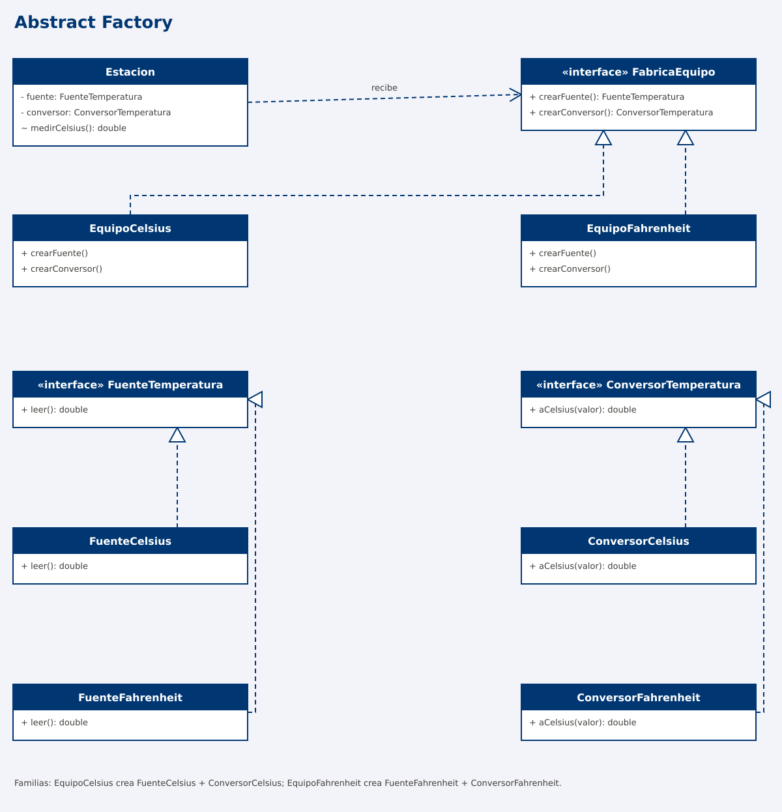
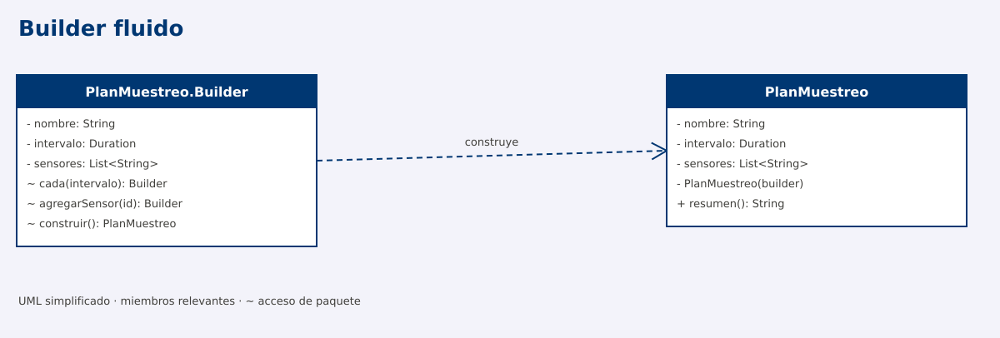
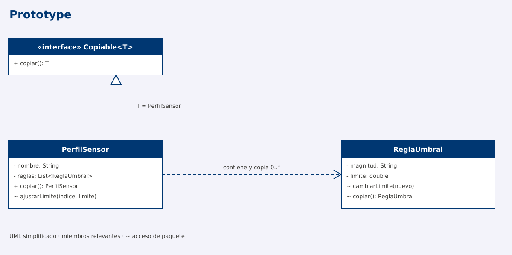
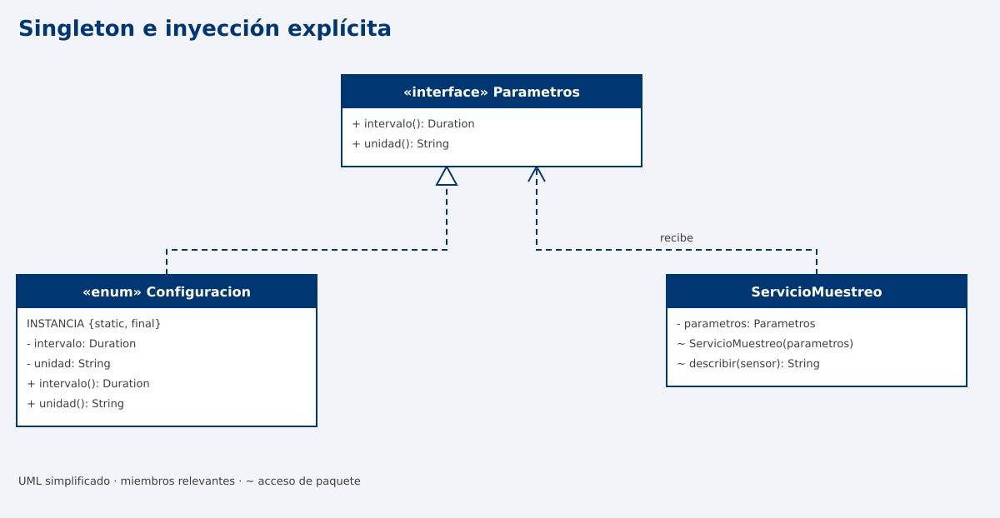

# Programación Aplicada
## 1.4a. Patrones creacionales


**Autor:** Ing. Pablo Torres, Mgtr.  
**Unidad:** 1. Programación genérica

Los patrones creacionales organizan la construcción, selección o reutilización de objetos. Cada patrón resuelve una variación diferente: el tipo concreto que se crea, la familia a la que pertenece, sus etapas de configuración, la copia de un estado existente o el control de una instancia compartida.

<a id="indice"></a>
## Índice

1. [Fundamentos](#fundamentos)
2. [Factory Method · Seleccionar un lector de datos](#factory-method)
3. [Abstract Factory · Crear equipos compatibles](#abstract-factory)
4. [Builder · Configurar un plan de muestreo](#builder)
5. [Prototype · Copiar perfiles de sensores](#prototype)
6. [Singleton · Compartir una configuración](#singleton)
7. [Comparación y criterios de elección](#comparacion)
8. [Referencias](#referencias)

<a id="fundamentos"></a>
## 1. Fundamentos

Un **patrón de diseño** describe una organización de responsabilidades y colaboraciones que resuelve un problema recurrente bajo determinadas condiciones. No es una clase lista para copiar ni una obligación de introducir interfaces en cualquier programa.

**Acoplamiento** es el grado de dependencia entre componentes. Si un servicio decide qué implementación construir, conoce su constructor y también la usa, cambiar esa implementación puede afectar varias partes del servicio. Una abstracción estable permite separar estas decisiones, a cambio de más tipos y relaciones.

**Producto** es el objeto que se obtiene; **creador** es el componente que lo suministra; **cliente** es quien lo utiliza. Estos nombres describen roles: un mismo objeto puede desempeñar más de uno. La creación concreta sigue necesitando constructores o mecanismos equivalentes; el patrón establece dónde reside esa decisión.

Los patrones no requieren genéricos. Estos pueden reforzar contratos de tipos, como `Copiable<PerfilSensor>`, pero añadir `<T>` no convierte por sí solo una clase en un patrón.

---
<a id="factory-method"></a>
## 2. Factory Method 

### Definición

**Factory Method** es un patrón de diseño creacional que define un método para crear objetos, pero permite que las subclases decidan qué clase concreta instanciar.

La clase base establece un proceso común y utiliza el objeto devuelto por el método fábrica, sin conocer su implementación concreta. Cada subclase sobrescribe ese método para proporcionar el objeto adecuado.

De esta manera, **se separa la lógica de creación de objetos de la lógica que los utiliza**, facilitando la incorporación de nuevas implementaciones sin modificar el proceso principal [1].

### Problema: importar formatos diferentes

Un proceso recibe líneas con identificador, valor y unidad. Un proveedor separa los campos con punto y coma; otro usa tabulaciones. En ambos casos se deben omitir líneas vacías, interpretar datos, validar lecturas y señalar en qué línea apareció un error.

Si cada formato implementa el proceso completo, se duplican el recorrido y el manejo de errores. Si el proceso instancia un lector concreto directamente, queda ligado a ese formato. La variación está en **cómo se interpreta una línea**, no en el flujo de importación.

### Solución y participantes

`Importador.importar()` conserva ese flujo. Solicita un `LectorLinea` mediante `crearLector()` y utiliza su operación `leer()`. La subclase del importador decide qué lector suministrar.

| Rol | Tipo del ejemplo | Responsabilidad |
|---|---|---|
| Producto | `LectorLinea` | Convertir una línea en `Lectura` |
| Productos concretos | `LectorPuntoComa`, `LectorTabulacion` | Interpretar su delimitador |
| Creador | `Importador` | Importar y contextualizar errores |
| Creadores concretos | `ImportadorPuntoComa`, `ImportadorTabulacion` | Sobrescribir `crearLector()` |
| Dato del dominio | `Lectura` | Mantener una medición válida |

`Lectura` no es el producto del Factory Method: el producto es el **lector**. La lectura es el resultado de utilizarlo. Esta distinción permite identificar el patrón aunque existan varios objetos creados durante la ejecución.

### Decisiones de implementación

El lector se solicita una vez por importación y se reutiliza en sus líneas. `importar()` es `final` para conservar el procedimiento del ejemplo; `crearLector()` es `protected abstract` para exigir una decisión a cada subclase. El creador podría proporcionar una implementación predeterminada si el diseño lo necesitara.

El cliente todavía debe seleccionar un creador concreto al configurar la aplicación. El patrón concentra esa selección; no elimina toda referencia a clases concretas. Un método estático con un `switch` puede ser una fábrica simple, pero no demuestra esta delegación mediante sobrescritura.

### Cuándo utilizarlo

Conviene cuando una jerarquía de servicios comparte un proceso, pero necesita variar un colaborador que crea. Incorporar un tercer formato exige otro lector y otro creador, sin cambiar el recorrido. Si solo existe un formato estable, el par adicional de jerarquías puede resultar innecesario. También sería posible recibir el lector por constructor: esa alternativa usa composición y evita crear una subclase del importador por cada variante.


### Estructura UML





### Implementación Java · Factory Method

**Código de referencia:** [FactoryMethodDemo.java](ejemplos/FactoryMethodDemo.java).

El ejemplo reúne las clases en un solo archivo para facilitar su ejecución. En un proyecto Java se recomienda organizarlas en archivos independientes, manteniendo las responsabilidades y relaciones del diagrama UML.

#### 1. Clases que deben implementarse

| Clase | Tipo | Responsabilidad |
|---|---|---|
| `Lectura` | Record | Representar una lectura con identificador, valor y unidad. Validar sus datos. |
| `LectorLinea` | Interfaz | Definir el contrato `leer(String linea): Lectura`. |
| `LectorPuntoComa` | Clase concreta | Implementar `LectorLinea` para procesar datos separados por `;`. |
| `LectorTabulacion` | Clase concreta | Implementar `LectorLinea` para procesar datos separados por tabulaciones. |
| `Importador` | Clase abstracta | Definir el proceso común de importación y declarar el Factory Method. |
| `ImportadorPuntoComa` | Creador concreto | Sobrescribir `crearLector()` para devolver un `LectorPuntoComa`. |
| `ImportadorTabulacion` | Creador concreto | Sobrescribir `crearLector()` para devolver un `LectorTabulacion`. |
| `FactoryMethodDemo` | Clase ejecutable | Demostrar el funcionamiento mediante `main()`. |

La función auxiliar `interpretar(String linea, String separador)` centraliza la conversión y validación de los campos. Puede mantenerse como método auxiliar en la demostración; no constituye el Factory Method.

#### 2. ¿Dónde se implementa el patrón?

**Creador abstracto: `Importador`**

Define dos operaciones principales:

- `crearLector()`: método abstracto que devuelve `LectorLinea`. Es el **Factory Method**.
- `importar(lineas)`: proceso común que obtiene un lector, recorre las líneas, omite las vacías y procesa las lecturas.

**Creadores concretos**

- `ImportadorPuntoComa` devuelve un objeto `LectorPuntoComa`.
- `ImportadorTabulacion` devuelve un objeto `LectorTabulacion`.

Cada subclase decide qué lector crear, sin modificar el algoritmo de importación.

**Productos**

La interfaz `LectorLinea` establece el contrato de lectura. Las clases `LectorPuntoComa` y `LectorTabulacion` proporcionan implementaciones diferentes.

#### 3. ¿Cómo funciona?

1. El cliente instancia un creador concreto, por ejemplo `ImportadorPuntoComa`.
2. Invoca el método heredado `importar(lineas)`.
3. `Importador` ejecuta `crearLector()` mediante polimorfismo.
4. La subclase devuelve el lector correspondiente.
5. `Importador` utiliza `lector.leer(linea)` para procesar cada registro.
6. El resultado se devuelve como una lista de objetos `Lectura`.

**Punto clave:** el proceso de importación permanece en la clase base; la selección del producto se delega a las subclases.

#### 4. Uso desde el cliente

```java
Importador importador = new ImportadorPuntoComa();

List<Lectura> resultado = importador.importar(
    List.of("S01;22.5;°C", "S02;18;personas")
);

System.out.println(resultado);
```

Para cambiar el formato de entrada, se selecciona otro creador:

```java
Importador importador = new ImportadorTabulacion();
```

El método `importar()` no necesita modificarse.

#### 5. Preguntas de análisis

1. ¿Por qué `crearLector()` devuelve `LectorLinea` y no `LectorPuntoComa`?
2. ¿Qué método contiene el algoritmo común y cuál es el Factory Method?
3. ¿Qué sucede si una subclase devuelve un lector diferente?
4. ¿Qué clases deben agregarse para admitir archivos delimitados por comas?
5. ¿Por qué no es necesario utilizar `if` o `switch` dentro de `importar()` para seleccionar el lector?

**Conclusión:** Factory Method permite reutilizar un proceso común y delegar en las subclases la creación del objeto que dicho proceso necesita.

### Salida y lectura de la ejecución

```text
[Lectura[idSensor=S01, valor=22.5, unidad=°C]]
[Lectura[idSensor=S02, valor=18.0, unidad=personas]]
Línea 1: Lectura inválida
```

La primera importación interpreta `;`; la segunda interpreta una tabulación. Ambas recorren los datos con el mismo método. `NaN` se convierte en un `double`, pero el constructor de `Lectura` lo rechaza porque no es finito. El importador añade el número de línea al error.

La secuencia relevante es `importar → crearLector → leer → new Lectura`. La llamada a `crearLector` se resuelve según el tipo concreto del importador, mientras el resto del proceso permanece estable.

### Comprobaciones y límites del ejemplo

- Una lista sin líneas produce una lista vacía. Una línea en blanco se omite.
- Dos campos en lugar de tres generan un error con el número de línea.
- Un identificador vacío o un valor infinito no generan una lectura válida.
- El formato es deliberadamente delimitado y simple: no admite comillas ni delimitadores escapados. No es un analizador CSV general.
- El contrato de entrada presupone una lista no nula con líneas no nulas. La validación de lecturas no sustituye la validación de un archivo o petición externa.

[Volver al índice](#indice)

---

<a id="abstract-factory"></a>
## 3. Abstract Factory · Crear equipos compatibles

### Definición

**Abstract Factory** ofrece operaciones para obtener varios tipos de productos de una misma familia. El cliente trabaja con las interfaces de fábrica y productos; cada fábrica concreta suministra una variante coordinada [2].

### Problema: una fuente debe corresponder a su conversor

Una estación utiliza una fuente de temperatura y un conversor a Celsius. Un equipo entrega Celsius; otro entrega Fahrenheit. Mezclar una fuente Fahrenheit con el conversor de Celsius no causa necesariamente un error de tipos: ambos intercambian `double`, pero el resultado sería físicamente incorrecto.

No se necesita elegir solo un objeto. Se necesita elegir **un conjunto coherente de colaboradores**. La unidad no está representada en el tipo `double`, por lo que la composición correcta importa.

### Solución y participantes

`FabricaEquipo` entrega una `FuenteTemperatura` y un `ConversorTemperatura`. `Estacion` recibe una fábrica y obtiene ambos productos de ella.

| Familia | Fuente concreta | Conversor concreto |
|---|---|---|
| Celsius | `FuenteCelsius` | `ConversorCelsius` |
| Fahrenheit | `FuenteFahrenheit` | `ConversorFahrenheit` |

Los dos contratos de producto son distintos: la fuente obtiene una muestra y el conversor interpreta su escala. `EquipoCelsius` y `EquipoFahrenheit` implementan la fábrica. `Estacion` es el cliente y no pregunta qué clase concreta recibió.

### Decisiones de implementación

Las fuentes devuelven muestras fijas para probar la composición. La transformación Fahrenheit–Celsius sí se calcula. Una implementación conectada a hardware sustituiría la fuente y definiría su gestión de recursos, tiempos de espera y errores de lectura.

La familia es una garantía del diseño de cada fábrica, no una propiedad que Java verifique automáticamente aquí. Una fábrica mal implementada podría mezclar productos. Por eso se comprueba que `77 °F` se interpreten como `25 °C`. Con dominios más estrictos se pueden representar las unidades mediante tipos específicos.

### Cuándo utilizarlo

Conviene cuando cambia un conjunto de componentes relacionados: proveedor, protocolo, plataforma o familia de equipos. Añadir una familia Kelvin requeriría su fuente, conversor y fábrica; `Estacion` seguiría usando los mismos contratos. Añadir un nuevo tipo de producto, como un calibrador, exigiría modificar la interfaz de fábrica y todas sus implementaciones.

La diferencia con Factory Method es el eje de variación. Allí un creador especializa una operación de construcción dentro de un proceso. Aquí un cliente recibe un objeto fábrica que suministra varios productos coordinados. Ambos patrones pueden coexistir, pero no son sinónimos.

### Estructura UML



[Fuente editable del diagrama](assets/abstract-factory.puml). El dibujo omite los contenedores externos `*Demo` y algunas operaciones auxiliares.

### Implementación Java comentada

**Archivo:** [AbstractFactoryDemo.java](ejemplos/AbstractFactoryDemo.java).

```java
package edu.ups.pap.u01.patrones.creacionales;

import java.util.Locale;
import java.util.Objects;

/** Crea una fuente y un conversor compatibles como una sola familia. */
public class AbstractFactoryDemo {
    interface FuenteTemperatura { double leer(); }
    interface ConversorTemperatura { double aCelsius(double valor); }

    /** Fábrica abstracta: dos tipos de producto que deben trabajar juntos. */
    interface FabricaEquipo {
        FuenteTemperatura crearFuente();
        ConversorTemperatura crearConversor();
    }

    // Fuentes simuladas: permiten probar las conversiones sin hardware.
    static final class FuenteCelsius implements FuenteTemperatura {
        @Override
        public double leer() { return 25.0; }
    }

    static final class FuenteFahrenheit implements FuenteTemperatura {
        @Override
        public double leer() { return 77.0; }
    }

    static final class ConversorCelsius implements ConversorTemperatura {
        @Override
        public double aCelsius(double valor) { return valor; }
    }

    static final class ConversorFahrenheit implements ConversorTemperatura {
        @Override
        public double aCelsius(double valor) { return (valor - 32) * 5.0 / 9.0; }
    }

    static final class EquipoCelsius implements FabricaEquipo {
        @Override
        public FuenteTemperatura crearFuente() { return new FuenteCelsius(); }
        @Override
        public ConversorTemperatura crearConversor() { return new ConversorCelsius(); }
    }

    static final class EquipoFahrenheit implements FabricaEquipo {
        @Override
        public FuenteTemperatura crearFuente() { return new FuenteFahrenheit(); }
        @Override
        public ConversorTemperatura crearConversor() { return new ConversorFahrenheit(); }
    }

    /** Cliente: solo obtiene los productos mediante una misma fábrica. */
    static final class Estacion {
        private final FuenteTemperatura fuente;
        private final ConversorTemperatura conversor;

        Estacion(FabricaEquipo fabrica) {
            Objects.requireNonNull(fabrica, "Fábrica obligatoria");
            fuente = Objects.requireNonNull(fabrica.crearFuente());
            conversor = Objects.requireNonNull(fabrica.crearConversor());
        }

        double medirCelsius() {
            double valor = conversor.aCelsius(fuente.leer());
            if (!Double.isFinite(valor)) {
                throw new IllegalStateException("Medición no finita");
            }
            return valor;
        }
    }

    public static void main(String[] args) {
        Estacion local = new Estacion(new EquipoCelsius());
        Estacion importada = new Estacion(new EquipoFahrenheit());
        System.out.printf(Locale.ROOT, "Equipo Celsius: %.1f °C%n", local.medirCelsius());
        System.out.printf(Locale.ROOT, "Equipo Fahrenheit: %.1f °C%n", importada.medirCelsius());
        // Si se mezclara FuenteFahrenheit con ConversorCelsius,
        // 77 °F se interpretarían incorrectamente como 77 °C.
    }
}
```

### Salida y lectura de la ejecución

```text
Equipo Celsius: 25.0 °C
Equipo Fahrenheit: 25.0 °C
```

Los equipos proporcionan muestras distintas: `25.0` y `77.0`. Las estaciones publican el mismo resultado porque cada fuente está asociada a su conversor. El cliente realiza `fuente.leer()` y después `conversor.aCelsius(...)`; no selecciona la fórmula con un condicional.

El punto de cambio es la fábrica entregada al constructor. Esta recibe la responsabilidad de componer la familia completa.

### Comprobaciones y límites del ejemplo

- Ambas familias deben devolver `25.0 °C` con las muestras del ejemplo.
- Al crear `Estacion` con una fábrica nula se rechaza la construcción.
- Si una fuente devuelve un valor no finito, `medirCelsius` lo rechaza.
- Las fuentes son simuladas; la salida no demuestra comunicación real con un dispositivo.
- Probar cada familia es indispensable: la interfaz común no detecta una fórmula o una pareja de productos equivocadas.

[Volver al índice](#indice)

---

<a id="builder"></a>
## 4. Builder · Configurar un plan de muestreo

### Definición

**Builder** separa la preparación progresiva de un producto de su obtención final. Acumula decisiones de construcción y entrega el objeto cuando se cumplen sus condiciones. En el diseño clásico puede existir un director que ordena pasos y varios builders que producen representaciones diferentes [3].

### Problema: configuraciones parcialmente válidas

Un plan de muestreo necesita nombre, intervalo y sensores. Crear el plan con un constructor vacío y agregar datos después permite que otros componentes reciban un plan incompleto. Un constructor con numerosas opciones, por otra parte, resulta difícil de leer y extender.

La necesidad no es elegir una subclase: es **reunir y validar una configuración antes de publicarla**. El plan debe contener al menos un sensor y un intervalo mínimo de un segundo; los identificadores no pueden repetirse.

### Solución y participantes

El builder conserva el estado provisional. Los métodos `cada()` y `agregarSensor()` lo configuran; `construir()` verifica las condiciones finales y crea `PlanMuestreo`.

| Rol | Tipo u operación | Responsabilidad |
|---|---|---|
| Producto | `PlanMuestreo` | Mantener el plan construido |
| Builder concreto | `PlanMuestreo.Builder` | Reunir nombre, intervalo y sensores |
| Etapas | `cada`, `agregarSensor` | Configurar opciones legibles |
| Terminación | `construir` | Validar y crear el producto |
| Cliente | `main` | Elegir los pasos y solicitar el resultado |

### Variante fluida y director

El ejemplo utiliza la variante **builder fluido**: cada etapa devuelve `this` para encadenar llamadas. Encadenar métodos no es suficiente para demostrar Builder; aquí existe además un producto separado que se obtiene al finalizar. No se necesita una interfaz de builder porque solo se construye una representación.

Un director sería una clase que conoce recetas repetidas, por ejemplo un plan de laboratorio con intervalo de diez segundos y sensores predeterminados. Usaría las operaciones del builder sin asumir su almacenamiento interno. Solo tendría sentido incorporarlo si esas secuencias se reutilizan. El ejemplo conserva esa responsabilidad en `main`.

### Inmutabilidad y validación

El builder es mutable y se puede reutilizar. El producto mantiene campos `final`, usa tipos inmutables para nombre e intervalo y copia la lista mediante `List.copyOf`. Como los elementos son cadenas inmutables, no hace falta duplicarlos. Cambiar el builder no modifica un plan ya construido.

Se valida el identificador al agregarlo y las condiciones globales al construir. El constructor del producto es privado para evitar que otros clientes omitan este proceso. Que una clase se construya con Builder no garantiza por sí mismo que sea inmutable.

### Cuándo utilizarlo

Es útil con opciones, valores predeterminados y restricciones conjuntas. Para una lectura de solo tres campos obligatorios puede bastar un constructor o un `record` validado. El costo consiste en mantener otro objeto mutable y una API de configuración. El builder del ejemplo no está diseñado para compartirse entre hilos.

### Estructura UML



[Fuente editable del diagrama](assets/builder.puml). El dibujo omite los contenedores externos `*Demo` y algunas operaciones auxiliares.

### Implementación Java comentada

**Archivo:** [BuilderDemo.java](ejemplos/BuilderDemo.java).

```java
package edu.ups.pap.u01.patrones.creacionales;

import java.time.Duration;
import java.util.ArrayList;
import java.util.List;
import java.util.Objects;

/** Construye una configuración válida antes de entregarla al servicio. */
public class BuilderDemo {
    static final class PlanMuestreo {
        private final String nombre;
        private final Duration intervalo;
        private final List<String> sensores;

        private PlanMuestreo(Builder builder) {
            nombre = builder.nombre;
            intervalo = builder.intervalo;
            sensores = List.copyOf(builder.sensores); // Copia defensiva.
        }

        public String resumen() {
            return nombre + " | " + intervalo.toSeconds() + " s | " + sensores;
        }

        /** Builder mutable: todavía no representa un plan ejecutable. */
        static final class Builder {
            private final String nombre;
            private Duration intervalo = Duration.ofSeconds(30);
            private final List<String> sensores = new ArrayList<>();

            Builder(String nombre) {
                if (nombre == null || nombre.isBlank()) {
                    throw new IllegalArgumentException("Nombre obligatorio");
                }
                this.nombre = nombre;
            }

            Builder cada(Duration intervalo) {
                this.intervalo = Objects.requireNonNull(intervalo);
                return this;
            }

            Builder agregarSensor(String id) {
                if (id == null || id.isBlank()) {
                    throw new IllegalArgumentException("Identificador obligatorio");
                }
                if (sensores.contains(id)) {
                    throw new IllegalArgumentException("Sensor duplicado: " + id);
                }
                sensores.add(id);
                return this;
            }

            PlanMuestreo construir() {
                // Invariantes del producto: no se entrega un plan incompleto.
                if (intervalo.compareTo(Duration.ofSeconds(1)) < 0) {
                    throw new IllegalArgumentException("Intervalo mínimo: 1 segundo");
                }
                if (sensores.isEmpty()) {
                    throw new IllegalArgumentException("Agrega al menos un sensor");
                }
                return new PlanMuestreo(this);
            }
        }
    }

    public static void main(String[] args) {
        PlanMuestreo.Builder builder = new PlanMuestreo.Builder("Laboratorio")
                .cada(Duration.ofSeconds(10)).agregarSensor("S01");
        PlanMuestreo primero = builder.construir();
        PlanMuestreo segundo = builder.agregarSensor("S02").construir();
        // Reutilizar el builder no cambia el producto que ya fue creado.
        System.out.println(primero.resumen());
        System.out.println(segundo.resumen());
        try {
            new PlanMuestreo.Builder("Vacío").construir();
        } catch (IllegalArgumentException error) {
            System.out.println(error.getMessage());
        }
    }
}
```

### Salida y lectura de la ejecución

```text
Laboratorio | 10 s | [S01]
Laboratorio | 10 s | [S01, S02]
Agrega al menos un sensor
```

El primer plan contiene únicamente `S01`. Después se agrega `S02` al builder y se construye otro plan. La primera salida conserva su contenido, lo que demuestra la separación del producto respecto al estado provisional.

La tercera salida corresponde a un intento de construir sin sensores. No se devuelve un plan inválido para que otra clase lo corrija posteriormente.

### Comprobaciones y límites del ejemplo

- Agregar dos veces `S01` debe producir un error de identificador duplicado.
- Un intervalo menor que un segundo debe impedir la construcción.
- Omitir `cada()` utiliza el valor predeterminado de treinta segundos.
- Un plan ya construido debe permanecer igual después de reutilizar su builder.
- La demostración construye configuración; no inicia un temporizador ni ejecuta tareas periódicas.

[Volver al índice](#indice)

---

<a id="prototype"></a>
## 5. Prototype · Copiar perfiles de sensores

### Definición

**Prototype** permite crear un objeto a partir de otro previamente configurado mediante una operación de copia. El tipo que posee el estado define cómo duplicarlo; el cliente solicita la copia sin reconstruir cada detalle de su configuración [4].

### Problema: personalizar una configuración existente

Un perfil contiene reglas para temperatura y humedad. Varios laboratorios parten de un perfil aprobado, pero algunos necesitan cambiar un umbral. Reconstruir las reglas en cada cliente duplica valores predeterminados. Asignar `copia = original`, en cambio, comparte el mismo perfil: modificar uno modifica lo observado por el otro.

La solución debe crear un perfil distinto y también independizar sus **reglas mutables**. Copiar solo la lista no basta si sus elementos siguen siendo los mismos objetos.

### Solución y participantes

`Copiable<T>` declara la operación. `PerfilSensor` implementa `Copiable<PerfilSensor>` y crea una copia de sí mismo. `ReglaUmbral` conoce cómo duplicar su magnitud y límite. El cliente modifica únicamente el resultado de `copiar()`.

| Elemento | Decisión de copia |
|---|---|
| Objeto `PerfilSensor` | Crear una instancia nueva |
| Lista de reglas | Crear una lista nueva |
| Cada `ReglaUmbral` | Crear un objeto nuevo porque su límite es mutable |
| Cadenas de nombre y magnitud | Compartir referencias porque son inmutables |
| Límite `double` | Copiar el valor primitivo |

### Copia superficial y profunda

Una **copia superficial** duplica el contenedor, pero conserva referencias a objetos internos. Una **copia profunda** duplica también el estado mutable que debe ser independiente. El alcance debe definirse para cada modelo: no significa copiar indiscriminadamente todo lo alcanzable desde un objeto.

En este caso el grafo es simple: perfil, lista y reglas. `copiar()` duplica cada regla, por lo que cambiar el límite de la copia no altera el original. No se usa `Cloneable` ni `Object.clone()`; un método explícito permite expresar y verificar mejor este contrato.

### Identidad, recursos y registros de prototipos

Copiar una plantilla no debe interpretarse automáticamente como duplicar la identidad de una entidad persistida. En otro modelo, un identificador de base de datos podría necesitar regenerarse. Tampoco se deberían copiar directamente conexiones, archivos abiertos o hilos.

Un registro de prototipos puede mantener perfiles por nombre y devolver `perfil.copiar()` cuando se solicita una variante. Ese registro no es obligatorio y no aparece en el ejemplo: primero se demuestra la independencia de la copia sin añadir otra responsabilidad.

### Cuándo utilizarlo

Conviene cuando la configuración inicial es extensa, se modifica a partir de plantillas o el cliente no debe conocer todos los detalles de construcción. Su principal costo es especificar y mantener la política de copia. Añadir un nuevo atributo mutable obliga a revisar `copiar()`. Para este perfil, copiar n reglas requiere tiempo y espacio adicionales O(n).

### Estructura UML



[Fuente editable del diagrama](assets/prototype.puml). El dibujo omite los contenedores externos `*Demo` y algunas operaciones auxiliares.

### Implementación Java comentada

**Archivo:** [PrototypeDemo.java](ejemplos/PrototypeDemo.java).

```java
package edu.ups.pap.u01.patrones.creacionales;

import java.util.ArrayList;
import java.util.List;

/** Duplica un perfil y sus reglas mutables para configurarlos por separado. */
public class PrototypeDemo {
    interface Copiable<T> { T copiar(); }

    static final class ReglaUmbral {
        private final String magnitud;
        private double limite;

        ReglaUmbral(String magnitud, double limite) {
            if (magnitud == null || magnitud.isBlank()) {
                throw new IllegalArgumentException("Magnitud obligatoria");
            }
            this.magnitud = magnitud;
            cambiarLimite(limite);
        }

        void cambiarLimite(double nuevo) {
            if (!Double.isFinite(nuevo)) {
                throw new IllegalArgumentException("Límite no finito");
            }
            limite = nuevo;
        }

        ReglaUmbral copiar() { return new ReglaUmbral(magnitud, limite); }

        @Override
        public String toString() { return magnitud + " > " + limite; }
    }

    static final class PerfilSensor implements Copiable<PerfilSensor> {
        private String nombre;
        private final List<ReglaUmbral> reglas = new ArrayList<>();

        PerfilSensor(String nombre) { renombrar(nombre); }

        void renombrar(String nuevo) {
            if (nuevo == null || nuevo.isBlank()) {
                throw new IllegalArgumentException("Nombre obligatorio");
            }
            nombre = nuevo;
        }

        void agregarRegla(String magnitud, double limite) {
            reglas.add(new ReglaUmbral(magnitud, limite));
        }

        void ajustarLimite(int indice, double limite) {
            reglas.get(indice).cambiarLimite(limite);
        }

        @Override
        public PerfilSensor copiar() {
            PerfilSensor copia = new PerfilSensor(nombre);
            // No basta new ArrayList<>(reglas): compartiría las reglas mutables.
            for (ReglaUmbral regla : reglas) {
                copia.reglas.add(regla.copiar());
            }
            return copia;
        }

        @Override
        public String toString() { return nombre + ": " + reglas; }
    }

    public static void main(String[] args) {
        PerfilSensor base = new PerfilSensor("Base");
        base.agregarRegla("temperatura", 28.0);
        base.agregarRegla("humedad", 70.0);

        // El cliente no reconstruye la configuración de cada regla.
        PerfilSensor laboratorio = base.copiar();
        laboratorio.renombrar("Laboratorio");
        laboratorio.ajustarLimite(0, 25.0);

        System.out.println(base);
        System.out.println(laboratorio);
        System.out.println("Mismo perfil: " + (base == laboratorio));
    }
}
```

### Salida y lectura de la ejecución

```text
Base: [temperatura > 28.0, humedad > 70.0]
Laboratorio: [temperatura > 25.0, humedad > 70.0]
Mismo perfil: false
```

El perfil del laboratorio reduce el límite de temperatura a `25.0`; el original conserva `28.0`. Ambos mantienen la regla de humedad. La comparación de referencias confirma que son perfiles distintos, pero esa comparación por sí sola no probaría una copia profunda: la evidencia decisiva es cambiar una regla interna y comprobar que la original no cambió.

### Comprobaciones y límites del ejemplo

- Cambiar una regla de la copia no debe modificar la misma posición del original.
- Agregar otra regla a la copia tampoco debe cambiar el tamaño de la lista original.
- Los límites deben ser finitos. Un índice fuera del rango produce la excepción de la lista.
- El ejemplo copia configuración, no mide sensores ni ejecuta las reglas.
- Esta política está definida para estos campos; un grafo con ciclos o referencias compartidas requeriría una estrategia adicional.

[Volver al índice](#indice)

---

<a id="singleton"></a>
## 6. Singleton · Compartir una configuración

### Definición

**Singleton** restringe la disponibilidad de una clase a una única instancia dentro de un ámbito y proporciona un punto de acceso a ella. La intención combina control de creación y acceso compartido; no convierte automáticamente el estado en inmutable ni seguro frente a concurrencia [5].

### Problema: una configuración común

Varios servicios necesitan conocer el intervalo predeterminado y la unidad de medida. Si cada servicio crea o modifica una configuración distinta, las decisiones pueden divergir. Se quiere compartir una configuración estable, manteniendo la posibilidad de probar el servicio con otros parámetros.

Antes de aplicar el patrón hay que distinguir dos necesidades: **compartir un objeto** y **prohibir múltiples instancias de una clase**. La primera suele resolverse creando una instancia al inicio y pasándola por constructor. Singleton añade una restricción más fuerte y un punto de acceso global.

### Solución y participantes

`Configuracion` es un `enum` con una sola constante, `INSTANCIA`. Sus datos son inmutables. `ServicioMuestreo` recibe el contrato `Parametros`, no consulta internamente el acceso global. El punto de composición, `main`, decide entregarle la configuración compartida o una implementación de prueba.

| Rol | Tipo u operación | Responsabilidad |
|---|---|---|
| Singleton | `Configuracion` | Exponer su única constante y sus valores |
| Acceso | `Configuracion.INSTANCIA` | Obtener la referencia compartida |
| Contrato de consumo | `Parametros` | Declarar lo que necesita el servicio |
| Cliente | `ServicioMuestreo` | Utilizar parámetros recibidos explícitamente |

### Variante Java y alcance

La constante se inicializa al inicializarse su clase. El cliente no puede invocar un constructor de enum con `new`. La variante evita implementar manualmente un acceso con comprobaciones de `null` y bloqueos. No necesita un método llamado `getInstance()` para representar el patrón.

La unicidad corresponde a esa clase cargada. Otra JVM o una copia de la clase cargada por otro cargador puede tener su propia instancia; no hay coordinación distribuida. Si se añadieran colecciones mutables o contadores, habría que diseñar su sincronización aunque la instancia se inicialice correctamente.

### Dependencias y pruebas

Una llamada a `Configuracion.INSTANCIA` dentro de cada servicio oculta el origen de los parámetros y dificulta sustituirlos. Recibir `Parametros` por constructor hace visible la dependencia. El ejemplo usa Singleton en la composición y composición explícita en el consumidor: son decisiones compatibles.

La implementación alternativa de `Parametros` no es otra instancia de `Configuracion`; es un objeto de prueba que cumple el mismo contrato. Así se prueba el servicio con un intervalo de un segundo sin modificar estado global ni afectar otros consumidores.

### Cuándo utilizarlo

Puede servir para un servicio verdaderamente único dentro de una aplicación y con ciclo de vida definido. No debe utilizarse como sustituto general de variables globales. El estado global mutable dificulta aislamiento, orden de pruebas y concurrencia.

Una conexión JDBC no es un buen reemplazo directo de este ejemplo: una conexión tiene transacciones, cierres y posibles restricciones de concurrencia. Compartir un proveedor o un pool no equivale a mantener una única conexión global. Tampoco Singleton garantiza que un temporizador se ejecute una sola vez en varios servidores.

### Estructura UML



[Fuente editable del diagrama](assets/singleton.puml). El dibujo omite los contenedores externos `*Demo` y algunas operaciones auxiliares.

### Implementación Java comentada

**Archivo:** [SingletonDemo.java](ejemplos/SingletonDemo.java).

```java
package edu.ups.pap.u01.patrones.creacionales;

import java.time.Duration;
import java.util.Objects;

/** Un único objeto de configuración, accesible a través de un enum. */
public class SingletonDemo {
    // Contrato pequeño: los servicios no necesitan conocer el Singleton.
    interface Parametros {
        Duration intervalo();
        String unidad();
    }

    enum Configuracion implements Parametros {
        INSTANCIA;

        private final Duration intervalo = Duration.ofSeconds(30);
        private final String unidad = "°C";

        @Override
        public Duration intervalo() { return intervalo; }
        @Override
        public String unidad() { return unidad; }
    }

    /** Dependencia explícita: también permite recibir una configuración de prueba. */
    static final class ServicioMuestreo {
        private final Parametros parametros;

        ServicioMuestreo(Parametros parametros) {
            this.parametros = Objects.requireNonNull(parametros);
        }

        String describir(String sensor) {
            return sensor + ": cada " + parametros.intervalo().toSeconds()
                    + " s, unidad " + parametros.unidad();
        }
    }

    public static void main(String[] args) {
        Configuracion primera = Configuracion.INSTANCIA;
        Configuracion segunda = Configuracion.INSTANCIA;
        System.out.println("Misma instancia: " + (primera == segunda));
        ServicioMuestreo servicio = new ServicioMuestreo(primera);
        System.out.println(servicio.describir("S01"));

        // Sustituto de prueba: el servicio no llama al Singleton internamente.
        Parametros prueba = new Parametros() {
            public Duration intervalo() { return Duration.ofSeconds(1); }
            public String unidad() { return "°F"; }
        };
        System.out.println(new ServicioMuestreo(prueba).describir("TEST"));
    }
}
```

### Salida y lectura de la ejecución

```text
Misma instancia: true
S01: cada 30 s, unidad °C
TEST: cada 1 s, unidad °F
```

Las dos referencias de configuración son idénticas. El primer servicio utiliza los valores compartidos: treinta segundos y Celsius. El segundo recibe parámetros de prueba: un segundo y Fahrenheit. Esto verifica tanto la identidad del Singleton como la independencia del consumidor respecto a su acceso global.

### Comprobaciones y límites del ejemplo

- `primera == segunda` debe ser `true` al acceder a la misma constante.
- Sustituir `Parametros` debe cambiar el resultado sin modificar `ServicioMuestreo`.
- Pasar parámetros nulos debe impedir construir el servicio.
- No se abren conexiones ni se inicia un proceso de muestreo: se describe su configuración.
- La prueba no demuestra exclusión mutua, ejecución distribuida ni seguridad de futuros campos mutables.

[Volver al índice](#indice)

---
<a id="comparacion"></a>
## 7. Comparación y criterios de elección

| Pregunta de diseño | Patrón | Cambio localizado en el ejemplo |
|---|---|---|
| ¿Qué implementación necesita mi proceso heredado? | Factory Method | Subclase del importador |
| ¿Qué productos deben elegirse juntos? | Abstract Factory | Fábrica del equipo |
| ¿Cómo reúno opciones antes de entregar un objeto válido? | Builder | Etapas y validación del plan |
| ¿Cómo obtengo una variante independiente de una configuración? | Prototype | Operación de copia del perfil |
| ¿Necesito restringir una clase a una instancia accesible? | Singleton | Constante de configuración |

### Relaciones y errores frecuentes

- **Factory Method y Abstract Factory:** comparten la creación mediante abstracciones, pero varían una operación y una familia, respectivamente.
- **Builder y Prototype:** el primero reúne decisiones para un producto nuevo; el segundo parte del estado de un objeto existente.
- **Builder y Singleton:** uno controla cómo se construye; el otro restringe la instancia disponible. Ninguno garantiza inmutabilidad por su nombre.
- **Genéricos y patrones:** `Copiable<T>` conserva el tipo del resultado; el patrón sigue siendo la delegación de la copia al objeto configurado.
- **`new` y acoplamiento:** no es necesario eliminar todos los constructores. Lo relevante es que las decisiones cambiantes no se dispersen entre consumidores.

Para seleccionar un patrón, identifica el cambio esperado, el contrato que permanecerá estable y el costo de los tipos adicionales. Si el problema se resuelve claramente con un constructor y una dependencia explícita, no es necesario introducir otra estructura.

<a id="referencias"></a>
## 8. Referencias

1. Refactoring.Guru. [Factory Method](https://refactoring.guru/es/design-patterns/factory-method).
2. Refactoring.Guru. [Abstract Factory](https://refactoring.guru/es/design-patterns/abstract-factory).
3. Refactoring.Guru. [Builder](https://refactoring.guru/es/design-patterns/builder).
4. Refactoring.Guru. [Prototype](https://refactoring.guru/es/design-patterns/prototype).
5. Refactoring.Guru. [Singleton](https://refactoring.guru/es/design-patterns/singleton).
6. Gamma, E.; Helm, R.; Johnson, R.; Vlissides, J. *Design Patterns: Elements of Reusable Object-Oriented Software*. Addison-Wesley, 1994.
7. Java SE 17. [API oficial](https://docs.oracle.com/en/java/javase/17/docs/api/index.html): `List`, `Duration`, `Objects`, `Double` y `Enum`.

Las referencias orientan la terminología y la clasificación. Los ejemplos Java, sus datos, el análisis de ejecución y los diagramas de este material son originales. No se reproducen las ilustraciones ni el pseudocódigo del libro *Sumérgete en los patrones de diseño*.
