# Programación Aplicada


## 1.4b. Patrones estructurales


**Autor:** Ing. Pablo Torres, Mgtr.  
**Unidad:** 1. Programación genérica  
**Tema:** 1.4. Patrones de diseño · Patrones estructurales

Los patrones estructurales organizan las relaciones entre clases y objetos. Permiten integrar componentes, separar dimensiones de cambio, representar jerarquías y distribuir responsabilidades sin concentrarlas en una sola clase. Cada patrón responde a una intención distinta; utilizar composición no significa que todos sean intercambiables.

Este material presenta siete patrones mediante problemas de sensores, lecturas, reportes y catálogos. Cada apartado integra teoría, estructura, explicación de la implementación y análisis. El código completo y comentado se encuentra exclusivamente en los archivos Java enlazados.

<a id="indice"></a>

## Índice

1. [Fundamentos y uso del material](#fundamentos)
2. [Adapter · Integrar un termómetro legado](#adapter)
3. [Bridge · Separar reportes y formatos](#bridge)
4. [Composite · Organizar sensores por zonas](#composite)
5. [Decorator · Combinar calibración y auditoría](#decorator)
6. [Facade · Coordinar la importación de lecturas](#facade)
7. [Flyweight · Compartir metadatos de sensores](#flyweight)
8. [Proxy · Controlar el acceso a un catálogo](#proxy)
9. [Comparación y criterios de elección](#comparacion)
10. [Referencias](#referencias)

<a id="fundamentos"></a>

## 1. Fundamentos y uso del material

Un **patrón de diseño** describe una solución recurrente en términos de responsabilidades, relaciones y consecuencias. No es una receta obligatoria ni un nombre que se asigna a cualquier clase con una interfaz. Para justificarlo es necesario identificar qué problema existe, qué variación se desea aislar y qué costo introduce la solución.

La familia **estructural** estudia cómo se conectan los componentes. La familia creacional se concentra en la provisión de objetos; la de comportamiento, en algoritmos y coordinación de responsabilidades. Estas intenciones pueden coexistir en un diseño. Una fábrica utilizada por un Flyweight no convierte toda la solución en un patrón creacional.

### 1.1. Conceptos necesarios

| Concepto | Significado técnico | Consecuencia en el diseño |
|---|---|---|
| Contrato | Operaciones y condiciones que un componente ofrece a sus clientes. | Compartir firmas no basta: también deben respetarse unidades, errores y significado del resultado. |
| Composición de objetos | Construir una funcionalidad mediante referencias a colaboradores. | Permite combinar objetos sin crear una subclase para cada combinación. |
| Delegación | Encargar una operación a otro objeto. | La responsabilidad se distribuye; el receptor puede traducir, coordinar, ampliar o controlar la llamada. |
| Herencia | Especializar un tipo mediante una relación de subtipo. | Debe conservar un comportamiento compatible con el contrato del tipo base. |
| Acoplamiento | Dependencia que un componente mantiene respecto de otro. | Una dependencia estable puede limitar el impacto de los cambios, pero no elimina la dependencia. |
| Cohesión | Relación entre las responsabilidades reunidas en un componente. | Una clase enfocada en una tarea resulta más fácil de explicar, probar y modificar. |

Una interfaz adicional tiene un costo: más tipos, más relaciones y más decisiones de composición. Resulta útil cuando representa una variación real, no únicamente para aumentar el número de capas.

Los genéricos pueden expresar relaciones entre tipos, pero **ninguno de estos patrones exige genéricos**. En los ejemplos se usan listas, mapas y un proveedor tipado donde ayudan a representar el problema; no se añade un parámetro de tipo artificial a cada clase.


---

<a id="adapter"></a>

## 2. Adapter

### Definición

**Adapter** presenta un objeto existente mediante el contrato que necesita otro componente. Traduce operaciones, parámetros, resultados o errores entre interfaces incompatibles, sin exigir que el cliente conozca esa incompatibilidad [1].

**Idea principal:** situar la traducción en una frontera explícita y mantener el cliente ligado a su propio contrato.

### 2.1. ¿Qué problema resuelve?

Cuando dos clases o componentes tienen interfaces incompatibles, no pueden colaborar directamente, aunque sus funcionalidades sean compatibles.
Modificar las interfaces existentes puede resultar costoso o imposible, especialmente cuando pertenecen a bibliotecas externas o sistemas que ya están en funcionamiento.
El patrón Adapter resuelve este problema mediante una clase intermediaria que convierte la interfaz de un componente en otra que el cliente espera, permitiendo su integración sin modificar las implementaciones originales.

### 2.2. Estructura y participantes

| Participante | Responsabilidad |
|---|---|
| Cliente | Utilizar una operación conforme al contrato que necesita. |
| Interfaz objetivo | Describir la operación esperada por el cliente. |
| Adaptado | Ofrecer una funcionalidad útil mediante una interfaz incompatible. |
| Adaptador | Implementar el contrato objetivo y delegar en el adaptado con las conversiones necesarias. |

El ejemplo utiliza **adaptación de objetos**, basada en una referencia al equipo. La adaptación mediante herencia es otra variante, pero no es necesaria aquí. En Java, además, no puede heredarse de dos clases concretas simultáneamente.

### 2.3. ¿Cuándo utilizarlo?

Es apropiado para incorporar bibliotecas externas, servicios antiguos o dispositivos cuyo contrato no coincide con el de la aplicación. La adaptación puede involucrar unidades, nombres de campos, formatos o excepciones.

No se necesita un adaptador si las interfaces ya son compatibles y no hay traducción que realizar. Tampoco corresponde convertirlo en un lugar donde acumular reglas ajenas a la integración, como la política de alertas de toda la estación.

### 2.4. Caso práctico: décimas de Fahrenheit

El equipo devuelve `770`, equivalente a 77,0 °F. La estación debe recibir 25,0 °C. El dato `-9999` significa que no hay una lectura disponible y no debe convertirse como si fuera una temperatura.

La conversión tiene dos etapas: dividir entre 10,0 para recuperar Fahrenheit y aplicar `C = (F − 32) × 5 / 9`. El adaptador comprueba primero el código de error. Esa secuencia evita producir un número aparentemente válido a partir de un fallo del equipo.

### 2.5. Estructura UML



| Rol | Tipo del ejemplo |
|---|---|
| Cliente | `Estacion` |
| Objetivo | `SensorTemperatura` |
| Adaptado | `TermometroLegado` |
| Adaptador | `AdaptadorFahrenheit` |

`Estacion` mantiene una asociación con `SensorTemperatura`. `AdaptadorFahrenheit` realiza esa interfaz y mantiene otra asociación con `TermometroLegado`. El diagrama no presenta una relación de herencia entre el adaptador y el equipo: la colaboración ocurre por delegación.

### 2.6. Implementación del ejemplo en Java

**Código completo y comentado:** [AdapterDemo.java](ejemplos/AdapterDemo.java).

| Tipo | Responsabilidad concreta |
|---|---|
| `SensorTemperatura` · interfaz | Declarar `leerCelsius()` como operación consumida por la estación. |
| `TermometroLegado` · clase | Simular el protocolo mediante `obtenerDecimasFahrenheit()`. |
| `AdaptadorFahrenheit` · clase | Validar la presencia del equipo, traducir el código de error y convertir la unidad. |
| `Estacion` · clase | Solicitar una medición sin conocer Fahrenheit ni el código especial. |

El contrato se mantiene en un solo lugar. El método de la estación no contiene una condición para detectar el tipo del dispositivo. El constructor del adaptador rechaza una referencia nula, mientras que el error del protocolo produce una `IllegalStateException` al solicitar la medición.

### 2.7. ¿Cómo se utiliza el patrón?

1. `main()` crea el equipo simulado y lo entrega al adaptador.
2. La estación recibe ese adaptador mediante `SensorTemperatura`.
3. `medir()` invoca `leerCelsius()`.
4. El adaptador solicita el entero al equipo, comprueba el error y convierte el resultado.
5. La estación recibe un `double` en Celsius.

El segundo caso crea un equipo que entrega el código de fallo. La misma ruta termina en una excepción descriptiva, capturada en `main()` para mostrarla.

### 2.8. Resultado de la ejecución

```text
Temperatura: 25.0 °C
Error: Equipo sin lectura
```

La primera línea confirma que la traducción incluye la escala, no solo el nombre del método. La segunda confirma que el adaptador no presenta un error del equipo como una lectura legítima.

### 2.9. Análisis

**Preguntas:**

1. ¿Por qué dividir entre 10 en lugar de 10,0 puede perder información para una muestra como `775`?
2. ¿Qué tipo debería cambiar si un nuevo equipo entrega centésimas de Celsius?
3. ¿Por qué una conversión de tipos o casting no sustituye la conversión de unidades?

**Limitaciones:** el equipo está simulado; no hay conexión serie, tiempos de espera ni recuperación ante desconexiones. El código especial pertenece al protocolo del ejemplo. Una integración real debe documentar sus propios códigos y el rango físico de sus mediciones.

**Criterio de diseño:** el cliente conserva su contrato; la traducción queda localizada en el adaptador.

[Volver al índice](#indice)

---

<a id="bridge"></a>

## 3. Bridge · Separar reportes y formatos

### Definición

**Bridge** separa una abstracción y su implementación en dos dimensiones que pueden variar de manera independiente. La abstracción mantiene una referencia al implementador y utiliza sus operaciones para realizar una funcionalidad de mayor nivel [2].

**Idea principal:** combinar dos familias de variaciones mediante objetos, evitando crear una subclase por cada combinación.

### 3.1. ¿Qué problema resuelve?

Cuando una abstracción está directamente vinculada a una implementación concreta, cualquier cambio en una de ellas puede afectar a la otra. Si existen múltiples variantes de ambas, puede producirse una proliferación de clases para representar todas sus combinaciones.
El patrón Bridge resuelve este problema separando la abstracción de su implementación mediante composición, permitiendo que ambas evolucionen y se extiendan de manera independiente.


Un sistema necesita reportes detallados y reportes de resumen. Ambos pueden presentarse como texto o como CSV. Una jerarquía que represente todas las combinaciones acabaría con clases como detalle-texto, detalle-CSV, resumen-texto y resumen-CSV.

Si se añade un tercer tipo de reporte, habría que resolverlo para cada formato. Si se añade un formato, habría que resolverlo para cada reporte. Con `m` variantes de contenido y `n` formatos, una solución por combinación puede requerir hasta `m × n` clases concretas.

Bridge conserva dos familias: una decide qué información presentar y otra cómo representar una fila. No elimina el trabajo de implementar las variaciones, pero evita repetir el contenido por cada formato.

### 3.2. Estructura y participantes

| Participante | Responsabilidad |
|---|---|
| Abstracción | Definir operaciones de alto nivel y conservar el enlace al implementador. |
| Abstracción refinada | Especializar la funcionalidad de alto nivel. |
| Implementador | Declarar las operaciones básicas utilizadas por la abstracción. |
| Implementador concreto | Resolver esas operaciones para una variante de representación. |
| Cliente | Elegir y conectar ambas variantes. |

“Abstracción” e “implementación” son roles del patrón, no sinónimos obligatorios de `abstract class` e `interface`. En este ejemplo se utilizan esas construcciones porque expresan bien los contratos, pero el patrón no depende de esos nombres de lenguaje.

### 3.3. ¿Cuándo utilizarlo?

Conviene cuando existen dos dimensiones identificables que evolucionan por separado: contenido y salida, control y dispositivo, o funcionalidad y plataforma. La relación entre ellas debe tener un contrato estable.

Si solo se necesita sustituir una pequeña política de cálculo, Strategy podría describir mejor el problema. Si se intenta conectar una biblioteca existente incompatible, Adapter suele ser una descripción más precisa. La estructura de clases puede parecerse; la intención y los ejes de cambio determinan el patrón.

### 3.4. Caso práctico: detalle y resumen

Se reciben dos lecturas numéricas: S01 con 22,5 y S02 con 27,5. El reporte de detalle presenta una fila por sensor. El reporte de resumen calcula el promedio y presenta una sola fila.

`FormatoTexto` separa etiqueta y dato con dos puntos. `FormatoCsv` produce dos campos entre comillas, separados por coma; también duplica comillas internas. Los reportes no implementan esas reglas de representación.

Las lecturas de esta demostración deben corresponder a la misma magnitud y unidad. El promedio de una temperatura y una ocupación carecería de sentido, aunque ambos valores sean `double`.

### 3.5. Estructura UML

[Diagrama editable de Bridge](assets/bridge.mmd).

| Rol | Tipo del ejemplo |
|---|---|
| Abstracción | `Reporte` |
| Abstracciones refinadas | `ReporteDetalle`, `ReporteResumen` |
| Implementador | `FormatoReporte` |
| Implementadores concretos | `FormatoTexto`, `FormatoCsv` |
| Datos de entrada | `Lectura` |

La asociación de `Reporte` hacia `FormatoReporte` es el puente. No existe herencia entre un reporte y un formato. `Lectura` es un dato recibido por las operaciones; no pertenece a ninguna de las dos jerarquías de variación.

### 3.6. Implementación del ejemplo en Java

**Código completo y comentado:** [BridgeDemo.java](ejemplos/BridgeDemo.java).

| Tipo | Responsabilidad concreta |
|---|---|
| `Lectura` · record | Rechazar identificadores vacíos y valores no finitos. |
| `Reporte` · clase abstracta | Conservar un formato no nulo y declarar `generar()`. |
| `ReporteDetalle` · clase | Recorrer las lecturas y delegar la representación de cada fila. |
| `ReporteResumen` · clase | Resolver la colección vacía o calcular el promedio. |
| `FormatoReporte` · interfaz | Establecer la operación `fila(etiqueta, dato)`. |
| `FormatoTexto`, `FormatoCsv` · clases | Proporcionar dos representaciones de esa operación. |

Las listas se copian con `List.copyOf()`, que también rechaza elementos nulos. El promedio utiliza `Locale.ROOT` al formatearse para mantener el punto decimal independientemente de la configuración regional de la computadora. El formato no decide si el dato representa un promedio o una lectura individual.

### 3.7. ¿Cómo se utiliza el patrón?

1. El cliente prepara la lista de lecturas.
2. Construye el tipo de reporte y le entrega un formato.
3. El reporte selecciona o calcula la información necesaria.
4. Cada fila se solicita al implementador de formato.
5. El cliente recibe el texto final.

La demostración combina detalle con texto, resumen con CSV y resumen con texto. La combinación detalle-CSV también queda disponible sin crear otra clase. El formato se fija en el constructor; este ejemplo no incorpora un método para reemplazarlo después.

### 3.8. Resultado de la ejecución

```text
Detalle / texto:
S01: 22.5
S02: 27.5
Resumen / CSV:
"Promedio","25.00"
Resumen / texto:
Promedio: 25.00
Promedio: Sin datos
```

El promedio permanece en 25,00 en ambas representaciones. Cambia la salida, no el cálculo. La entrada vacía genera un mensaje explícito y evita una división entre cero.

### 3.9. Análisis

**Preguntas:**

1. ¿Qué clase nueva permitiría agregar un reporte de máximo sin modificar los formatos?
2. ¿Qué contrato debe implementar un tercer formato para funcionar con ambos reportes?
3. ¿Qué reglas necesitaría el modelo para garantizar que las lecturas son comparables entre sí?

**Limitaciones:** se generan cadenas en memoria, no archivos. El CSV representa filas simples de dos campos, sin encabezado. El promedio presupone valores moderados: sumar muchos valores extremos puede desbordar un `double` aunque cada entrada sea finita. La validación de unidades tendría que expresarse en un modelo más completo.

**Criterio de diseño:** modificar la representación no debe obligar a duplicar las decisiones sobre el contenido.

[Volver al índice](#indice)

---

<a id="composite"></a>

## 4. Composite · Organizar sensores por zonas

### Definición

**Composite** representa estructuras de partes y conjuntos mediante un contrato común para elementos individuales y agrupaciones. Un compuesto realiza su operación delegando en sus hijos, que pueden ser hojas u otros compuestos [3].

**Idea principal:** permitir que el cliente solicite una operación sin tener que distinguir el nivel de la jerarquía.

### 4.1. ¿Qué problema resuelve?

Un edificio contiene zonas; una zona puede contener sensores o subzonas. Se necesita conocer cuántos sensores activos existen en cualquier nivel.

Si el cliente inspecciona el tipo concreto de cada elemento, tendrá que decidir cuándo contar un sensor y cuándo recorrer una lista. Esa lógica puede repetirse en informes, pantallas y servicios.

Composite traslada esa decisión a cada objeto. El sensor resuelve su propio conteo; la zona suma los resultados de sus hijos. El recorrido se obtiene por la colaboración recursiva entre objetos que comparten el mismo contrato.

### 4.2. Estructura y participantes

| Participante | Responsabilidad |
|---|---|
| Componente | Definir una operación común para hojas y compuestos. |
| Hoja | Resolver la operación sin delegar en hijos. |
| Compuesto | Conservar componentes y combinar sus resultados. |
| Cliente | Utilizar el componente sin identificar su clase concreta. |

No es obligatorio declarar operaciones de agregar o eliminar hijos en el componente. Hacerlo daría una interfaz uniforme, pero obligaría a las hojas a rechazar operaciones que no tienen sentido. Este ejemplo mantiene el contrato reducido al conteo y configura las zonas al construirlas.

### 4.3. ¿Cuándo utilizarlo?

Es adecuado para jerarquías de carpetas, elementos gráficos, menús, conjuntos de equipos o zonas anidadas cuando existe una operación común coherente.

No debe utilizarse únicamente porque hay una lista de objetos. Una colección plana sin relación parte-conjunto ni operación recursiva puede resolverse con una lista normal. Tampoco todas las operaciones de un grupo tienen sentido sobre una hoja: conviene evitar contratos artificiales.

### 4.4. Caso práctico: sensores activos

El laboratorio contiene S01 activo y S02 inactivo. El edificio contiene ese laboratorio y S03 activo. Una consulta al laboratorio devuelve 1; una consulta al edificio devuelve 2.

Una zona sin hijos devuelve 0, que es el elemento neutro de la suma. Un sensor activo devuelve 1 y uno inactivo devuelve 0. Estas decisiones permiten combinar resultados sin condiciones especiales en el cliente.

La estructura de la demostración se construye desde las hojas hacia la raíz. Los hijos se copian a una lista no modificable y las clases incluidas no permiten cambiar su estructura después de construirse.

### 4.5. Estructura UML

[Diagrama editable de Composite](assets/composite.mmd).

| Rol | Tipo del ejemplo |
|---|---|
| Componente | `NodoMonitoreo` |
| Hoja | `Sensor` |
| Compuesto | `Zona` |
| Cliente | `main()` de `CompositeDemo` |

La asociación desde `Zona` apunta al componente común, no solo a `Sensor`. Por eso una zona puede contener otra zona. Se utiliza una asociación normal: el código permite que una misma hoja aparezca en más de un lugar y no impone propiedad exclusiva.

### 4.6. Implementación del ejemplo en Java

**Código completo y comentado:** [CompositeDemo.java](ejemplos/CompositeDemo.java).

| Tipo | Responsabilidad concreta |
|---|---|
| `NodoMonitoreo` · interfaz | Declarar `contarActivos()`. |
| `Sensor` · record | Conservar identificador y estado, y devolver 1 o 0. |
| `Zona` · clase | Conservar nombre e hijos y sumar sus conteos. |

El método de `Zona` no utiliza `instanceof`. Cada llamada a un hijo se resuelve mediante polimorfismo. `List.copyOf()` protege la estructura de la lista y rechaza hijos nulos; no vuelve inmutable cualquier implementación externa de `NodoMonitoreo`.

Los sensores del ejemplo son records con estado fijo. Si se necesitara actualizar su estado, habría que definir explícitamente una política de actualización o construir una nueva estructura, sin asumir que el patrón resuelve esa decisión.

### 4.7. ¿Cómo se utiliza el patrón?

1. El cliente crea las hojas.
2. Forma la zona laboratorio con dos sensores.
3. Forma el edificio con el laboratorio y un sensor adicional.
4. Invoca `contarActivos()` en la raíz.
5. La raíz delega en sus hijos; la zona interna repite el proceso y las hojas producen los valores base.

Se muestra también una zona que recibe la misma hoja dos veces. El resultado es 2: el algoritmo cuenta apariciones en la estructura, no identificadores únicos. Esta diferencia debe establecerse como una regla del dominio antes de reutilizar el algoritmo.

### 4.8. Resultado de la ejecución

```text
S01 activos: 1
Laboratorio activos: 1
Edificio activos: 2
Zona vacía activos: 0
Hoja compartida activos: 2
```

La tercera línea incluye los resultados de los dos niveles. La última evidencia que compartir una referencia no equivale a deduplicar un sensor.

### 4.9. Análisis

**Preguntas:**

1. ¿Por qué `Zona` guarda nodos y no una lista limitada a sensores?
2. ¿Qué cambiaría si el requisito fuera contar identificadores únicos?
3. ¿Por qué permitir cambios arbitrarios en los hijos obligaría a considerar ciclos?

**Limitaciones y costo:** para un árbol con `n` nodos, el recorrido es O(n) y utiliza O(h) de pila, donde `h` es la altura. Si se comparten subestructuras, se recorren por cada aparición. Una profundidad extrema puede agotar la pila. No se incluye detección de ciclos de implementaciones externas ni deduplicación por identificador.

**Criterio de diseño:** la uniformidad corresponde a una operación válida en todos los niveles, no a obligar a cada hoja a comportarse como un contenedor.

[Volver al índice](#indice)

---

<a id="decorator"></a>

## 5. Decorator · Combinar calibración y auditoría

### Definición

**Decorator** añade responsabilidades a un objeto mediante envoltorios que mantienen su contrato y delegan en él. Cada envoltorio puede ejecutar trabajo antes o después de la delegación y combinarse con otros decoradores [4].

**Idea principal:** construir combinaciones de comportamientos alrededor de una instancia sin crear una subclase para cada combinación.

### 5.1. ¿Qué problema resuelve?

Cuando se necesita agregar nuevas responsabilidades a un objeto, recurrir exclusivamente a la herencia puede generar numerosas subclases para representar distintas combinaciones de funcionalidades.
El patrón Decorator resuelve este problema permitiendo incorporar comportamientos adicionales a objetos individuales mediante composición, sin modificar su clase original ni afectar a otros objetos de la misma clase.

### 5.2. Estructura y participantes

| Participante | Responsabilidad |
|---|---|
| Componente | Declarar el contrato compartido por el objeto original y sus envoltorios. |
| Componente concreto | Proporcionar el comportamiento básico. |
| Decorador base | Conservar el componente envuelto y facilitar la delegación. |
| Decorador concreto | Añadir una responsabilidad específica. |
| Cliente | Construir la cadena y utilizar el contrato del componente. |

El decorador base es una conveniencia, no una obligación del patrón. Aquí evita repetir la validación y el almacenamiento de la referencia. La herencia de los decoradores comparte esa infraestructura; la combinación de funcionalidades se obtiene por composición de instancias.

### 5.3. ¿Cuándo utilizarlo?

Es útil cuando las responsabilidades adicionales son combinables y pueden preservar el significado del contrato: trazabilidad, medición de tiempos, transformación de datos o validaciones de una operación.

No es adecuado envolver un objeto si la nueva operación deja de ser compatible con lo que espera su cliente. Tampoco conviene ocultar una cadena muy profunda sin explicar cómo se configura: depurar el orden de efectos y excepciones puede resultar difícil.

### 5.4. Caso práctico: una muestra, dos responsabilidades

La fuente fija entrega 24,0 °C. La calibración añade 0,5 °C. La auditoría imprime la muestra que recibe y devuelve ese mismo valor.

Se comparan dos composiciones. En la primera, la auditoría envuelve a la calibración: registra 24,5. En la segunda, la calibración envuelve a la auditoría: esta registra 24,0 y luego el valor se ajusta. Ambas devuelven 24,5, pero su evidencia de auditoría es diferente.

El orden forma parte del comportamiento observable. Compartir una interfaz no implica que dos decoradores puedan intercambiarse sin consecuencias.

### 5.5. Estructura UML

[Diagrama editable de Decorator](assets/decorator.mmd).

| Rol | Tipo del ejemplo |
|---|---|
| Componente | `FuenteTemperatura` |
| Componente concreto | `FuenteFija` |
| Decorador base | `DecoradorFuente` |
| Decoradores concretos | `FuenteCalibrada`, `FuenteAuditada` |

`DecoradorFuente` implementa el mismo contrato que la fuente original y conserva exactamente una `FuenteTemperatura`. Esa referencia también puede apuntar a otro decorador. El diagrama representa esa relación con el contrato, no con una clase concreta de fuente.

### 5.6. Implementación del ejemplo en Java

**Código completo y comentado:** [DecoratorDemo.java](ejemplos/DecoratorDemo.java).

| Tipo | Responsabilidad concreta |
|---|---|
| `FuenteTemperatura` · interfaz | Definir `leer()`. |
| `FuenteFija` · clase | Proporcionar una muestra finita. |
| `DecoradorFuente` · clase abstracta | Conservar una fuente no nula y delegar. |
| `FuenteCalibrada` · clase | Validar el ajuste, sumarlo y comprobar que el resultado sea finito. |
| `FuenteAuditada` · clase | Obtener una muestra, imprimirla y devolverla. |

`FuenteAuditada` llama una sola vez a la fuente. Consultarla de nuevo para devolver el valor podría consumir otra muestra en un dispositivo real. La variable local conserva el resultado de esa única lectura.

`FuenteCalibrada` verifica tanto el ajuste recibido como el resultado de la suma. Dos números finitos todavía pueden producir infinito por desbordamiento. La auditoría se realiza después de obtener el dato: si la fuente lanza una excepción, este decorador no registra un valor exitoso.

### 5.7. ¿Cómo se utiliza el patrón?

1. Se crea la fuente base.
2. Se construye una cadena con calibración interior y auditoría exterior.
3. El cliente invoca `leer()` sobre la referencia exterior.
4. La llamada desciende hasta la fuente y los resultados regresan por los decoradores.
5. Se construye la cadena inversa y se compara su auditoría.

La demostración comparte una fuente fija entre ambas cadenas porque es inmutable. Compartir una fuente que consuma muestras o mantenga una conexión exigiría analizar también su estado y su ciclo de vida.

### 5.8. Resultado de la ejecución

```text
Auditoría exterior:
Auditoría: 24.5 °C
Resultado: 24.5 °C
Auditoría interior:
Auditoría: 24.0 °C
Resultado: 24.5 °C
```

El valor devuelto coincide en ambos casos; el valor auditado cambia. Las responsabilidades se combinaron sin modificar `FuenteFija` ni crear una clase específica para cada orden.

### 5.9. Análisis

**Preguntas:**

1. ¿En qué posición debe estar la auditoría para registrar la muestra original?
2. ¿Qué ocurriría si un decorador consultara dos veces una fuente que devuelve valores sucesivos?
3. ¿Qué parte de la cadena debería rechazar un ajuste no finito?

**Limitaciones:** la auditoría escribe en consola, no en un sistema persistente de registros. No incorpora fecha, identidad del sensor ni tratamiento de excepciones. La calibración es un ajuste constante; no modela curvas de calibración ni incertidumbre de medición.

**Criterio de diseño:** preservar el contrato permite envolver; documentar el orden permite comprender el comportamiento resultante.

[Volver al índice](#indice)

---

<a id="facade"></a>

## 6. Facade · Coordinar la importación de lecturas

### Definición

**Facade** ofrece un punto de entrada de mayor nivel para un conjunto de componentes. Encapsula la secuencia de colaboración que necesita el cliente y delega las tareas específicas en el subsistema [5].

**Idea principal:** simplificar una operación frecuente sin trasladar todas las responsabilidades del subsistema a una sola clase.

### 6.1. ¿Qué problema resuelve?

Importar un lote requiere interpretar las líneas, validar las lecturas y almacenarlas. Si cada cliente organiza esa secuencia, puede repetir reglas, guardar filas antes de terminar las validaciones o manejar los errores de manera inconsistente.

Una fachada expresa la operación completa desde el punto de vista del cliente. El parser sigue interpretando, el validador sigue comprobando el dominio y el repositorio sigue almacenando. La fachada conoce cómo colaborar con ellos, pero no sustituye sus implementaciones.

El beneficio principal es reducir lo que debe conocer el consumidor del caso de uso. La complejidad interna continúa existiendo y necesita sus propios contratos y pruebas.

### 6.2. Estructura y participantes

| Participante | Responsabilidad |
|---|---|
| Cliente | Solicitar una operación de alto nivel. |
| Fachada | Coordinar colaboradores y ofrecer una entrada simplificada. |
| Componentes del subsistema | Resolver tareas especializadas. |

La fachada no tiene que implementar la misma interfaz que el subsistema. Tampoco prohíbe acceder directamente a sus componentes. Si se necesita restringir ese acceso, deben utilizarse decisiones de módulos, paquetes o visibilidad adicionales.

### 6.3. ¿Cuándo utilizarlo?

Conviene cuando varios pasos forman una operación frecuente, cuando se integra una biblioteca compleja o cuando se quiere reducir el conocimiento del cliente sobre un subsistema.

No debería convertirse en una clase con todas las funcionalidades de la aplicación. Cuando reúne procesos poco relacionados, conviene dividirla por casos de uso. Tampoco es necesario interponer una fachada para delegar una única llamada trivial si no aporta un contrato de mayor nivel.

### 6.4. Caso práctico: importación validada

El proceso acepta líneas con identificador, valor y unidad separados por punto y coma. En este caso de uso solo se admiten temperaturas Celsius entre −50 y 100, ambos límites incluidos.

Se exige que un error de datos no deje guardadas las primeras filas del mismo lote. La fachada construye una lista temporal, interpreta y valida todas las entradas y solo después solicita el almacenamiento.

Esta regla se comprueba con un lote válido de dos lecturas y un segundo lote cuya segunda fila contiene 180 °C. La primera fila del segundo lote tampoco se guarda.

### 6.5. Estructura UML

[Diagrama editable de Facade](assets/facade.mmd).

| Rol | Tipo del ejemplo |
|---|---|
| Fachada | `ImportacionLecturas` |
| Subsistema de interpretación | `ParserLecturas` |
| Subsistema de validación | `ValidadorTemperatura` |
| Subsistema de almacenamiento | `RepositorioMemoria` |
| Dato intercambiado | `Lectura` |

Las asociaciones desde la fachada representan sus tres colaboradores conservados. El parser depende de `Lectura` porque la construye; el repositorio mantiene una colección de lecturas. Ningún componente necesita conocer a la fachada para realizar su operación.

### 6.6. Implementación del ejemplo en Java

**Código completo y comentado:** [FacadeDemo.java](ejemplos/FacadeDemo.java).

| Tipo | Responsabilidad concreta |
|---|---|
| `Lectura` · record | Exigir identificador y unidad no vacíos, y valor finito. |
| `ParserLecturas` · clase | Separar tres campos, recortar espacios y convertir el número. |
| `ValidadorTemperatura` · clase | Comprobar unidad y rango del proceso. |
| `RepositorioMemoria` · clase | Guardar una copia de las referencias del lote y contar registros. |
| `ImportacionLecturas` · clase | Preparar el lote, coordinar los pasos y agregar contexto a los errores. |

La validación básica del record no reemplaza la regla de temperatura del caso de uso. Ambas tienen alcances diferentes. Al capturar un error de una línea, la fachada conserva la causa original y añade su número, contado desde 1.

El repositorio es una simulación en memoria. Validar antes de escribir evita guardados parciales por errores de datos en esta demostración; **no garantiza atomicidad ante cualquier fallo ni constituye una transacción de base de datos**.

### 6.7. ¿Cómo se utiliza el patrón?

1. El cliente construye los componentes y los entrega a la fachada.
2. Invoca `importar()` con el lote.
3. Por cada línea, la fachada solicita interpretación y validación.
4. Si todas son válidas, envía el lote al repositorio.
5. Devuelve la cantidad importada; ante un error, propaga una excepción contextualizada.

En el lote inválido, el flujo se interrumpe antes de `guardarLote()`. El ejemplo consulta luego el contador del repositorio para comprobar que siguen existiendo únicamente los dos registros del primer lote.

### 6.8. Resultado de la ejecución

```text
Importadas: 2
Error: Línea 2: Temperatura fuera del contrato
Total almacenado: 2
Lote vacío: 0
```

La segunda línea identifica el lugar y la causa del rechazo. La tercera demuestra la política de validación previa. El lote vacío es válido, no agrega registros y devuelve 0.

### 6.9. Análisis

**Preguntas:**

1. ¿Por qué interpretar y validar cada fila justo antes de guardarla cambiaría la política del lote?
2. ¿Qué responsabilidades deberían permanecer en el repositorio al incorporar una base de datos?
3. ¿Por qué una fachada no evita por sí sola que otro cliente use directamente el parser?

**Limitaciones:** el formato no admite delimitadores escapados ni campos entre comillas; las líneas vacías no se omiten, se rechazan. No se comprueban identificadores duplicados. El lote temporal requiere memoria proporcional a la cantidad de lecturas. Una integración JDBC necesitaría límites de transacción, commit y rollback explícitos.

**Criterio de diseño:** una operación simple para el cliente puede coordinar varios especialistas sin absorber su lógica.

[Volver al índice](#indice)

---

<a id="flyweight"></a>

## 7. Flyweight · Compartir metadatos de sensores

### Definición

**Flyweight** reduce la duplicación de estado al compartir una parte reutilizable entre muchos objetos o contextos. Separa el estado **intrínseco**, que puede compartirse, del **extrínseco**, que depende de cada uso [6].

**Idea principal:** almacenar una vez la información repetida y conservar por separado la información particular de cada elemento.

### 7.1. ¿Qué problema resuelve?

Un catálogo puede contener miles de sensores del mismo modelo. Repetir modelo, unidad y rango en cada sensor produce múltiples representaciones de la misma descripción.

No se puede compartir todo el sensor: cada uno tiene identificador y ubicación propios. Flyweight extrae los metadatos comunes a un objeto reutilizable y hace que cada contexto mantenga una referencia a él.

La separación requiere decidir qué información es realmente común. Guardar la última lectura dentro del objeto compartido haría que varios sensores sobrescribieran un estado que debería pertenecer a cada uno.

### 7.2. Estructura y participantes

| Participante | Responsabilidad |
|---|---|
| Flyweight | Conservar estado intrínseco y ofrecer operaciones que puedan recibir contexto externo. |
| Contexto | Conservar estado extrínseco y la referencia compartida. |
| Fábrica o catálogo de flyweights | Encontrar o crear el objeto correspondiente a una clave. |
| Cliente | Solicitar el tipo compartido y construir los contextos particulares. |

| Estado del ejemplo | Clasificación | Ubicación |
|---|---|---|
| Modelo, unidad, mínimo y máximo | Intrínseco | `ClaveTipo`, conservada por `TipoSensor`. |
| Identificador y ubicación física | Extrínseco | `Sensor`. |
| Cantidad de tipos almacenados | Gestión de reutilización | `FabricaTipos`. |

El estado compartido se mantiene inmutable para evitar que una modificación afecte inesperadamente a todos los contextos. Una referencia `final` por sí sola no garantizaría esa condición si apuntara a un objeto mutable.

### 7.3. ¿Cuándo utilizarlo?

Tiene sentido cuando existen muchos objetos, una porción significativa de estado se repite y esa porción puede compartirse de forma segura. La decisión debe apoyarse en mediciones si el objetivo es reducir memoria.

Con pocos objetos o muchos tipos distintos, el mapa y las referencias adicionales pueden compensar o superar el ahorro. El patrón no acelera automáticamente el programa ni demuestra una reducción de memoria por el simple hecho de crear una fábrica.

### 7.4. Caso práctico: tipos de sensor

S01 y S02 pertenecen al modelo T100, miden Celsius y admiten de −40 a 80. Sus ubicaciones son distintas. S03 corresponde al modelo O200, mide ocupación en personas y admite de 0 a 60.

Se crean tres contextos `Sensor`, pero únicamente dos instancias de `TipoSensor` dentro de la misma fábrica. Las dos solicitudes para T100 emplean claves nuevas con valores iguales; no dependen de reutilizar la misma instancia de clave.

El tipo compartido puede comprobar un valor contra su rango y producir una descripción si recibe el identificador y la ubicación del contexto.

### 7.5. Estructura UML

[Diagrama editable de Flyweight](assets/flyweight.mmd).

| Rol | Tipo del ejemplo |
|---|---|
| Flyweight | `TipoSensor` |
| Contexto | `Sensor` |
| Fábrica | `FabricaTipos` |
| Clave inmutable y descripción del tipo | `ClaveTipo` |

Muchos sensores pueden apuntar al mismo `TipoSensor`. La fábrica conserva el mapa de tipos; no conserva los sensores. El vínculo entre tipo y clave representa el estado intrínseco. No se utiliza composición exclusiva entre `Sensor` y `TipoSensor`, precisamente porque el tipo se comparte.

### 7.6. Implementación del ejemplo en Java

**Código completo y comentado:** [FlyweightDemo.java](ejemplos/FlyweightDemo.java).

| Tipo | Responsabilidad concreta |
|---|---|
| `ClaveTipo` · record | Validar y comparar por valor todos los atributos que definen un tipo. |
| `TipoSensor` · clase | Conservar la clave, comprobar rangos y describir un contexto recibido. |
| `FabricaTipos` · clase | Usar un mapa y `computeIfAbsent()` para reutilizar por clave. |
| `Sensor` · record | Conservar id, ubicación y tipo; delegar la descripción. |

Los métodos de igualdad y hash generados por el record permiten encontrar claves equivalentes en el mapa. El mínimo y el máximo forman parte de la clave: omitirlos permitiría compartir erróneamente tipos con capacidades diferentes.

La operación `describir()` de `TipoSensor` recibe el estado extrínseco como argumentos y no lo guarda. La fábrica se instancia normalmente; no es Singleton. Dos fábricas independientes pueden producir instancias distintas para una misma descripción.

### 7.7. ¿Cómo se utiliza el patrón?

1. Se crea una fábrica para el alcance de la demostración.
2. Se solicita el tipo T100 al construir S01.
3. La solicitud equivalente para S02 recupera el objeto existente.
4. Una clave diferente crea el tipo O200 para S03.
5. Cada sensor aporta sus datos particulares al describirse.

La comparación con `==` comprueba identidad de las referencias al tipo, no igualdad de los sensores. El contador comprueba cuántos tipos retuvo la fábrica. Ninguna de esas dos comprobaciones mide por sí sola los bytes ahorrados.

### 7.8. Resultado de la ejecución

```text
S01 @ Laboratorio | T100 | °C
S02 @ Biblioteca | T100 | °C
S03 @ Aula | O200 | personas
S01 y S02 comparten tipo: true
Tipos creados: 2
Temperatura 90 admitida: false
```

Las ubicaciones permanecen distintas aunque S01 y S02 compartan el tipo. La lectura de 90 no pertenece al rango T100 y se rechaza mediante el contrato de validación del tipo.

### 7.9. Análisis

**Preguntas:**

1. ¿Qué error aparecería si la ubicación se almacenara dentro de `TipoSensor`?
2. ¿Por qué dos claves creadas por separado pueden recuperar el mismo objeto?
3. ¿Cómo cambia el posible ahorro cuando casi todos los sensores tienen metadatos diferentes?

**Limitaciones:** el mapa es secuencial, no es seguro para acceso concurrente y no elimina entradas. Un catálogo con claves ilimitadas necesita una política de alcance o retención. Las cadenas se comparan exactamente: no se normalizan mayúsculas ni equivalencias de unidades. El ejemplo utiliza pocos objetos para mostrar la identidad compartida, no para justificar un ahorro de memoria medido.

**Criterio de diseño:** compartir requiere una definición precisa de identidad del tipo y una separación explícita del estado particular.

[Volver al índice](#indice)

---

<a id="proxy"></a>

## 8. Proxy · Controlar el acceso a un catálogo

### Definición

**Proxy** representa a otro objeto mediante un contrato compatible y controla cómo se accede a él. Puede verificar permisos, retrasar la creación de un recurso, representar una comunicación remota o administrar una política de acceso [7].

**Idea principal:** interponer un representante que tome decisiones de acceso antes de delegar en el servicio real.

### 8.1. ¿Qué problema resuelve?

Un catálogo puede requerir una inicialización costosa y no todos los usuarios están autorizados a consultarlo. Repetir en cada cliente la comprobación de permisos y la creación diferida dispersa esa política.

Construir siempre el servicio antes de comprobar el permiso también desperdicia recursos para solicitudes que se van a rechazar. Un proxy presenta la operación del catálogo, comprueba el acceso y solo crea el servicio cuando realmente lo necesita.

El consumidor conoce el contrato `CatalogoSensores`, no el procedimiento de inicialización. El servicio real puede concentrarse en responder la consulta.

### 8.2. Estructura y participantes

| Participante | Responsabilidad |
|---|---|
| Sujeto | Definir la operación común del proxy y del servicio real. |
| Sujeto real | Ejecutar el trabajo solicitado. |
| Proxy | Controlar el acceso y delegar cuando corresponda. |
| Cliente | Utilizar el contrato del sujeto. |

Entre las variantes habituales están el proxy **virtual**, que difiere la obtención del recurso; el de **protección**, que aplica una regla de acceso; y el **remoto**, que representa un servicio en otro proceso. Son responsabilidades diferentes y ninguna aparece automáticamente por crear una clase con el nombre Proxy.

### 8.3. ¿Cuándo utilizarlo?

Es apropiado cuando el cliente debe utilizar el mismo contrato, pero el acceso necesita una política adicional. Puede ayudar a centralizar decisiones de inicialización o permisos.

No constituye por sí solo una barrera de seguridad completa. Si un cliente puede construir el servicio real y acceder directamente a él, puede eludir el representante. Una aplicación real debe controlar también las vías de acceso, las credenciales y el lugar donde se aplican las autorizaciones.

### 8.4. Caso práctico: catálogo autorizado

Un usuario invitado no puede listar sensores. Un operador sí puede hacerlo. El servicio real imprime un mensaje cuando se inicializa y devuelve una lista inmutable con S01 y S02.

El proxy recibe al usuario y un `Supplier<CatalogoSensores>`, que es un proveedor capaz de crear el servicio. Recibir el proveedor no equivale a ejecutar su operación: permite posponer la construcción hasta después de comprobar el permiso.

La primera solicitud autorizada crea el servicio; la segunda reutiliza esa instancia. El ejemplo combina protección y creación diferida dentro de un mismo representante.

### 8.5. Estructura UML

[Diagrama editable de Proxy](assets/proxy.mmd).

| Rol | Tipo del ejemplo |
|---|---|
| Sujeto | `CatalogoSensores` |
| Sujeto real | `CatalogoReal` |
| Proxy | `CatalogoProtegido` |
| Contexto de autorización | `Usuario` |
| Proveedor de creación | `Supplier<CatalogoSensores>`, configurado en `main()`. |

El proxy implementa el contrato del catálogo y conserva una referencia inicialmente ausente al servicio real. La multiplicidad `0..1` representa esa ausencia antes de la primera consulta autorizada. El tipo del campo es la interfaz; `main()` configura un proveedor que construye `CatalogoReal`.

### 8.6. Implementación del ejemplo en Java

**Código completo y comentado:** [ProxyDemo.java](ejemplos/ProxyDemo.java).

| Tipo | Responsabilidad concreta |
|---|---|
| `Usuario` · record | Conservar nombre y permiso simulado. |
| `CatalogoSensores` · interfaz | Declarar `listar()`. |
| `CatalogoReal` · clase | Anunciar su inicialización y devolver los identificadores. |
| `CatalogoProtegido` · clase | Verificar permiso, inicializar una vez y delegar. |

El proxy comprueba el permiso antes de invocar el proveedor. Si este devuelve una referencia nula, se rechaza con un mensaje explícito. La operación normal devuelve la lista proporcionada por el servicio real.

**Conservar el servicio no equivale a cachear sus resultados.** Cada llamada autorizada vuelve a invocar `real.listar()`. Solo se evita repetir la construcción de ese objeto. Si el catálogo real devolviera datos cambiantes, cada consulta podría observar un resultado diferente.

### 8.7. ¿Cómo se utiliza el patrón?

1. El cliente construye un proxy para el invitado, sin crear el catálogo real.
2. Su consulta se rechaza y el proveedor no se ejecuta.
3. Se construye otro proxy para el operador.
4. Su primera consulta verifica el permiso, invoca el proveedor y delega.
5. La segunda consulta verifica nuevamente el permiso y reutiliza el servicio conservado.

Cada proxy tiene su propio estado. El ejemplo no comparte automáticamente una instancia entre usuarios ni entre procesos. El permiso del record es fijo durante la vida de ese contexto de usuario.

### 8.8. Resultado de la ejecución

```text
Acceso denegado a invitado
Inicializando catálogo real
Primera consulta: [S01, S02]
Segunda consulta: [S01, S02]
```

No aparece una inicialización antes del rechazo al invitado. Para el operador aparece una sola inicialización y dos consultas exitosas. Ese orden permite distinguir la comprobación de permisos de la creación del servicio.

### 8.9. Análisis

**Preguntas:**

1. ¿Qué ventaja se perdería si el constructor del proxy ejecutara inmediatamente el proveedor?
2. ¿Por qué reutilizar el servicio no implica que `listar()` se ejecute una sola vez?
3. ¿Qué ocurriría si dos hilos encontraran simultáneamente que el campo `real` está vacío?

**Limitaciones:** la autorización es un dato simulado, no una autenticación segura. El ejemplo es secuencial y la creación diferida no está sincronizada. Un uso concurrente requiere definir publicación segura y exclusión cuando corresponda. Tampoco hay red, expiración de permisos ni cierre de recursos.

**Criterio de diseño:** el representante controla cuándo y para quién se realiza una operación, manteniendo un contrato utilizable por el cliente.

[Volver al índice](#indice)

---

<a id="comparacion"></a>

## 9. Comparación y criterios de elección

| Patrón | Pregunta que ayuda a reconocerlo | Relación decisiva del ejemplo | Costo o condición importante |
|---|---|---|---|
| Adapter | ¿Necesito utilizar un componente con otro contrato? | La estación usa Celsius y el adaptador traduce el equipo legado. | Debe traducir también unidades y fallos, no solo firmas. |
| Bridge | ¿Necesito combinar dos dimensiones de cambio? | Un reporte conserva un formato independiente. | Requiere identificar un contrato estable entre las dos familias. |
| Composite | ¿Necesito operar sobre elementos y grupos anidados? | Las zonas contienen nodos que pueden ser sensores u otras zonas. | Deben definirse reglas sobre ciclos, referencias compartidas y conteos. |
| Decorator | ¿Necesito combinar responsabilidades alrededor de una instancia? | Cada decorador conserva otra fuente con el mismo contrato. | El orden puede modificar resultados o efectos laterales. |
| Facade | ¿El cliente necesita una operación simple sobre varios componentes? | La importación coordina parser, validador y repositorio. | No debe absorber todas las reglas ni prometer transacciones inexistentes. |
| Flyweight | ¿Existe suficiente estado repetido que pueda compartirse? | Varios sensores apuntan a un tipo inmutable reutilizado por clave. | Debe medirse el beneficio y controlarse la retención de tipos. |
| Proxy | ¿Debo controlar el acceso o la obtención de un servicio? | El catálogo protegido verifica y delega mediante el contrato común. | Debe evitarse la evasión del control y definirse el comportamiento concurrente. |

### 9.1. Relaciones y errores frecuentes

**Adapter, Decorator y Proxy pueden contener un objeto y delegar en él**, pero responden a intenciones distintas. Adapter traduce el contrato; Decorator añade responsabilidades combinables; Proxy representa al servicio para controlar el acceso. Reconocer únicamente un atributo llamado `envuelto` no permite identificar el patrón.

**Bridge y Adapter no son equivalentes.** En Bridge, los reportes y los formatos son dos dimensiones del diseño. En Adapter, existe una incompatibilidad concreta entre el equipo y el contrato que la estación ya espera.

**Composite y Decorator comparten la uniformidad del contrato**, pero organizan colaboraciones distintas: el compuesto combina resultados de varios hijos; el decorador envuelve un componente y añade una responsabilidad a su operación.

**Facade no implica una única instancia global.** Pueden existir varias fachadas con distintos colaboradores o alcances. Tampoco Flyweight exige Singleton: cada fábrica puede gestionar su propio conjunto de objetos compartidos.

**Un patrón no reemplaza las reglas del dominio.** Una temperatura sigue necesitando unidad y rango; una importación sigue necesitando política de errores; un catálogo sigue necesitando autorización real cuando se despliegue. El patrón organiza responsabilidades, pero no determina automáticamente esas reglas.

### 9.2. Guía de análisis de una solución

Antes de aplicar un patrón, identifica el cambio esperado y el contrato que debe permanecer estable. Después asigna responsabilidades a los participantes y comprueba la colaboración con un caso normal y un caso límite.

Una justificación técnica debe explicar qué componente se evita modificar, qué responsabilidad se localiza y qué costo se acepta. Si no existe una variación real o la alternativa directa resulta más clara, mantener un diseño más pequeño puede ser la mejor decisión.

Los ejemplos son demostraciones independientes para comparar decisiones. No constituyen siete capas que deban añadirse juntas a una misma aplicación.

[Volver al índice](#indice)

---

<a id="referencias"></a>

## 10. Referencias

Las definiciones se apoyan en el catálogo de patrones de diseño. Los escenarios, implementaciones Java y diagramas de este material se elaboraron para los ejemplos aquí descritos.

1. Refactoring.Guru. [Adapter](https://refactoring.guru/es/design-patterns/adapter).
2. Refactoring.Guru. [Bridge](https://refactoring.guru/es/design-patterns/bridge).
3. Refactoring.Guru. [Composite](https://refactoring.guru/es/design-patterns/composite).
4. Refactoring.Guru. [Decorator](https://refactoring.guru/es/design-patterns/decorator).
5. Refactoring.Guru. [Facade](https://refactoring.guru/es/design-patterns/facade).
6. Refactoring.Guru. [Flyweight](https://refactoring.guru/es/design-patterns/flyweight).
7. Refactoring.Guru. [Proxy](https://refactoring.guru/es/design-patterns/proxy).
8. Gamma, E.; Helm, R.; Johnson, R.; Vlissides, J. *Design Patterns: Elements of Reusable Object-Oriented Software*. Addison-Wesley, 1994.

[Volver al índice](#indice)
