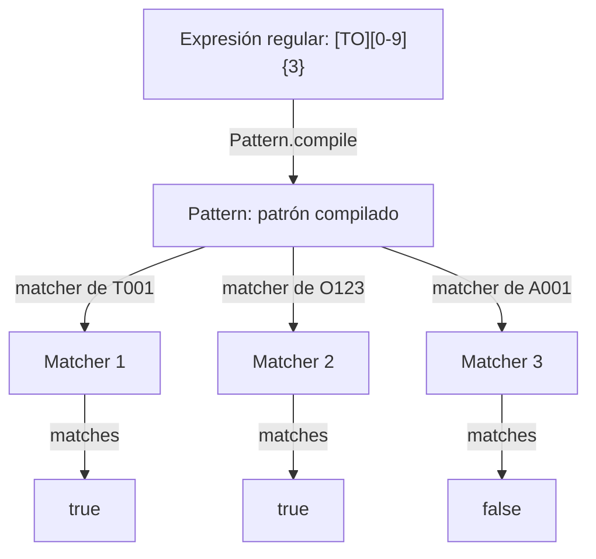

# Programación Aplicada


## 2.2. Diseño de expresiones regulares

**Autor:** Ing. Pablo Torres, Mgtr.
**Unidad:** 2. Expresiones regulares
**Tema:** 2.2. Diseño de expresiones regulares


Las expresiones regulares permiten especificar y reconocer estructuras de texto mediante patrones. Diseñar una expresión implica partir de un contrato de entrada, identificar sus símbolos permitidos, construir una regla de reconocimiento y verificar tanto los casos aceptados como los rechazados.
Este tema desarrolla las clases de caracteres, cuantificadores, alternancia, agrupación, capturas y APIs de reconocimiento. Se estudia cuándo utilizar expresiones regulares directamente y cuándo conviene compilar un patrón, reutilizarlo y trabajar con objetos de coincidencia. También se introducen operaciones de búsqueda, extracción, reemplazo y división de cadenas. Como caso de aplicación, se interpreta una trama de CampusMonitor con identificador, valor y unidad. Se distinguen las reglas de formato de las reglas del dominio y se incluyen implementaciones equivalentes en Java, Python y JavaScript.

[Inicio del curso](../../README.md) · [Tema anterior: 2.1. Fundamentos de los lenguajes regulares](../2.1-lenguajes-regulares/material.md)

<a id="indice"></a>

## Índice

1. [Del lenguaje regular al patrón de reconocimiento](#fundamentos)
2. [Componentes de una expresión regular](#componentes)
3. [Construcción progresiva de un patrón](#construccion)
4. [Capturas, escapes y texto literal](#capturas)
5. [Formas de utilizar expresiones regulares: validación, búsqueda y transformación](#reconocimiento)
6. [Caso práctico: tramas de CampusMonitor](#caso)
7. [Implementación de CampusMonitor en Java](#java)
8. [Implementaciones equivalentes en Python y JavaScript](#otros-lenguajes)
9. [PC2.2 · Práctica de clase](#pc)
10. [Análisis y criterios de diseño](#analisis)
11. [Referencias](#referencias)

---

<a id="fundamentos"></a>

## 1. Del lenguaje regular al patrón de reconocimiento

En el tema 2.1 se estudió que un lenguaje formal es un conjunto de cadenas definidas sobre un alfabeto. Una **expresión regular** representa un conjunto de cadenas mediante operaciones de combinación, elección y repetición. En programación, los motores regex añaden una sintaxis práctica para describir y reconocer formatos de texto.

Una expresión regular no sustituye la definición de un requisito. Antes de escribir el patrón deben establecerse las reglas aceptadas: longitud de un identificador, separadores, signos, unidades y política de espacios.

Por ejemplo, para aceptar únicamente códigos compuestos por `S` seguida de dos dígitos ASCII:

```regex
S[0-9]{2}
```

La expresión describe una secuencia. La **validación completa** determina si toda la entrada pertenece al lenguaje, mientras que la **búsqueda** localiza una secuencia compatible dentro de un texto mayor.

| Entrada | Coincidencia parcial del patrón | Validación completa |
|---|---|---|
| `S01` | Sí | Sí |
| `ID=S01` | Sí | No |
| `S1` | No | No |
| `S012` | Sí: `S01` | No |

**Distinción:** reconocer el formato de una cadena no implica que sus datos sean válidos para una regla de negocio. `O001;12.5;PERSONAS` puede tener sintaxis decimal correcta, pero no representar una cantidad entera de personas.

[Volver al índice](#indice)

---

<a id="componentes"></a>

## 2. Componentes de una expresión regular

### 2.1. Literales, clases y rangos

Una clase de caracteres define el conjunto de símbolos permitidos **en una posición**. Un literal representa un símbolo concreto. Los rangos ayudan a expresar conjuntos contiguos de caracteres.

| Sintaxis | Significado | Ejemplo que acepta |
|---|---|---|
| `A` | Letra `A` literal | `A` |
| `[0-9]` | Un dígito ASCII | `7` |
| `[A-Z]` | Una letra mayúscula ASCII | `T` |
| `[TO]` | `T` u `O` | `O` |
| `[^;]` | Un carácter distinto de punto y coma | `x` |
| `[.]` | Un punto literal | `.` |
| `\d` | Clase de dígitos del motor; su alcance varía | `7` |
| `\s` | Clase de espacios del motor; su alcance varía | espacio |

En un protocolo con identificadores y números ASCII, `[0-9]` expresa mejor el contrato que una clase abreviada cuyo comportamiento Unicode puede variar entre motores y opciones.

### 2.2. Cuantificadores

Los cuantificadores controlan cuántas veces puede aparecer un elemento o grupo.

| Sintaxis | Cantidad | Ejemplo |
|---|---|---|
| `X?` | Cero o una | `X`, cadena vacía |
| `X*` | Cero o más | `XX`, cadena vacía |
| `X+` | Una o más | `XXX` |
| `X{3}` | Exactamente tres | `XXX` |
| `X{2,4}` | Entre dos y cuatro | `XX`, `XXX`, `XXXX` |
| `X{2,}` | Dos o más | `XXXX` |

Para `T001`, `[0-9]{3}` exige exactamente tres dígitos. La alternativa `[0-9]+` aceptaría longitudes no previstas como `T1` o `T000001`.

### 2.3. Concatenación, alternancia y agrupación

La **concatenación** exige elementos sucesivos. La **alternancia** `|` admite una opción u otra. Los paréntesis agrupan expresiones para controlar el alcance de las operaciones.

```regex
C|PERSONAS
```

Acepta `C` o `PERSONAS` cuando se usa con una operación de coincidencia completa.

```regex
(?:T|O)[0-9]{3}
```

Acepta identificadores que empiezan con `T` u `O`, seguidos de tres dígitos. `(?:...)` agrupa sin registrar una captura.

**Importancia del agrupamiento:** `T|O[0-9]{3}` representa `T` **o** `O` seguido de tres dígitos. No equivale a `(?:T|O)[0-9]{3}`.

Los siguientes patrones ilustran la importancia de distinguir alternancia, agrupación y opcionalidad:

| Patrón | Regla | Ejemplos aceptados |
|---|---|---|
| `[TO][0-9]{3}` | Un prefijo obligatorio y tres dígitos | `T001`, `O123` |
| `(T\|O)[0-9]{3}` | La misma regla, con un grupo capturador | `T001`, `O123` |
| `(?:T\|O)[0-9]{3}` | La misma regla, sin captura del prefijo | `T001`, `O123` |
| `(T\|O)?[0-9]{3}` | Prefijo opcional | `T001`, `O123`, `123` |

En los tres primeros casos se reconocen las mismas cadenas mediante validación completa. En el cuarto, `?` permite omitir el grupo. Si las alternativas son palabras completas, por ejemplo `TEMP` u `OCUP`, se necesita una alternancia como `(?:TEMP|OCUP)[0-9]{3}`, no una clase de caracteres.

De forma similar, `ab*` y `a(b)*` reconocen una `a` seguida de cero o más `b`. En cambio, `(ab)*` repite toda la secuencia `ab`, incluyendo cero repeticiones.

### 2.4. Capturas y repetición codiciosa

Los grupos capturadores `( ... )` conservan fragmentos reconocidos para consultarlos posteriormente. Los grupos no capturadores `(?: ... )` únicamente organizan el patrón. Los grupos con nombre permiten consultar un dato mediante su significado, sin depender del número de paréntesis anteriores.

Los cuantificadores `*` y `+` son **codiciosos** por defecto: intentan consumir la mayor cantidad posible de caracteres, aunque el motor puede retroceder para completar una coincidencia. Las variantes `*?` y `+?` son reacias. En un protocolo delimitado, es preferible especificar caracteres y cantidades permitidas en lugar de usar `.*` de manera indiscriminada.

[Volver al índice](#indice)

---

<a id="construccion"></a>

## 3. Construcción progresiva de un patrón

Supongamos un protocolo de una línea con este formato:

```text
identificador;valor;unidad
```

El contrato define:

- Identificador: `T` u `O`, seguido de tres dígitos ASCII.
- Separador: punto y coma literal.
- Valor: signo menos opcional, uno o más dígitos y parte decimal opcional con punto.
- Unidad: `C` o `PERSONAS`, respetando mayúsculas.
- No se admiten espacios, signos `+`, separador decimal con coma, exponentes ni saltos de línea.
- Toda la entrada debe coincidir; no se aceptan prefijos o sufijos adicionales.

### 3.1. Descomposición

| Campo | Regla | Patrón |
|---|---|---|
| Identificador | Prefijo `T` u `O` y tres dígitos | `[TO][0-9]{3}` |
| Valor entero | Signo negativo opcional y uno o más dígitos | `-?[0-9]+` |
| Fracción | Punto y uno o más dígitos, opcionales como conjunto | `(?:[.][0-9]+)?` |
| Valor decimal | Entero y fracción opcional | `-?[0-9]+(?:[.][0-9]+)?` |
| Unidad | Dos alternativas literales | `(?:C\|PERSONAS)` |

Al concatenar los componentes:

```regex
[TO][0-9]{3};-?[0-9]+(?:[.][0-9]+)?;(?:C|PERSONAS)
```

### 3.2. Pruebas de aceptación y rechazo

| Entrada | Resultado sintáctico | Motivo |
|---|---|---|
| `T001;23.5;C` | Aceptar | Cumple todos los campos |
| `O001;12;PERSONAS` | Aceptar | Entero permitido por la gramática |
| `O001;12.5;PERSONAS` | Aceptar | La gramática admite fracciones; la regla del dominio decide después |
| `T01;23;C` | Rechazar | Faltan dígitos del identificador |
| `T001;+23;C` | Rechazar | No se admite signo positivo explícito |
| `T001;23,5;C` | Rechazar | Separador decimal incorrecto |
| `T001;23.;C` | Rechazar | El punto requiere al menos un dígito posterior |
| `T001;NaN;C` | Rechazar | `NaN` no pertenece a la gramática |
| `X001;23;C` | Rechazar | Prefijo no permitido |
| ` T001;23;C` | Rechazar | Espacio inicial no permitido |

**Regla de trabajo:** primero probar el reconocimiento completo del formato; después convertir y validar los valores capturados. No se debe forzar toda la lógica de negocio dentro de una expresión regular.

### 3.3. Aplicaciones en campos de formularios

Las expresiones regulares son útiles para traducir restricciones habituales de sistemas de información en reglas de formato.

| Campo | Contrato de ejemplo | Expresión regular |
|---|---|---|
| Cédula | Exactamente diez dígitos ASCII | `[0-9]{10}` |
| Celular | `09` seguido de ocho dígitos | `09[0-9]{8}` |
| Usuario | De 4 a 16 caracteres; inicia con letra ASCII | `[A-Za-z][A-Za-z0-9_]{3,15}` |
| Código académico | `EST-` seguido de cuatro dígitos | `EST-[0-9]{4}` |
| Correo institucional | Parte local simplificada y dominio `ups.edu.ec` o `est.ups.edu.ec` | `[A-Za-z0-9._%+-]+@(?:ups[.]edu[.]ec\|est[.]ups[.]edu[.]ec)` |

Ejemplo de validación directa en Java:

```java
String correo = "ana@est.ups.edu.ec";
String patronCorreo = "[A-Za-z0-9._%+-]+@"
        + "(?:ups[.]edu[.]ec|est[.]ups[.]edu[.]ec)";

System.out.println(correo.matches(patronCorreo)); // true
System.out.println("ana@gmail.com".matches(patronCorreo)); // false
System.out.println("0102030405".matches("[0-9]{10}")); // true
System.out.println("0991234567".matches("09[0-9]{8}")); // true
System.out.println("EST-0025".matches("EST-[0-9]{4}")); // true
```

Son reglas didácticas de formato, no verificaciones completas de identidad o existencia. Una cédula de diez dígitos puede tener un dígito verificador incorrecto; un correo con un dominio permitido puede no corresponder a una cuenta existente. El patrón de correo tampoco implementa todas las reglas de sintaxis de los estándares de correo electrónico. Estas comprobaciones adicionales deben resolverse según los requisitos del sistema.

[Volver al índice](#indice)

---

<a id="capturas"></a>

## 4. Capturas, escapes y texto literal

### 4.1. Grupos con nombre

Los motores de Java, Python y JavaScript admiten grupos con nombre, pero **su sintaxis no es idéntica**:

| Lenguaje | Grupo con nombre | Acceso a la captura |
|---|---|---|
| Java | `(?<sensor>...)` | `matcher.group("sensor")` |
| Python | `(?P<sensor>...)` | `match.group("sensor")` |
| JavaScript | `(?<sensor>...)` | `match.groups.sensor` |

Para Java:

```regex
(?<sensor>[TO][0-9]{3});(?<valor>-?[0-9]+(?:[.][0-9]+)?);(?<unidad>C|PERSONAS)
```

`valor` sigue siendo una cadena capturada. El nombre del grupo facilita la extracción; no realiza conversiones ni validaciones de dominio.

### 4.2. Escape del patrón y escape del lenguaje

La expresión regular y el código fuente poseen reglas distintas para representar algunos caracteres.

| Objetivo | Regex conceptual | Java como `String` | Python raw string | JavaScript literal regex |
|---|---|---|---|---|
| Un dígito | `\d` | `"\\d"` | `r"\d"` | `/\d/` |
| Un punto literal | `\.` | `"\\."` | `r"\."` | `/\./` |
| Un punto con clase | `[.]` | `"[.]"` | `r"[.]"` | `/[.]/` |

En Java, `"\d"` **no es un literal de cadena válido**: la barra inversa debe escaparse como `"\\d"`. Usar `[0-9]` y `[.]` evita parte de este problema cuando el contrato se limita a ASCII y punto decimal.

### 4.3. Texto externo y reemplazos

No concatenes directamente una entrada externa dentro de un patrón si debe buscarse como texto literal. En Java, `Pattern.quote()` protege su interpretación regex:

```java
Pattern literal = Pattern.compile(Pattern.quote("sensor.a"));
```

`Matcher.quoteReplacement()` cumple otra función: protege el contenido de **reemplazo** frente a la interpretación especial de `$` y `\`:

```java
String reemplazoSeguro = Matcher.quoteReplacement("$5");
```

Los dos métodos no son intercambiables. En Python se dispone de `re.escape()` para construir fragmentos literales del patrón; en JavaScript hay que elegir un mecanismo de escape adecuado para construir expresiones dinámicas, en lugar de interpolar entradas sin protección.

[Volver al índice](#indice)

---

<a id="reconocimiento"></a>

## 5. Formas de utilizar expresiones regulares: validación, búsqueda y transformación

Una misma expresión regular puede utilizarse para operaciones diferentes. El patrón describe qué secuencia se desea reconocer; el método determina si se comprueba toda la entrada, se busca una coincidencia, se extraen datos o se transforma el texto.

En los ejemplos de esta sección se utiliza el patrón `[TO][0-9]{3}`.

### 5.1. Validación directa en Java: `String.matches()` y `Pattern.matches()`

Cuando solo se necesita conocer si un campo cumple una regla, no es necesario crear explícitamente un `Matcher`.

```java
String codigo = "T001";
String regex = "[TO][0-9]{3}";

System.out.println(codigo.matches(regex)); // true
System.out.println("T001 activo".matches(regex)); // false
System.out.println("T00123".matches(regex)); // false
```

`String.matches()` devuelve un `boolean` y exige que toda la cadena coincida. No necesita importar clases de `java.util.regex`.

La forma estática ofrece el mismo comportamiento:

```java
import java.util.regex.Pattern;

// Dentro de un método:
boolean valido = Pattern.matches("[TO][0-9]{3}", "T001");
System.out.println(valido); // true
```

Ambas formas compilan el patrón en cada llamada. Son convenientes para validaciones puntuales de campos como un código académico, un correo o un número de teléfono.

### 5.2. Validación reutilizable: `Pattern.compile()` y `Matcher.matches()`

Cuando se aplica una misma expresión muchas veces, conviene separar su compilación de su ejecución.

```java
import java.util.regex.Pattern;
import java.util.regex.Matcher;

// Dentro de un método:
Pattern patron = Pattern.compile("[TO][0-9]{3}");

String[] codigos = {"T001", "O123", "A001", "T12"};

for (String codigo : codigos) {
    Matcher matcher = patron.matcher(codigo);
    System.out.println(codigo + " => " + matcher.matches());
}
```

Salida:

```text
T001 => true
O123 => true
A001 => false
T12 => false
```

Las clases tienen responsabilidades diferentes:

- `Pattern`: representación compilada de una expresión regular. Es inmutable, reutilizable y puede compartirse entre hilos.
- `Matcher`: aplica un patrón sobre una entrada concreta y mantiene el estado del reconocimiento. No es seguro compartirlo simultáneamente entre hilos.



En aplicaciones que validan numerosos registros o solicitudes, puede declararse un patrón como constante de clase:

```java
import java.util.regex.Pattern;

public class ValidadorSensor {

    private static final Pattern CODIGO =
            Pattern.compile("[TO][0-9]{3}");

    public static boolean validar(String texto) {
        return texto != null && CODIGO.matcher(texto).matches();
    }
}
```

Aquí se compila una sola vez y se crea un nuevo `Matcher` por entrada. No se necesita crear objetos `Pattern` repetidamente dentro de un ciclo.

**Criterio de elección:** utilizar `String.matches()` o `Pattern.matches()` para validaciones puntuales; utilizar un `Pattern` reutilizable para validaciones frecuentes, búsquedas, extracción de grupos o configuración explícita de flags.

### 5.3. Validación completa, búsqueda y reconocimiento del inicio

Con `Matcher` se dispone de tres operaciones de reconocimiento principales.

| Método | Qué comprueba | Resultado |
|---|---|---|
| `matches()` | Toda la entrada, o la región configurada | `boolean` |
| `find()` | La siguiente coincidencia dentro de la entrada | `boolean` |
| `lookingAt()` | Una coincidencia que comienza al inicio de la entrada o región | `boolean` |

```java
Pattern patron = Pattern.compile("[TO][0-9]{3}");

String texto = "T001 reporta temperatura";

System.out.println(patron.matcher(texto).matches());   // false
System.out.println(patron.matcher(texto).find());      // true
System.out.println(patron.matcher(texto).lookingAt()); // true
```

Se crea un `Matcher` independiente para cada operación para que el resultado no dependa de su estado anterior.

| Entrada | `matches()` | `find()` | `lookingAt()` |
|---|---|---|---|
| `T001` | true | true | true |
| `T001 activo` | false | true | true |
| `Sensor T001` | false | true | false |
| `T00123` | false | true | true |
| `A001` | false | false | false |

**Importante:** un resultado positivo de `find()` no demuestra que toda la cadena sea válida. Por ejemplo, en `T00123` encuentra `T001`, aunque el código completo no cumple el requisito de tres dígitos.

### 5.4. Buscar coincidencias y obtener su posición

`find()` permite recorrer todas las coincidencias no superpuestas. Después de un reconocimiento exitoso, `group()` devuelve el fragmento encontrado y `start()` y `end()` indican sus posiciones.

```java
import java.util.regex.Pattern;
import java.util.regex.Matcher;

public class BuscarSensores {
    public static void main(String[] args) {
        String texto = "Sensores: T001, O002 y T003";
        Pattern patron = Pattern.compile("[TO][0-9]{3}");
        Matcher matcher = patron.matcher(texto);

        while (matcher.find()) {
            System.out.printf(
                "Encontrado: %s | Inicio: %d | Fin: %d%n",
                matcher.group(), matcher.start(), matcher.end()
            );
        }
    }
}
```

Salida:

```text
Encontrado: T001 | Inicio: 10 | Fin: 14
Encontrado: O002 | Inicio: 16 | Fin: 20
Encontrado: T003 | Inicio: 23 | Fin: 27
```

Los índices comienzan en cero; el índice final es exclusivo. `texto.substring(matcher.start(), matcher.end())` devuelve la coincidencia actual.

Cada llamada a `find()` continúa la búsqueda desde la posición correspondiente a la coincidencia anterior. Si se desea reiniciar el recorrido se puede crear un nuevo `Matcher` o llamar a `reset()`.

Otra posibilidad, disponible desde Java 9, es obtener las coincidencias como un flujo:

```java
import java.util.regex.MatchResult;
import java.util.List;

// Dentro de un método:
List<String> codigos = patron.matcher(texto)
        .results()
        .map(MatchResult::group)
        .toList();

System.out.println(codigos); // [T001, O002, T003]
```

El método `Stream.toList()` requiere Java 16 o superior. Para los primeros ejemplos, `while (matcher.find())` permite observar con mayor claridad el proceso de reconocimiento.

### 5.5. Extraer información con grupos de captura

Encontrar un código completo no siempre es suficiente. Si se necesita separar su tipo y número, pueden definirse grupos:

```regex
([TO])([0-9]{3})
```

```java
Pattern patron = Pattern.compile("([TO])([0-9]{3})");
Matcher matcher = patron.matcher("T001, O002");

while (matcher.find()) {
    System.out.println("Completo: " + matcher.group(0));
    System.out.println("Tipo: " + matcher.group(1));
    System.out.println("Número: " + matcher.group(2));
}
```

Salida:

```text
Completo: T001
Tipo: T
Número: 001
Completo: O002
Tipo: O
Número: 002
```

| Método | Información |
|---|---|
| `group()` o `group(0)` | Coincidencia completa |
| `group(1)` | Primer grupo de captura |
| `group(2)` | Segundo grupo de captura |
| `group("nombre")` | Grupo con nombre |
| `groupCount()` | Número de grupos de captura, sin contar el grupo 0 |

Los grupos se numeran según el orden de apertura de sus paréntesis. Un grupo no capturador `(?:...)` no recibe número.

Para acceder a los grupos debe existir una coincidencia exitosa obtenida mediante `matches()`, `find()` o `lookingAt()`. De lo contrario, Java lanza `IllegalStateException`. Los grupos opcionales que no participaron en una coincidencia devuelven `null`.

### 5.6. Reemplazar coincidencias

Las expresiones regulares también permiten transformar cadenas.

```java
String texto = "Sensores: T001, O002 y T003";
String regex = "[TO][0-9]{3}";

System.out.println(texto.replaceAll(regex, "[SENSOR]"));
System.out.println(texto.replaceFirst(regex, "[SENSOR]"));
```

Salida:

```text
Sensores: [SENSOR], [SENSOR] y [SENSOR]
Sensores: [SENSOR], O002 y T003
```

- `replaceAll()` reemplaza todas las coincidencias.
- `replaceFirst()` reemplaza únicamente la primera.

Si ya se dispone de un patrón compilado, también puede reutilizarse:

```java
Pattern patron = Pattern.compile("[TO][0-9]{3}");

String resultado = patron.matcher(texto).replaceAll("[SENSOR]");
```

Los métodos devuelven una nueva cadena, no modifican el `String` original. No debe confundirse `String.replace()`, que reemplaza texto literal, con `String.replaceAll()`, que interpreta su primer argumento como regex.

Los grupos capturados también pueden reutilizarse en el reemplazo mediante `$1`, `$2`, etc.

```java
String codigo = "T001";

String resultado = codigo.replaceAll(
        "([TO])([0-9]{3})", "$1-$2"
);

System.out.println(resultado); // T-001
```

Si el reemplazo proviene de una entrada externa y debe interpretarse literalmente, utilizar `Matcher.quoteReplacement()`.

### 5.7. Dividir y normalizar cadenas

`split()` divide una cadena utilizando un patrón como separador.

```java
String datos = "T001,O002;T003 T004";
String[] codigos = datos.split("[,;\\s]+");

for (String codigo : codigos) {
    System.out.println(codigo);
}
```

Salida:

```text
T001
O002
T003
T004
```

El patrón admite comas, punto y coma o espacios como separadores. El cuantificador `+` agrupa separadores consecutivos.

Con un patrón compilado se puede utilizar `Pattern.split(datos)`. Por defecto, Java descarta los campos vacíos finales; cuando sea necesario conservarlos, utilizar `datos.split(";", -1)`.

También es posible normalizar espacios mediante una sustitución:

```java
String mensaje = "  Sensor    T001   activo   ";

String limpio = mensaje.strip().replaceAll("\\s+", " ");

System.out.println(limpio); // Sensor T001 activo
```

`strip()` elimina espacios exteriores según las reglas de caracteres en blanco de Java; `replaceAll()` sustituye las secuencias reconocidas por `\s+`. Sus conjuntos de caracteres no son idénticos en todos los casos Unicode. Para el texto ASCII del ejemplo, el resultado es el esperado.

Estas operaciones introducen aplicaciones de preprocesamiento de texto que se desarrollarán con mayor profundidad en el tema 2.4.

### 5.8. Resumen de métodos y criterios de selección en Java

| Necesidad | API recomendada | Ejemplo de uso |
|---|---|---|
| Validación puntual | `texto.matches(regex)` | Comprobar un código |
| Validación estática | `Pattern.matches(regex, texto)` | Comprobar un campo |
| Validación repetitiva | `patron.matcher(texto).matches()` | Validar numerosos registros |
| Buscar un fragmento | `matcher.find()` | Detectar un identificador en un mensaje |
| Buscar todas las coincidencias | `while (matcher.find())` | Enumerar códigos en un texto |
| Reconocer un prefijo | `matcher.lookingAt()` | Identificar un comando |
| Extraer información | `matcher.group(n)` | Separar tipo y número |
| Obtener posiciones | `matcher.start()` y `matcher.end()` | Localizar coincidencias |
| Reemplazar todas | `replaceAll()` | Anonimizar identificadores |
| Reemplazar la primera | `replaceFirst()` | Modificar la primera coincidencia |
| Dividir texto | `split()` | Separar campos o palabras |

`Pattern.matches()` y `String.matches()` son formas abreviadas de la misma estrategia de coincidencia completa. No son métodos de búsqueda.

### 5.9. Flags y alcance

Los flags son opciones que modifican la interpretación del patrón o el comportamiento de las operaciones de búsqueda.

| Efecto | Java | Python | JavaScript |
|---|---|---|---|
| Ignorar mayúsculas y minúsculas | `Pattern.CASE_INSENSITIVE` | `re.IGNORECASE` | `i` |
| Multilínea | `Pattern.MULTILINE` | `re.MULTILINE` | `m` |
| Permitir que `.` reconozca saltos de línea | `Pattern.DOTALL` | `re.DOTALL` | `s` |
| Búsqueda global | Repetir `find()` | `finditer()` o `findall()` | `g` |

Ejemplo en Java:

```java
Pattern patron = Pattern.compile(
        "[TO][0-9]{3}",
        Pattern.CASE_INSENSITIVE
);

System.out.println(patron.matcher("t001").matches()); // true
```

La configuración de mayúsculas, espacios y Unicode debe responder al contrato de entrada. El protocolo CampusMonitor exige prefijos y unidades exactos, por lo que no activa la insensibilidad a mayúsculas.

En JavaScript, los flags `g` e `y` pueden modificar el índice interno `lastIndex` en operaciones como `test()` y `exec()`. Por ello, no deben añadirse a un validador simple reutilizable sin una razón concreta.

### 5.10. Ejemplo integrador en Java

El siguiente programa reúne las operaciones de esta sección en un único archivo independiente. Guardar como `RegexOperaciones.java`.

```java
import java.util.regex.Pattern;
import java.util.regex.Matcher;

public class RegexOperaciones {

    public static void main(String[] args) {
        String regex = "[TO][0-9]{3}";
        String codigo = "T001";
        String texto = "T001 reporta 23 C, O002 reporta 15 personas, T003 reporta 18 C";

        // 1. Validación directa
        System.out.println("\n1. Validación directa");
        System.out.println(codigo.matches(regex));
        System.out.println(texto.matches(regex));
        System.out.println(Pattern.matches(regex, codigo));

        // 2. Compilación y reutilización
        System.out.println("\n2. Validación reutilizable");
        Pattern patron = Pattern.compile(regex);

        for (String dato : new String[]{"T001", "O123", "A001", "T12"}) {
            System.out.println(dato + " => " + patron.matcher(dato).matches());
        }

        // 3. Primera coincidencia
        System.out.println("\n3. Primera coincidencia");
        Matcher primero = patron.matcher(texto);
        if (primero.find()) {
            System.out.println(primero.group());
        }

        // 4. Todas las coincidencias y posiciones
        System.out.println("\n4. Todas las coincidencias");
        Matcher matcher = patron.matcher(texto);
        while (matcher.find()) {
            System.out.printf("Encontrado: %s | Inicio: %d | Fin: %d%n",
                    matcher.group(), matcher.start(), matcher.end());
        }

        // 5. Coincidencia al inicio
        System.out.println("\n5. Reconocimiento del inicio");
        System.out.println(patron.matcher(texto).lookingAt());
        System.out.println(patron.matcher(texto).matches());

        // 6. Grupos de captura
        System.out.println("\n6. Grupos de captura");
        Matcher grupos = Pattern.compile("([TO])([0-9]{3})").matcher(texto);

        while (grupos.find()) {
            System.out.printf("Completo: %s | Tipo: %s | Número: %s%n",
                    grupos.group(0), grupos.group(1), grupos.group(2));
        }

        // 7. Reemplazar todas
        System.out.println("\n7. Reemplazar todas");
        System.out.println(texto.replaceAll(regex, "[SENSOR]"));

        // 8. Reemplazar la primera
        System.out.println("\n8. Reemplazar la primera");
        System.out.println(texto.replaceFirst(regex, "[SENSOR]"));

        // 9. Dividir una cadena
        System.out.println("\n9. Dividir");
        String datos = "T001,O002;T003 T004";
        for (String elemento : datos.split("[,;\\s]+")) {
            System.out.println(elemento);
        }

        // 10. Normalizar espacios
        System.out.println("\n10. Normalizar espacios");
        String mensaje = "  Sensor    T001   activo   ";
        System.out.println(mensaje.strip().replaceAll("\\s+", " "));
    }
}
```

Ejecución con JDK 17 o superior:

```bash
java RegexOperaciones.java
```

[Volver al índice](#indice)

---

<a id="caso"></a>

## 6. Caso práctico: tramas de CampusMonitor

### 6.1. Problema y contrato

CampusMonitor recibe lecturas mediante cadenas con tres campos separados por punto y coma. El sistema necesita detectar entradas mal formadas, identificar los valores y comunicar errores sin insertar datos incorrectos en el registro de lecturas.

La solución se organiza en tres etapas:

1. **Reconocimiento:** comprobar que toda la trama respeta el patrón y extraer los grupos.
2. **Conversión:** transformar `valor` a un número y rechazar resultados no finitos.
3. **Validación de dominio:** comprobar que `T...` use unidad `C` y que `O...` use `PERSONAS` con un entero no negativo.

El ejemplo limita la entrada a 80 caracteres y rechaza entradas nulas. No incluye almacenamiento; el parser devuelve una estructura de datos que otro componente podría utilizar.

### 6.2. Estructura de responsabilidades

| Elemento | Responsabilidad |
|---|---|
| Patrón compilado | Definir el formato reconocido |
| Coincidencia y grupos | Extraer `sensor`, `valor` y `unidad` |
| Parser | Coordinar reconocimiento y conversión |
| Validación de dominio | Verificar coherencia entre sensor, unidad y magnitud |
| Aplicación cliente | Presentar el resultado o reportar el error |

Esta separación permite cambiar la política de almacenamiento sin modificar el patrón y modificar el formato sin mezclarlo con la presentación del resultado.

### 6.3. Casos que deben distinguirse

| Trama | Sintaxis | Dominio | Resultado |
|---|---|---|---|
| `T001;23.5;C` | Válida | Válido | Lectura de temperatura |
| `O001;12;PERSONAS` | Válida | Válido | Lectura de ocupación |
| `O001;12.5;PERSONAS` | Válida | Inválido | Personas no enteras |
| `T001;25;PERSONAS` | Válida | Inválido | Unidad incompatible |
| `O001;-1;PERSONAS` | Válida | Inválido | Ocupación negativa |
| `T01;23;C` | Inválida | No se evalúa | Identificador incorrecto |
| `T001;NaN;C` | Inválida | No se evalúa | Número fuera del formato |

El resultado debe indicar si el fallo pertenece al formato o a la regla de dominio. Reemplazar valores inválidos por cero ocultaría errores, porque cero puede ser una medida legítima.

[Volver al índice](#indice)

---

<a id="java"></a>

## 7. Implementación de CampusMonitor en Java

**Código completo y comentado:** [RegexDemo.java](ejemplos/RegexDemo.java).

### 7.1. Tipos y métodos utilizados

| Elemento | Función |
|---|---|
| `record Trama` | Conservar los tres campos ya interpretados |
| `Pattern.compile()` | Compilar la expresión una vez |
| `Matcher.matches()` | Exigir coincidencia con toda la entrada |
| `Matcher.group("valor")` | Obtener la captura identificada por nombre |
| `Double.parseDouble()` | Convertir texto numérico a `double` |
| `Double.isFinite()` | Rechazar infinitos y `NaN` tras la conversión |
| `Math.rint()` | Comprobar que el valor de ocupación sea integral |

### 7.2. Fragmento central

```java
private static final Pattern TRAMA = Pattern.compile(
        "(?<sensor>[TO][0-9]{3});(?<valor>-?[0-9]+(?:[.][0-9]+)?);(?<unidad>C|PERSONAS)");
Matcher matcher = TRAMA.matcher(linea);
if (!matcher.matches()) {
    throw new IllegalArgumentException("Formato inválido");
}
String sensor = matcher.group("sensor");
String unidad = matcher.group("unidad");
double valor = Double.parseDouble(matcher.group("valor"));
```

El código completo también controla entrada nula, longitud, resultados no finitos, compatibilidad entre prefijos y unidades, y la regla de ocupación. La validación posterior **no se incorpora a la regex**, porque pertenece a la semántica de la lectura.

### 7.3. Secuencia de ejecución

1. `main()` recorre varias tramas de prueba.
2. `parsear()` valida la entrada inicial y crea un `Matcher` para esa línea.
3. `matches()` rechaza la cadena completa si no satisface el patrón.
4. `group()` extrae los campos definidos por sus nombres.
5. Se convierte el valor, se aplican las reglas del dominio y se devuelve `Trama`.
6. El cliente imprime el registro o el motivo del rechazo.

### 7.4. Ejecución

Desde el directorio que contiene el archivo Java, con una versión de Java que permita ejecutar archivos fuente:

```bash
java RegexDemo.java
```

Salida esperada:

```text
Trama[sensor=T001, valor=23.5, unidad=C]
Trama[sensor=O001, valor=12.0, unidad=PERSONAS]
O001;12.5;PERSONAS -> Ocupación debe ser un entero no negativo
T01;23;C -> Formato inválido
T001;NaN;C -> Formato inválido
T001;25;PERSONAS -> Unidad incompatible con temperatura
O001;-1;PERSONAS -> Ocupación debe ser un entero no negativo
```

**Observación:** el programa se puede ejecutar sin Gradle y sin dependencias externas. Los mensajes con tildes requieren una terminal con codificación compatible con UTF-8.

[Volver al índice](#indice)

---

<a id="otros-lenguajes"></a>

## 8. Implementaciones equivalentes en Python y JavaScript

Los tres lenguajes resuelven el mismo problema con el mismo conjunto de casos. Las diferencias importantes están en la sintaxis de las capturas, la API de validación completa y la representación de los números.

### 8.1. Python

**Código completo:** [regex_demo.py](ejemplos/regex_demo.py).

```python
import re
PATRON = re.compile(
    r"(?P<sensor>[TO][0-9]{3});(?P<valor>-?[0-9]+(?:[.][0-9]+)?);(?P<unidad>C|PERSONAS)"
)
coincidencia = PATRON.fullmatch("T001;23.5;C")
if coincidencia:
    sensor = coincidencia["sensor"]
    valor = float(coincidencia["valor"])
    unidad = coincidencia["unidad"]
```

Python utiliza `(?P<nombre>...)` para los grupos con nombre y `fullmatch()` para validar toda la cadena. El archivo completo emplea `math.isfinite()` y `float.is_integer()` cuando corresponde.

Ejecución:

```bash
python regex_demo.py
```

### 8.2. JavaScript


```javascript
const TRAMA = /^(?<sensor>[TO][0-9]{3});(?<valor>-?[0-9]+(?:[.][0-9]+)?);(?<unidad>C|PERSONAS)$/u;
const coincidencia = TRAMA.exec('T001;23.5;C');
if (coincidencia) {
  const { sensor, unidad } = coincidencia.groups;
  const valor = Number(coincidencia.groups.valor);
}
```

JavaScript admite grupos con nombre mediante `(?<nombre>...)`. El patrón se ancla para validar la entrada completa y no utiliza el flag `m`. El archivo completo comprueba `Number.isFinite()` y exige `Number.isSafeInteger()` en la ocupación para no aceptar enteros fuera del rango de precisión segura del tipo `number`.

Ejecución con Node.js:

```bash
node regex-demo.mjs
```

### 8.3. Comparación de decisiones

| Aspecto | Java | Python | JavaScript |
|---|---|---|---|
| Grupo nombrado | `(?<x>...)` | `(?P<x>...)` | `(?<x>...)` |
| Coincidencia completa | `matches()` | `fullmatch()` | Patrón anclado y `exec()` |
| Conversión | `Double.parseDouble()` | `float()` | `Number()` |
| Valor finito | `Double.isFinite()` | `math.isfinite()` | `Number.isFinite()` |
| Número integral | `Math.rint()` | `float.is_integer()` | `Number.isSafeInteger()` |
| Tratamiento de errores | Excepciones | Excepciones | Excepciones |

**Límite de equivalencia:** el ejemplo Java y el de Python comprueban integralidad de `double`/`float`; JavaScript añade precisión segura. Si CampusMonitor exige que los contadores conserven exactamente valores muy grandes, conviene definir un límite común de magnitud o convertir directamente desde el texto a un entero exacto antes de aceptar los datos.

### 8.4. Operaciones equivalentes en Python

El módulo estándar `re` permite trabajar directamente con el patrón o compilarlo mediante `re.compile()`. Las funciones del módulo mantienen una caché de patrones recientes; la compilación explícita permite reutilizar el objeto y centralizar su configuración.

- `re.fullmatch(regex, texto)` valida la entrada completa.
- `re.search(regex, texto)` busca la primera coincidencia en cualquier posición.
- `re.match(regex, texto)` comprueba el inicio, no toda la cadena.
- `finditer()` recorre objetos de coincidencia; `findall()` devuelve una lista de resultados.
- `sub()` reemplaza coincidencias; `split()` divide el texto.

Guardar como `regex_operaciones.py`. Resuelve las mismas diez operaciones del ejemplo Java, con los mismos datos.

```python
import re

regex = r"[TO][0-9]{3}"
codigo = "T001"
texto = "T001 reporta 23 C, O002 reporta 15 personas, T003 reporta 18 C"

# 1. Validación directa
print("\n1. Validación directa")
print(bool(re.fullmatch(regex, codigo)))
print(bool(re.fullmatch(regex, texto)))

# 2. Compilación y reutilización
print("\n2. Validación reutilizable")
patron = re.compile(regex)

for dato in ["T001", "O123", "A001", "T12"]:
    print(f"{dato} => {bool(patron.fullmatch(dato))}")

# 3. Primera coincidencia
print("\n3. Primera coincidencia")
primero = patron.search(texto)
if primero:
    print(primero.group())

# 4. Todas las coincidencias y posiciones
print("\n4. Todas las coincidencias")
for coincidencia in patron.finditer(texto):
    print(f"Encontrado: {coincidencia.group()} | "
          f"Inicio: {coincidencia.start()} | Fin: {coincidencia.end()}")

# 5. Coincidencia al inicio
print("\n5. Reconocimiento del inicio")
print(bool(patron.match(texto)))
print(bool(patron.fullmatch(texto)))

# 6. Grupos de captura
print("\n6. Grupos de captura")
patron_grupos = re.compile(r"([TO])([0-9]{3})")
for coincidencia in patron_grupos.finditer(texto):
    print(f"Completo: {coincidencia.group(0)} | "
          f"Tipo: {coincidencia.group(1)} | Número: {coincidencia.group(2)}")

# 7. Reemplazar todas
print("\n7. Reemplazar todas")
print(patron.sub("[SENSOR]", texto))

# 8. Reemplazar la primera
print("\n8. Reemplazar la primera")
print(patron.sub("[SENSOR]", texto, count=1))

# 9. Dividir una cadena
print("\n9. Dividir")
datos = "T001,O002;T003 T004"
for elemento in re.split(r"[,;\s]+", datos):
    print(elemento)

# 10. Normalizar espacios
print("\n10. Normalizar espacios")
mensaje = "  Sensor    T001   activo   "
print(re.sub(r"\s+", " ", mensaje.strip()))
```

Ejecución:

```bash
python3 regex_operaciones.py
```

Si solo interesan los valores encontrados y no sus posiciones, puede utilizarse:

```python
print(re.findall(r"[TO][0-9]{3}", texto))
# ['T001', 'O002', 'T003']
```

Si el patrón contiene grupos de captura, `findall()` devuelve las capturas en lugar de la coincidencia completa, según el número de grupos. Para obtener siempre la coincidencia completa y sus grupos, utilizar `finditer()` con `group(0)` y `group(n)`.

### 8.5. Operaciones equivalentes en JavaScript

JavaScript dispone del literal `/patron/` y del constructor `new RegExp(patron, flags)`. El literal es apropiado cuando se conoce el patrón al escribir el código; el constructor permite construirlo dinámicamente.

- `test()` devuelve un booleano y busca una coincidencia; para exigir coincidencia completa se necesitan anclas.
- `exec()` devuelve información sobre una coincidencia o `null`.
- `matchAll()` recorre coincidencias y capturas; al recibir un objeto `RegExp`, este debe incluir `g`.
- `match()` con `g` devuelve las coincidencias completas como un arreglo, o `null` cuando no existen.
- `replace()` y `replaceAll()` permiten transformar el texto.

Para los patrones de este tema, `^` y `$` sin el flag `m` exigen el inicio y el final de toda la cadena. Con `m`, las anclas pueden reconocer límites de líneas; por ello no se utiliza ese flag en validaciones de campos. Se explicarán las anclas con mayor profundidad en el tema 2.3.

Guardar como `regex-operaciones.js`.

```javascript
const regex = "[TO][0-9]{3}";
const codigo = "T001";
const texto = "T001 reporta 23 C, O002 reporta 15 personas, T003 reporta 18 C";

// 1. Validación directa
console.log("\n1. Validación directa");
console.log(/^[TO][0-9]{3}$/.test(codigo));
console.log(/^[TO][0-9]{3}$/.test(texto));

// Construcción dinámica de una expresión con anclas.
const patronCompleto = new RegExp(`^(?:${regex})$`);
console.log(patronCompleto.test(codigo));

// 2. Compilación y reutilización
console.log("\n2. Validación reutilizable");

for (const dato of ["T001", "O123", "A001", "T12"]) {
    console.log(`${dato} => ${patronCompleto.test(dato)}`);
}

// 3. Primera coincidencia
console.log("\n3. Primera coincidencia");
const patron = new RegExp(regex);
const primero = patron.exec(texto);
if (primero) {
    console.log(primero[0]);
}

// 4. Todas las coincidencias y posiciones
console.log("\n4. Todas las coincidencias");
const patronGlobal = new RegExp(regex, "g");

for (const coincidencia of texto.matchAll(patronGlobal)) {
    console.log(
        `Encontrado: ${coincidencia[0]} | Inicio: ${coincidencia.index} | ` +
        `Fin: ${coincidencia.index + coincidencia[0].length}`
    );
}

// 5. Coincidencia al inicio
console.log("\n5. Reconocimiento del inicio");
console.log(/^[TO][0-9]{3}/.test(texto));
console.log(patronCompleto.test(texto));

// 6. Grupos de captura
console.log("\n6. Grupos de captura");

for (const coincidencia of texto.matchAll(/([TO])([0-9]{3})/g)) {
    console.log(
        `Completo: ${coincidencia[0]} | Tipo: ${coincidencia[1]} | ` +
        `Número: ${coincidencia[2]}`
    );
}

// 7. Reemplazar todas
console.log("\n7. Reemplazar todas");
console.log(texto.replaceAll(/[TO][0-9]{3}/g, "[SENSOR]"));

// 8. Reemplazar la primera
console.log("\n8. Reemplazar la primera");
console.log(texto.replace(/[TO][0-9]{3}/, "[SENSOR]"));

// 9. Dividir una cadena
console.log("\n9. Dividir");
const datos = "T001,O002;T003 T004";

for (const elemento of datos.split(/[,;\s]+/)) {
    console.log(elemento);
}

// 10. Normalizar espacios
console.log("\n10. Normalizar espacios");
const mensaje = "  Sensor    T001   activo   ";
console.log(mensaje.trim().replace(/\s+/g, " "));
```

Ejecución con Node.js 18 o superior:

```bash
node regex-operaciones.js
```

También se pueden obtener todas las coincidencias completas mediante:

```javascript
console.log(texto.match(/[TO][0-9]{3}/g));
// ["T001", "O002", "T003"]
```

El flag `g` es apropiado en búsquedas globales, pero no en un validador simple reutilizado con `test()`:

```javascript
const global = /[TO][0-9]{3}/g;

console.log(global.test("T001")); // true
console.log(global.test("T001")); // false
```

El segundo resultado cambia porque la primera operación avanzó `lastIndex`. Se debe eliminar `g` del validador o gestionar explícitamente ese estado.

### 8.6. Comparación de las APIs

| Operación | Java | Python | JavaScript |
|---|---|---|---|
| Validación directa | `texto.matches(regex)` | `re.fullmatch(regex, texto)` | `/^(?:patron)$/.test(texto)` |
| Patrón reutilizable | `Pattern.compile(regex)` | `re.compile(regex)` | `new RegExp(regex)` o literal |
| Validación reutilizable | `patron.matcher(texto).matches()` | `patron.fullmatch(texto)` | `test()` con anclas y sin `g` ni `m` |
| Primera coincidencia | `matcher.find()` | `patron.search(texto)` | `patron.exec(texto)` sin `g` |
| Coincidencia al inicio | `matcher.lookingAt()` | `patron.match(texto)` | `test()` con `^` y sin `m` |
| Todas las coincidencias | `while (matcher.find())` | `patron.finditer(texto)` | `texto.matchAll(patronGlobal)` |
| Colección de coincidencias | `matcher.results()` y conversión a lista | `patron.findall(texto)` | `texto.match(patronGlobal)` |
| Coincidencia completa | `matcher.group(0)` | `match.group(0)` | `match[0]` |
| Captura numerada | `matcher.group(n)` | `match.group(n)` | `match[n]` |
| Posición inicial | `matcher.start()` | `match.start()` | `match.index` |
| Posición final exclusiva | `matcher.end()` | `match.end()` | `match.index + match[0].length` |
| Reemplazar todas | `texto.replaceAll(regex, reemplazo)` | `re.sub(regex, reemplazo, texto)` | `texto.replaceAll(patronGlobal, reemplazo)` |
| Reemplazar primera | `texto.replaceFirst(regex, reemplazo)` | `re.sub(regex, reemplazo, texto, count=1)` | `texto.replace(patronSinG, reemplazo)` |
| Dividir | `texto.split(regex)` | `re.split(regex, texto)` | `texto.split(patron)` |

En esta tabla, `patronGlobal` representa una expresión JavaScript con el flag `g`, y `patronSinG` una sin dicho flag. `Matcher.results()` devuelve un `Stream<MatchResult>`, no una lista directa. Las posiciones de Java y JavaScript se expresan en unidades UTF-16; Python cuenta puntos de código Unicode. Para los datos ASCII de estos ejemplos, los índices coinciden.

### 8.7. Resultados de los ejemplos integradores

Los programas de las secciones 5.10, 8.4 y 8.5 realizan operaciones equivalentes. Java y JavaScript imprimen `true` y `false`; Python imprime `True` y `False`.

Validaciones:

```text
T001 => true
O123 => true
A001 => false
T12 => false
```

Búsqueda:

```text
Encontrado: T001 | Inicio: 0 | Fin: 4
Encontrado: O002 | Inicio: 19 | Fin: 23
Encontrado: T003 | Inicio: 45 | Fin: 49
```

Capturas:

```text
Completo: T001 | Tipo: T | Número: 001
Completo: O002 | Tipo: O | Número: 002
Completo: T003 | Tipo: T | Número: 003
```

Reemplazo de todas las coincidencias:

```text
[SENSOR] reporta 23 C, [SENSOR] reporta 15 personas, [SENSOR] reporta 18 C
```

Reemplazo de la primera:

```text
[SENSOR] reporta 23 C, O002 reporta 15 personas, T003 reporta 18 C
```

División:

```text
T001
O002
T003
T004
```

Normalización:

```text
Sensor T001 activo
```

[Volver al índice](#indice)

---

<a id="pc"></a>

## 9. PC2.2 · Práctica de clase

### 9.1. Objetivo

Ampliar CampusMonitor para recibir tramas `id;valor;unidad`, reconocer los campos mediante expresiones regulares y diferenciar los errores de formato de las reglas del dominio.

Esta actividad se desarrolla en el repositorio personal `icc-pap-campusmonitor-apellido`. Se conserva la funcionalidad implementada previamente; los ejemplos resueltos no se copian como sustituto de la solución personal.

### 9.2. Requisitos

1. Implementa un parser para identificadores `T001` y `O001`, con tres dígitos y grupos con nombre para los campos `sensor`, `valor` y `unidad`.
2. Acepta valores decimales con signo menos opcional y punto decimal. No aceptes espacios, exponentes, `NaN`, separadores con coma ni caracteres sobrantes.
3. Rechaza entradas nulas o que superen 80 caracteres y comunica un motivo identificable.
4. Admite únicamente `C` para sensores `T` y `PERSONAS` para sensores `O`.
5. Comprueba que las lecturas `PERSONAS` sean enteros no negativos y que los valores convertidos sean finitos.
6. Integra un comando `validar-trama` que muestre los campos reconocidos o un mensaje de error. Conserva la cadena original al reportar entradas inválidas.
7. Mantén separado el reconocimiento del almacenamiento de lecturas.

### 9.3. Pruebas mínimas

| Entrada | Resultado requerido |
|---|---|
| `T001;23.5;C` | Válida: temperatura `23.5` |
| `O001;12;PERSONAS` | Válida: ocupación `12` |
| `O001;12.5;PERSONAS` | Error de dominio: ocupación no integral |
| `T001;25;PERSONAS` | Error de dominio: unidad incompatible |
| `O001;-1;PERSONAS` | Error de dominio: ocupación negativa |
| `T01;23;C` | Error de formato: identificador |
| `T001;NaN;C` | Error de formato: valor |
| `T001;23,5;C` | Error de formato: separador decimal |

### 9.4. Evidencia y entrega

En `evidencias/PC2.2.md`, registra el cambio implementado, los archivos principales, los comandos de ejecución, la tabla con resultados reales, una explicación de un caso válido y de uno inválido y el enlace al commit final. No se requiere una rúbrica para esta PC.

Comandos de referencia:

```bash
git status
git add src evidencias
git commit -m "feat(pc2.2): diseno-de-expresiones-regulares"
git push
git log -1 --format=%H
```

Ajusta las rutas de `git add` a los archivos modificados. El último comando muestra el identificador real del commit para incluirlo en la evidencia.

[Volver al índice](#indice)

---

<a id="analisis"></a>

## 10. Análisis y criterios de diseño

### 10.1. Preguntas de análisis

1. Si `T001;23.5;C` se considera válido, ¿por qué `ID=T001;23.5;C` debe rechazarse al importar una trama completa, aunque contenga un fragmento reconocible?
2. ¿Cuál es el efecto de sustituir `[TO][0-9]{3}` por `T|O[0-9]{3}`? Construye un caso que evidencie el cambio de significado.
3. Si la expresión acepta `O001;12.5;PERSONAS`, ¿en qué etapa debe rechazarse y por qué no se trata de un error de sintaxis?
4. ¿Qué diferencia hay entre escapar el punto decimal en la expresión regular y escapar la barra inversa de un literal Java?
5. ¿Por qué compilar una expresión una sola vez y crear un `Matcher` por operación es preferible a compartir el mismo `Matcher` entre solicitudes concurrentes?
6. Si se incorpora una unidad `K` para temperaturas, ¿qué parte del contrato y qué pruebas deben actualizarse?
7. Si un valor tiene miles de dígitos, ¿por qué pasar la regex no garantiza que `double` pueda representarlo correctamente?
8. Si un formulario valida un código una sola vez, ¿qué ventaja ofrece `String.matches()`? ¿Qué cambiaría si se validaran diez mil códigos?
9. ¿Qué diferencia existe entre `Pattern` y `Matcher`? ¿Qué objeto se puede reutilizar entre distintas entradas?
10. Con el patrón `[TO][0-9]{3}`, explica los resultados de `matches()`, `find()` y `lookingAt()` para `T00123` y `Sensor O123`.
11. ¿Qué diferencia hay entre `group(0)` y `group(1)` al aplicar `([TO])([0-9]{3})`?
12. Si se quiere ocultar cada identificador de un documento, ¿qué método debe utilizarse? ¿Qué ocurriría al usar `replaceFirst()`?
13. ¿Por qué el flag `g` de JavaScript puede producir resultados inesperados si se reutiliza el mismo objeto `RegExp` para validar campos con `test()`?

### 10.2. Errores frecuentes

| Error | Consecuencia | Corrección |
|---|---|---|
| Usar búsqueda parcial para validar tramas | Acepta textos con prefijos y sufijos | Exigir coincidencia completa |
| Usar `.*` para cada campo | Se pierden límites concretos del protocolo | Definir clases y cuantificadores específicos |
| Olvidar agrupar alternativas | Cambia el alcance de las opciones | Utilizar `(?:...)` cuando corresponda |
| Convertir antes de verificar el formato | Excepciones confusas y aceptación accidental | Reconocer, extraer, convertir y validar |
| Aceptar `NaN` o infinito | Resultados sin significado para las lecturas | Definir gramática numérica y verificar finitud |
| Compartir estado de `Matcher` o `RegExp` global con flags `g`/`y` | Resultados dependientes de llamadas previas | Usar instancias de coincidencia independientes y flags mínimos |
| Compilar un patrón estable dentro de cada iteración | Trabajo repetido innecesario | Compilar antes del ciclo y reutilizar `Pattern` |
| Consultar `group()` sin reconocimiento exitoso | Excepción en Java | Consultar capturas después de comprobar el resultado |
| Usar `String.replace()` esperando interpretar una regex | El patrón se interpreta literalmente | Utilizar `replaceAll()` o `replaceFirst()` |

### 10.3. Limitaciones

La demostración procesa una línea en memoria y no implementa recepción desde red, archivos ni base de datos. La regex comprueba la **forma** de cada entrada, pero no asegura precisión física, límites propios del sensor, existencia real del identificador ni autorización para registrar lecturas. Esos requisitos pertenecen a otras capas del sistema.

Para entradas no confiables, se debe considerar además el costo de evaluación de expresiones regulares complejas. Un patrón innecesariamente ambiguo, combinado con repeticiones anidadas, puede provocar tiempos de ejecución elevados. El diseño de este tema usa clases y límites simples para evitar depender de expresiones genéricas difíciles de analizar.

**Criterio de diseño:** una buena expresión regular representa exactamente el formato requerido; un buen parser transforma sus capturas y delega las reglas de dominio a validaciones explícitas.

[Volver al índice](#indice)

---

<a id="referencias"></a>

## 11. Referencias

1. Oracle. [Pattern — Java SE 25](https://docs.oracle.com/en/java/javase/25/docs/api/java.base/java/util/regex/Pattern.html).
2. Oracle. [Matcher — Java SE 25](https://docs.oracle.com/en/java/javase/25/docs/api/java.base/java/util/regex/Matcher.html).
3. Python Software Foundation. [Módulo `re` — Python 3.14](https://docs.python.org/3.14/library/re.html).
4. MDN Web Docs. [Regular expressions — JavaScript](https://developer.mozilla.org/en-US/docs/Web/JavaScript/Guide/Regular_expressions).
5. MDN Web Docs. [Grupos con nombre — JavaScript](https://developer.mozilla.org/en-US/docs/Web/JavaScript/Reference/Regular_expressions/Named_capturing_group).

[Volver al índice](#indice)
